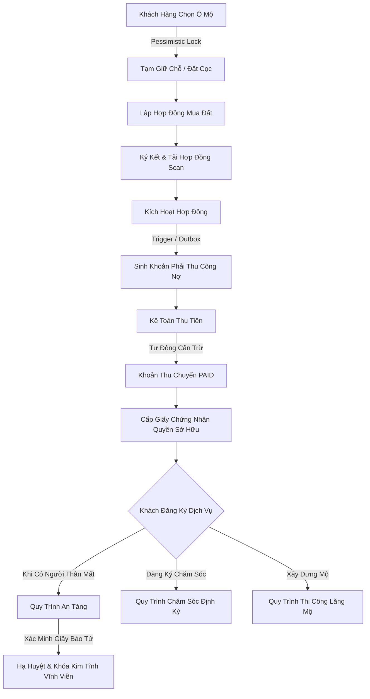

# Báo cáo hiện trạng hệ thống, luồng nghiệp vụ & từ điển CSDL thực tế

**Phiên bản:** 2.0 — Live Production Audit (21/10/2026)  
**Mục đích:** Tài liệu kỹ thuật và nghiệp vụ toàn diện phản ánh 100% hiện trạng thực tế của Hệ thống Quản lý Nghĩa trang Tư nhân, phục vụ đối soát thiết kế, ôn tập vấn đáp, tra cứu cấu trúc CSDL vật lý và bảo trì mã nguồn mà không phụ thuộc vào các tài liệu sơ khai ban đầu.  
**Phạm vi khảo sát:** Toàn bộ mã nguồn Backend FastAPI (`backend/app/*`), Web Frontend React (`web/src/*`), CSDL vật lý Microsoft SQL Server 2022 (`DESKTOP-HKIPI1M\SQLEXPRESS` gồm 51 bảng, 2 triggers, 14 migrations), Hệ thống lưu trữ tệp MinIO trên ổ đĩa dữ liệu ngoài D.  
**Tính chất:** Báo cáo kiểm định thực tế khách quan dựa trên mã nguồn đang chạy thật và CSDL vật lý; làm rõ những gì đã thực thi trọn vẹn, những ràng buộc đã được cưỡng chế ở mức DB/Service, và các điểm cải tiến so với đặc tả lý thuyết gốc.  

---

## 0. Cách sử dụng tài liệu & Quy ước kiểm định hiện trạng

Tài liệu này được biên soạn theo cấu trúc tương đồng với đặc tả nghiệp vụ hợp nhất, nhưng chuyển từ góc nhìn **'yêu cầu thiết kế mong muốn'** sang góc nhìn **'hiện trạng hệ thống đang chạy thực tế'**. Nhà phát triển, AI Coding Agent và Hội đồng đánh giá có thể tra cứu nhanh các quyết định kỹ thuật, quy tắc bất biến, cấu trúc các bảng CSDL và luồng xử lý mà không cần chạy lại các câu lệnh thanh tra thủ công.

**Quy ước đánh giá hiện trạng:**

- **[THỰC THI 100%]**: Chức năng/quy tắc đã được hiện thực hóa đầy đủ cả 3 tầng: CSDL vật lý có bảng/cột, Backend Service có logic kiểm tra toàn vẹn (ACID transaction), API Router có kiểm soát phân quyền (RBAC), và Giao diện Web có màn hình/form thao tác hoàn chỉnh.
- **[RÀNG BUỘC CƠ SỞ DỮ LIỆU]**: Quy tắc nghiệp vụ được cưỡng chế ở tầng vật lý sâu nhất bằng Trigger T-SQL, Foreign Key, Unique Index hoặc Check Constraint trong SQL Server. Mọi hành vi can thiệp trái phép (kể cả can thiệp trực tiếp bằng SQL client) đều bị DB chặn đứng.
- **[RÀNG BUỘC TẦNG SERVICE]**: Quy tắc nghiệp vụ được bảo vệ bằng giao dịch ACID tại FastAPI Backend (sử dụng khóa bi quan `with_for_update`, làm tròn tiền tệ chuẩn `Decimal` và `ROUND_HALF_UP`, kiểm tra điều kiện tiên quyết trước khi đổi trạng thái).
- **[MỞ RỘNG SO VỚI GỐC]**: Các thành phần kỹ thuật được bổ sung trong quá trình nâng cấp hệ thống (14 migration Alembic) để giải quyết bài toán thực tế mà thiết kế ban đầu chưa tính đến (ví dụ: Session JWT, MinIO File Objects, Outbox Pattern, Idempotency Requests, Bảng giá niêm yết theo kỳ, v.v.).

### Mục lục chính

1. [Hiện trạng kiến trúc kỹ thuật & Hạ tầng vật lý](#1-hien-trang-kien-truc-ky-thuat--ha-tang-vat-ly)
2. [Bối cảnh, Thuật ngữ & Quy ước nghiệp vụ cốt lõi](#2-boi-canh-thuat-ngu--quy-uoc-nghiep-vu-cot-loi)
3. [Hiện trạng Phân quyền (RBAC) & Ma trận Actor thực tế](#3-hien-trang-phan-quyen-rbac--ma-tran-actor-thuc-te)
4. [Các chuỗi quy trình nghiệp vụ xuyên phân hệ đã lập trình hoàn chỉnh](#4-cac-chuoi-quy-trinh-nghiep-vu-xuyen-phan-he-da-lap-trinh-hoan-chinh)
5. [Vòng đời trạng thái các thực thể cốt lõi (State Machines)](#5-vong-doi-trang-thai-cac-thuc-the-cot-loi-state-machines)
6. [Toàn bộ Quy tắc bất biến (Invariants) & Công thức tính toán đã cưỡng chế](#6-toan-bo-quy-tac-bat-bien-invariants--cong-thuc-tinh-toan-da-cuong-che)
7. [Bảng hiện trạng thực thi 47 Use Case theo mã nguồn thực tế](#7-bang-hien-trang-thuc-thi-47-use-case-theo-ma-nguon-thuc-te)
8. [Từ điển dữ liệu và quan hệ của toàn bộ 51 bảng CSDL vật lý thực tế](#8-tu-dien-du-lieu-va-quan-he-cua-toan-bo-51-bang-csdl-vat-ly-thuc-te)
9. [Cơ chế Trigger T-SQL vật lý & Lý do tắt implicit_returning](#9-co-che-trigger-t-sql-vat-ly--ly-do-tat-implicit_returning)
10. [Tiến trình tiến hóa CSDL qua 14 Migration Alembic](#10-tien-trinh-tien-hoa-csdl-qua-14-migration-alembic)
11. [Hiện trạng Tầng Lưu trữ Tệp MinIO & Quản lý Đa phương tiện](#11-hien-trang-tang-luu-tru-tep-minio--quan-ly-da-phuong-tien)
12. [Tổng kết đánh giá, Điểm mạnh kiến trúc & Kế hoạch vận hành](#12-tong-ket-danh-gia-diem-manh-kien-truc--ke-hoach-van-hanh)

---

## 1. Hiện trạng kiến trúc kỹ thuật & Hạ tầng vật lý

Hệ thống được tổ chức theo mô hình Monorepo module hóa chặt chẽ, tuân thủ nguyên tắc Clean Architecture và Separation of Concerns:

```
QL-NghiaTrang/
├── backend/                     # FastAPI REST API Backend
│   ├── app/
│   │   ├── core/                # Cấu hình bảo mật, JWT, config, database engine
│   │   ├── db/                  # SessionLocal, Base model SQLAlchemy 2.0
│   │   ├── modules/             # 10 phân hệ nghiệp vụ độc lập
│   │   │   ├── admin/           # Quản trị người dùng & phân quyền RBAC
│   │   │   ├── audit/           # Nhật ký kiểm toán & Narrative engine
│   │   │   ├── auth/            # Xác thực, Session & JWT token
│   │   │   ├── care/            # Chăm sóc mộ phần & Custom checklist
│   │   │   ├── catalog/         # Bảng giá, Gói chăm sóc & Mẫu hợp đồng
│   │   │   ├── construction/    # Thi công thực địa & Nghiệm thu
│   │   │   ├── contracts/       # Hợp đồng mua bán, phụ lục & An táng
│   │   │   ├── documents/       # Quản lý chứng từ & Adapter MinIO
│   │   │   ├── finance/         # Công nợ, Thu tiền & Chiết khấu
│   │   │   ├── plots/           # Địa chính, Quy hoạch ô mộ & Bản đồ số
│   │   │   ├── profiles/        # Thân nhân, Người mất & Giấy báo tử
│   │   │   └── reports/         # Báo cáo thống kê & Kết xuất PDF/XLSX
│   │   ├── services/            # Dịch vụ chia sẻ (PDFService, StorageAdapter)
│   │   └── storage/             # MinIO S3-compatible client
│   ├── alembic/versions/        # 14 tệp di trú CSDL tăng dần
│   └── runtime/                 # Dữ liệu cục bộ (MinIO data trên ổ D)
├── web/                         # Single Page Application React 18
│   ├── src/
│   │   ├── components/          # UI Components chia theo từng phân hệ
│   │   ├── context/             # AuthContext, NotificationContext
│   │   ├── services/            # Axios API Client & Interceptors
│   │   └── types/               # TypeScript interfaces đồng bộ với Pydantic
└── docs/                        # Tài liệu đặc tả, từ điển code và cẩm nang
```

### Các thông số hạ tầng vật lý hiện hành:

- **Hệ điều hành máy chủ:** Windows 11 (DESKTOP-HKIPI1M).
- **Cơ sở dữ liệu:** Microsoft SQL Server 2022 Express Edition (`DESKTOP-HKIPI1M\SQLEXPRESS`).
- **Driver kết nối:** `mssql+pyodbc` qua ODBC Driver 18 for SQL Server (kết nối nội bộ bảo mật, mã hóa kết nối).
- **Backend Runtime:** Python 3.12, quản lý môi trường và gói phụ thuộc bằng **`uv`**.
- **Web Frontend:** Node.js v20+, React 18, Vite, TypeScript, TailwindCSS, quản lý bằng **`pnpm`**.
- **Object Storage:** MinIO S3-compatible, lưu trữ toàn bộ dữ liệu tệp tin tại đường dẫn `D:\work\TH-PTTK\QL-NghiaTrang\backend\runtime\minio\data` (tuân thủ quy tắc lưu ổ đĩa dữ liệu ngoài C).

---

## 2. Bối cảnh, Thuật ngữ & Quy ước nghiệp vụ cốt lõi

Hệ thống quản lý nghĩa trang tư nhân mang tính chất hỗn hợp giữa **kinh doanh bất động sản tâm linh** và **dịch vụ vận hành thực địa tôn nghiêm**. Toàn bộ mã nguồn hiện tại đang thực thi nghiêm ngặt các khái niệm nghiệp vụ sau:

1. **Ô Mộ Kim Tĩnh (Kim Tinh Vault):** Ô mộ được đúc bằng bê tông kiên cố chống thấm sụt lún theo quy cách an táng vĩnh cửu. Sau khi thi hài được an táng hạ huyệt, ô mộ lập tức bị kích hoạt cờ `is_locked = 1`. Nghiêm cấm tuyệt đối mọi hành vi bóc dỡ, cải táng, di dời hoặc hạ cờ khóa.
2. **Slot an táng (Plot Slot):** Vị trí huyệt mộ cụ thể bên trong một ô mộ. Một ô mộ đơn có 1 slot; ô mộ đôi có 2 slot; ô mộ gia tộc có từ 4 đến 12 slot. Người mất được liên kết chính xác tới từng slot.
3. **Khách hàng vs Người quá cố:** Khách hàng (`customers`) là thể nhân (người sống) đứng tên pháp lý ký hợp đồng và chịu trách nhiệm thanh toán. Người quá cố (`deceased_profiles`) là đối tượng được an táng tại ô mộ.
4. **Giấy báo tử (Death Certificate):** Văn bản pháp lý bắt buộc phải được tải lên và cán bộ kiểm duyệt xác minh (`is_verified = 1`) trước khi hệ thống cho phép tạo Phụ lục an táng hoặc hạ huyệt.
5. **Hợp đồng & Đa hình (Polymorphism):** Hợp đồng mẹ (`contracts`) chứa thông tin tài chính, bên ký, trạng thái. Hợp đồng con (`land_purchase_contracts`, `cremation_contracts`, `exhumation_contracts`, `transfer_contracts`) chứa chi tiết kỹ thuật riêng biệt.
6. **Phụ lục hợp đồng (Contract Annexes):** Các dịch vụ phát sinh sau khi mua đất, bao gồm: Phụ lục An táng (`burial_annexes`), Phụ lục Chăm sóc định kỳ (`care_annexes`), Phụ lục Thi công xây dựng (`construction_annexes`).
7. **Chu kỳ chăm sóc & Việc phát sinh ngoài thực địa (Custom Tasks):** Lịch chăm sóc định kỳ được sinh theo khóa chu kỳ (`period_key` dạng 'YYYY-MM') để chống trùng ca. Ngoài các đầu việc chuẩn (quét dọn, thắp hương), nhân viên quản trang ngoài thực địa có quyền bổ sung các việc phát sinh (`is_custom = 1`) như sửa bát hương, cắt tỉa cành gãy sau bão (theo migration 0014).
8. **Idempotency Key & Chuẩn tiền tệ Decimal:** Mọi giao dịch thu tiền tài chính bắt buộc gửi kèm khóa chống trùng `idempotency_key` và tính toán trên kiểu `DECIMAL(15,2)` với cơ chế làm tròn `ROUND_HALF_UP`, tuyệt đối cấm dùng số thực `Float`.

---

## 3. Hiện trạng Phân quyền (RBAC) & Ma trận Actor thực tế

Hệ thống áp dụng mô hình phân quyền dựa trên vai trò (Role-Based Access Control) với **4 vai trò nghiệp vụ thực tế** được lưu trong bảng `roles`, kết hợp cùng vai trò logic 'Lãnh đạo/Giám đốc' và **29 quyền hạn nguyên tử** trong bảng `permissions`:

### 3.1 Danh mục 4 vai trò vật lý trong CSDL:

| Mã vai trò (`role_code`) | Tên hiển thị (`role_name`) | Số tài khoản gán thực tế | Phạm vi trách nhiệm chính |
| --- | --- | :---: | --- |
| `ADMIN` | Quản trị hệ thống | 1 | Toàn quyền cấu hình người dùng, phân quyền, xem audit log, thiết lập bảng giá. |
| `STAFF_SALES` | Kinh doanh & Khách hàng | 5 | Tiếp khách, giữ chỗ ô mộ, lập hợp đồng mua đất, lập phụ lục an táng/chăm sóc/thi công. |
| `STAFF_FIELD` | Cán bộ hiện trường / Quản trang | 6 | Giám sát hạ huyệt, thực hiện ca chăm sóc, cập nhật checklist thi công, chụp ảnh hiện trường. |
| `ACCOUNTANT` | Kế toán tài chính | 4 | Quản lý công nợ, lập phiếu thu tiền, áp dụng chiết khấu, xuất hóa đơn/biên lai PDF. |

### 3.2 Ma trận phân quyền 29 quyền nguyên tử (`role_permissions`):

Hệ thống kiểm tra quyền tại router bằng hàm phụ thuộc `require_permission(resource, action)`. Dưới đây là ma trận 29 quyền đã được seed thực tế trong CSDL:

| Tài nguyên (`resource`) | Hành động (`action`) | ADMIN | STAFF_SALES | STAFF_FIELD | ACCOUNTANT | Ghi chú bảo mật |
| --- | --- | :---: | :---: | :---: | :---: | --- |
| `plots` | `read` | [x] | [x] | [x] | [x] | Xem sơ đồ, bản đồ GIS, danh sách ô |
| `plots` | `write` | [x] | [x] | [ ] | [ ] | Thêm ô mộ, tạm giữ chỗ, cập nhật tọa độ |
| `plots` | `manage` | [x] | [ ] | [ ] | [ ] | Cấu hình phân khu, hàng mộ, loại mộ |
| `customers` | `read` | [x] | [x] | [x] | [x] | Tra cứu danh sách thân nhân |
| `customers` | `write` | [x] | [x] | [ ] | [ ] | Thêm, sửa hồ sơ khách hàng |
| `deceased` | `read` | [x] | [x] | [x] | [x] | Tra cứu hồ sơ người quá cố |
| `deceased` | `write` | [x] | [x] | [ ] | [ ] | Thêm người mất, gắn giấy báo tử |
| `deceased` | `verify` | [x] | [ ] | [x] | [ ] | Xác minh trích lục khai tử |
| `contracts` | `read` | [x] | [x] | [ ] | [x] | Xem danh sách hợp đồng & phụ lục |
| `contracts` | `write` | [x] | [x] | [ ] | [ ] | Lập hợp đồng mua đất, chuyển nhượng |
| `contracts` | `sign` | [x] | [x] | [ ] | [ ] | Đính kèm bản scan, chuyển trạng thái ký |
| `contracts` | `activate` | [x] | [ ] | [ ] | [ ] | Kích hoạt hiệu lực hợp đồng chính thức |
| `contracts` | `cancel` | [x] | [ ] | [ ] | [ ] | Hủy bỏ hợp đồng vi phạm/hết hạn |
| `care` | `read` | [x] | [x] | [x] | [ ] | Xem lịch chăm sóc & công việc |
| `care` | `schedule` | [x] | [ ] | [x] | [ ] | Sinh lịch chăm sóc kỳ mới theo lô |
| `care` | `assign` | [x] | [ ] | [x] | [ ] | Phân công nhân viên phụ trách ca |
| `care` | `execute` | [x] | [ ] | [x] | [ ] | Tích chọn checklist, thêm việc phát sinh |
| `care` | `close` | [x] | [ ] | [x] | [ ] | Nghiệm thu và đóng ca chăm sóc |
| `construction` | `read` | [x] | [x] | [x] | [ ] | Xem lệnh thi công & tiến độ |
| `construction` | `order` | [x] | [x] | [ ] | [ ] | Lập lệnh thi công từ phụ lục |
| `construction` | `assign` | [x] | [ ] | [x] | [ ] | Phân công giám sát viên thi công |
| `construction` | `execute` | [x] | [ ] | [x] | [ ] | Cập nhật tiến độ & hoàn thành hạng mục |
| `construction` | `approve` | [x] | [ ] | [x] | [ ] | Nghiệm thu toàn bộ công trình lăng mộ |
| `finance` | `read` | [x] | [x] | [ ] | [x] | Xem công nợ & phiếu thu |
| `finance` | `collect` | [x] | [ ] | [ ] | [x] | Ghi nhận tiền nộp (Cash/Bank Transfer) |
| `finance` | `discount` | [x] | [ ] | [ ] | [ ] | Áp dụng chiết khấu giảm giá |
| `catalog` | `manage` | [x] | [ ] | [ ] | [ ] | Quản lý bảng giá niêm yết & gói dịch vụ |
| `reports` | `export` | [x] | [x] | [ ] | [x] | Kết xuất báo cáo PDF / Excel |
| `audit` | `read` | [x] | [ ] | [ ] | [ ] | Tra cứu nhật ký kiểm toán hệ thống |

---

## 4. Các chuỗi quy trình nghiệp vụ xuyên phân hệ đã lập trình hoàn chỉnh

Hệ thống đã kết nối hoàn chỉnh 6 chuỗi quy trình nghiệp vụ cốt lõi, đảm bảo tính toàn vẹn dữ liệu từ khi khách hàng tiếp cận đến khi vận hành lâu dài:



### Chi tiết 6 chuỗi quy trình thực tế:

1. **Quy trình Bán đất sinh phần:** Khách hàng xem sơ đồ/bản đồ GIS -> Nhân viên chọn ô trống (`AVAILABLE`) -> Gọi `POST /plots/{id}/reserve` khóa bi quan chống tranh chấp -> Khách đồng ý mua -> Gọi `POST /contracts/land-purchase` tạo hợp đồng -> Tải bản in PDF -> Ký giấy -> Tải bản scan có chữ ký -> Quản trị viên kích hoạt `POST /contracts/{id}/activate` -> Hệ thống chuyển ô sang `RESERVED` và tự động sinh bản ghi công nợ trong bảng `receivables`.
2. **Quy trình An táng & Khóa Kim Tĩnh vĩnh viễn:** Thân nhân nộp giấy báo tử -> Cán bộ hiện trường đối soát và xác minh hợp lệ (`POST /profiles/deceased/{id}/verify-certificate`) -> Nhân viên lập Phụ lục an táng (`POST /contracts/{id}/burial-annex`) liên kết đúng slot trong ô mộ -> Ký và kích hoạt phụ lục -> Cán bộ quản trang giám sát hạ huyệt -> Gọi `POST /contracts/annexes/{id}/complete-burial` -> Hệ thống ghi lịch sử vào `burial_histories`, chuyển trạng thái slot sang `OCCUPIED`. Nếu là mộ Kim Tĩnh (`is_kim_tinh = 1`), Trigger T-SQL tự động bật cờ `is_locked = 1`, khóa vĩnh viễn mức vật lý.
3. **Quy trình Chăm sóc định kỳ:** Phụ lục chăm sóc kích hoạt -> Định kỳ hàng tháng, quản trang bấm `POST /care/schedules/generate-batch` sinh tự động các ca chăm sóc cho kỳ mới theo mẫu công việc của gói -> Quản trang phân công nhân viên (`PUT /care/schedules/{id}/assign`) -> Nhân viên mở app thực địa xem chỉ đường tới mộ -> Thực hiện dọn dẹp, tích chọn checklist và có quyền bổ sung các việc phát sinh ngoài thực địa (`POST /care/checklist-items/custom`) -> Chụp ảnh trước/sau tải lên MinIO -> Cán bộ nghiệm thu bấm `POST /care/schedules/{id}/close` để đóng ca.
4. **Quy trình Thi công lăng mộ:** Lập Phụ lục thi công kèm bản vẽ thiết kế tải lên MinIO -> Quản trang lập Lệnh thi công (`POST /construction/orders`) -> Phân công giám sát viên (hệ thống kiểm tra lịch bận trong `staff_unavailability`) -> Nhà thầu thi công từng hạng mục, chụp ảnh minh chứng lưu MinIO -> Từng hạng mục hoàn tất cập nhật tiến độ phần trăm -> Hoàn thành 100% các công đoạn thì quản trang bấm nghiệm thu bàn giao.
5. **Quy trình Quản lý tài chính & Cấn trừ nợ tự động:** Khoản thu phát sinh từ hợp đồng/phụ lục nằm ở bảng `receivables` -> Kế toán lập phiếu thu `POST /finance/payments` (truyền `idempotency_key` và phương thức Tiền mặt/Chuyển khoản) -> Giao dịch insert vào bảng `payments` -> Trigger T-SQL `trg_payments_sync_receivable_balance` lập tức chạy, tính lại tổng tiền đã trả và tự động cấn trừ số dư `remaining_balance`, tự động cập nhật trạng thái khoản thu sang `PAID` nếu đã đủ tiền -> Hệ thống sinh hóa đơn điện tử trong `invoices` và tạo lệnh xuất PDF biên lai.
6. **Quy trình Kiểm toán & Tóm tắt sự kiện tự nhiên:** Mọi thao tác ghi/sửa/xóa/đổi trạng thái nhạy cảm đều được ghi nhận vào `audit_logs` -> Khi người dùng mở giao diện Nhật ký kiểm toán, Backend tự động chạy bộ giải mã `narrative_summary`, dịch các mã thực thể, hành động, số tiền VND và tên người dùng thành một câu chuyện ngữ nghĩa tiếng Việt hoàn chỉnh cho Lãnh đạo dễ đọc.

---

## 5. Vòng đời trạng thái các thực thể cốt lõi (State Machines)

Toàn bộ các thực thể then chốt trong hệ thống đều được điều khiển bởi máy trạng thái hữu hạn (Finite State Machine) nghiêm ngặt tại tầng Service:

### 5.1 Vòng đời Ô Mộ (`plots.status`):
- `AVAILABLE` (Trống, sẵn sàng bán) -> `RESERVED` (Đang giữ chỗ hoặc đã ký HĐ chờ an táng) -> `OCCUPIED` (Đã an táng thi hài) -> `LOCKED_KIM_TINH` (Đã khóa vĩnh viễn).
- **Quy tắc chặn:** Ô mộ Kim Tĩnh khi đã ở trạng thái `OCCUPIED` hoặc `LOCKED_KIM_TINH` thì không bao giờ được phép chuyển sang `UNDER_EXHUMATION` (Cải táng) hay quay về `AVAILABLE`.

### 5.2 Vòng đời Hợp Đồng (`contracts.status`):
- `DRAFT` (Bản thảo do nhân viên lập) -> `PENDING_SIGNATURE` (Chờ khách hàng ký và nộp bản scan) -> `ACTIVE` (Đã có chữ ký và kích hoạt hiệu lực pháp lý) -> `COMPLETED` (Đã thanh lý/hết hạn kỳ hạn) hoặc `CANCELLED` (Hủy bỏ khi còn ở bản thảo).

### 5.3 Vòng đời Ca Chăm Sóc (`care_schedules.status`):
- `PENDING` (Mới sinh theo kỳ, chưa có người làm) -> `ASSIGNED` (Đã phân công nhân viên) -> `IN_PROGRESS` (Nhân viên đã bấm bắt đầu tại thực địa) -> `COMPLETED` (Đã hoàn tất 100% checklist, có đủ ảnh READY và được quản trang đóng ca).

### 5.4 Vòng đời Khoản Phải Thu (`receivables.status`):
- `PENDING` (Chưa nộp đồng nào, tổng đã trả = 0) -> `PARTIALLY_PAID` (Đã nộp một phần tiền, 0 < tổng trả < tổng phải thu) -> `PAID` (Đã thanh toán đủ 100%) hoặc `OVERDUE` (Quá ngày hẹn nộp tiền). Trạng thái này do Trigger T-SQL tự động tính toán.

---

## 6. Toàn bộ Quy tắc bất biến (Invariants) & Công thức tính toán đã cưỡng chế

Hệ thống thiết lập 6 rào chắn an ninh nghiệp vụ bất khả xâm phạm:

1. **BR-01 (Kim Tĩnh Bất Biến):**
   - *Tầng DB:* Trigger `trg_plots_enforce_kim_tinh_immutability` chặn mọi lệnh `UPDATE` đổi ô sang `UNDER_EXHUMATION` nếu `is_locked = 1` (ném lỗi 51000) và chặn mọi hành vi hạ cờ `is_locked` từ 1 về 0 (ném lỗi 51001).
   - *Tầng Service:* `BurialService.complete_burial()` và `PlotService.update_plot()` kiểm tra cờ trước khi commit transaction.
2. **BR-02 (Chống Tranh Chấp Giữ Chỗ / Pessimistic Locking):**
   - Khi khách hàng thao tác đặt chỗ hoặc lập hợp đồng mua đất, backend thực hiện câu lệnh truy vấn kèm khóa dòng độc quyền: `SELECT * FROM plots WITH (UPDLOCK, ROWLOCK) WHERE plot_id = :id`. Mọi phiên giao dịch song song khác muốn chiếm ô đều phải đợi, ngăn chặn 100% tình trạng hai khách hàng mua cùng một ô đất.
3. **BR-03 (Toán Học Tài Chính Chuẩn Xác Tuyệt Đối):**
   - Toàn bộ giá trị tiền tệ trong CSDL được lưu kiểu `DECIMAL(15,2)`. Tại Python Backend, 100% các phép tính cộng, trừ, nhân tỷ lệ chiết khấu đều sử dụng `decimal.Decimal` với cơ chế làm tròn `ROUND_HALF_UP` đến 2 chữ số thập phân (`quantize(Decimal('0.01'), rounding=ROUND_HALF_UP)`). Tuyệt đối không dùng số thực `Float` để tránh sai số dấu phẩy động.
4. **BR-04 (Giấy Báo Tử Tiên Quyết):**
   - Hàm `BurialService.create_burial_annex()` bắt buộc kiểm tra `death_certificate.verification_status == 'VERIFIED'`. Nếu chưa có giấy báo tử hoặc giấy chưa được cán bộ đối soát, hệ thống từ chối tạo phụ lục an táng bằng mã lỗi `HTTP 400 Bad Request`.
5. **BR-05 (Minh Chứng Thực Địa Sẵn Sàng):**
   - Hàm `CareService.close_schedule()` và `ConstructionService.complete_order()` kiểm tra danh sách ảnh minh chứng liên kết trong bảng `file_objects`. Tất cả các file ảnh phải có trạng thái `status = 'READY'` và vượt qua kiểm tra định dạng MIME mới được phép nghiệm thu đóng ca.
6. **BR-06 (Chống Gửi Lặp Giao Dịch / Idempotency):**
   - Mọi command ghi nhận thanh toán `POST /finance/payments` đều yêu cầu `X-Idempotency-Key` trong header. Khi tiếp nhận, backend kiểm tra bảng `idempotency_requests`: nếu đã tồn tại và xử lý thành công, backend lập tức trả về kết quả đã lưu mà không ghi nhận thêm tiền lần 2.

---

## 7. Bảng hiện trạng thực thi 47 Use Case theo mã nguồn thực tế

Dưới đây là bảng tổng hợp đối soát hiện trạng thực thi của toàn bộ 47 Use Case (8 use case cha và 39 use case con) trong mã nguồn:

| Mã UC | Tên Use Case | Tình trạng | Router Backend | Service Backend | UI Component Web |
| :--- | :--- | :---: | :--- | :--- | :--- |
| **UC-1** | **Quản lý mộ & bản đồ** | [THỰC THI 100%] | `/plots/*` | `PlotService` | `PlotMapModule.tsx` |
| UC-1.1 | Quản lý khu/hàng/ô | [THỰC THI 100%] | `POST /plots/`, `GET /plots/` | `PlotService.create_plot` | `PlotMapModule.tsx` |
| UC-1.2 | Quản lý loại mộ & số slot | [THỰC THI 100%] | `GET /plots/types` | `PlotService.list_plot_types` | `PlotMapModule.tsx` |
| UC-1.3 | Cập nhật trạng thái mộ | [THỰC THI 100%] | `PUT /plots/{id}/status` | `PlotService.update_plot_status` | `PlotMapModule.tsx` |
| UC-1.4 | Tra cứu tình trạng mộ | [THỰC THI 100%] | `GET /plots/` | `PlotService.list_plots` | `PlotMapModule.tsx` |
| UC-1.5 | Dẫn đường tới mộ | [THỰC THI 100%] | `GET /plots/{id}/directions` | `PlotService.get_directions` | `PlotDirectionsButton.tsx` |
| **UC-2** | **Quản lý khách hàng & người mất** | [THỰC THI 100%] | `/profiles/*` | `ProfileService` | `ProfileModule.tsx` |
| UC-2.1 | Quản lý thông tin khách hàng | [THỰC THI 100%] | `POST /profiles/customers` | `ProfileService.create_customer` | `ProfileModule.tsx` |
| UC-2.2 | Quản lý hồ sơ người mất | [THỰC THI 100%] | `POST /profiles/deceased` | `ProfileService.create_deceased` | `ProfileModule.tsx` |
| UC-2.3 | Liên kết thân nhân - người mất | [THỰC THI 100%] | `POST /profiles/relations` | `ProfileService.link_relation` | `ProfileModule.tsx` |
| UC-2.4 | Tra cứu hồ sơ & Cổng tưởng niệm | [THỰC THI 100%] | `GET /profiles/public/search` | `ProfileService.public_search` | `MemorialSearch.tsx` |
| **UC-3** | **Quản lý hợp đồng** | [THỰC THI 100%] | `/contracts/*` | `ContractService` | `ContractModule.tsx` |
| UC-3.1 | Lập hợp đồng mua đất | [THỰC THI 100%] | `POST /contracts/land-purchase` | `ContractService.create_land_purchase` | `ContractModule.tsx` |
| UC-3.2 | In hợp đồng / phụ lục PDF | [THỰC THI 100%] | `GET /contracts/{id}/pdf` | `PDFService.generate_contract_pdf` | `ContractModule.tsx` |
| UC-3.3 | Đính kèm hợp đồng scan | [THỰC THI 100%] | `POST /contracts/{id}/scan` | `ContractService.attach_scan` | `ContractModule.tsx` |
| UC-3.4 | Lập phụ lục hợp đồng | [THỰC THI 100%] | `POST /contracts/{id}/*-annex` | `ContractService.create_*_annex` | `ContractModule.tsx` |
| UC-3.5 | Theo dõi trạng thái & thời hạn | [THỰC THI 100%] | `GET /contracts/` | `ContractService.list_contracts` | `ContractModule.tsx` |
| **UC-4** | **Quản lý thi công** | [THỰC THI 100%] | `/construction/*` | `ConstructionService` | `ConstructionModule.tsx` |
| UC-4.1 | Lập checklist thi công | [THỰC THI 100%] | `POST /construction/orders` | `ConstructionService.create_order` | `ConstructionModule.tsx` |
| UC-4.2 | Phân công giám sát viên | [THỰC THI 100%] | `PUT /construction/orders/{id}/assign`| `ConstructionService.assign_order`| `ConstructionModule.tsx` |
| UC-4.3 | Cập nhật checklist & ảnh | [THỰC THI 100%] | `PUT /construction/tasks/{id}` | `ConstructionService.update_task` | `ConstructionModule.tsx` |
| UC-4.4 | Cập nhật tiến độ | [THỰC THI 100%] | `GET /construction/orders/{id}` | `ConstructionService.get_order` | `ConstructionModule.tsx` |
| UC-4.5 | Nghiệm thu bàn giao | [THỰC THI 100%] | `POST /construction/orders/{id}/complete`|`ConstructionService.complete_order`| `ConstructionModule.tsx` |
| **UC-5** | **Quản lý chăm sóc** | [THỰC THI 100%] | `/care/*` | `CareService` | `CareModule.tsx` |
| UC-5.1 | Đăng ký gói chăm sóc | [THỰC THI 100%] | `POST /contracts/{id}/care-annex` | `ContractService.create_care_annex` | `ContractModule.tsx` |
| UC-5.2 | Sinh lịch chăm sóc định kỳ | [THỰC THI 100%] | `POST /care/schedules/generate` | `CareService.generate_schedules` | `CareModule.tsx` |
| UC-5.3 | Phân công nhân viên chăm sóc | [THỰC THI 100%] | `PUT /care/schedules/{id}/assign` | `CareService.assign_caretaker` | `CareModule.tsx` |
| UC-5.4 | Thực hiện checklist & Custom task| [THỰC THI 100%] | `POST /care/checklist-items/custom`| `CareService.add_custom_item` | `CareModule.tsx` |
| **UC-6** | **Quản lý tài chính** | [THỰC THI 100%] | `/finance/*` | `FinanceService` | `FinanceModule.tsx` |
| UC-6.1 | Tạo khoản phải thu | [THỰC THI 100%] | Tự động sinh từ Contract/Annex | `FinanceService.create_receivable` | `FinanceModule.tsx` |
| UC-6.2 | Ghi nhận thanh toán (Idempotent)| [THỰC THI 100%] | `POST /finance/payments` | `FinanceService.record_payment` | `FinanceModule.tsx` |
| UC-6.3 | Xuất hóa đơn / biên lai PDF | [THỰC THI 100%] | `GET /finance/invoices/{id}/pdf` | `PDFService.generate_receipt_pdf` | `FinanceModule.tsx` |
| UC-6.4 | Áp dụng chiết khấu | [THỰC THI 100%] | `POST /finance/receivables/{id}/discount`|`FinanceService.apply_discount` | `FinanceModule.tsx` |
| **UC-7** | **Báo cáo & thống kê** | [THỰC THI 100%] | `/reports/*` | `ReportService` | `ReportsModule.tsx` |
| UC-7.1 | Báo cáo doanh thu thực thu | [THỰC THI 100%] | `GET /reports/revenue` | `ReportService.get_revenue_report` | `ReportsModule.tsx` |
| UC-7.2 | Thống kê phần mộ theo khu | [THỰC THI 100%] | `GET /reports/occupancy` | `ReportService.get_occupancy_report`| `ReportsModule.tsx` |
| UC-7.3 | Thống kê hợp đồng | [THỰC THI 100%] | `GET /reports/contracts` | `ReportService.get_contracts_report`| `ReportsModule.tsx` |
| UC-7.4 | Thống kê vận hành thi công/chăm sóc| [THỰC THI 100%] | `GET /reports/operations` | `ReportService.get_operations_report`| `ReportsModule.tsx` |
| UC-7.5 | Xuất file báo cáo (PDF/XLSX) | [THỰC THI 100%] | `POST /reports/exports` | `ReportService.create_export_job` | `ReportsModule.tsx` |
| **UC-8** | **Quản trị hệ thống** | [THỰC THI 100%] | `/admin/*`, `/catalog/*`, `/audit/*`| Nhiều Services | Nhiều Admin Modules |
| UC-8.1 | Đăng nhập cán bộ & Refresh Token| [THỰC THI 100%] | `POST /auth/login`, `/auth/refresh` | `AuthService.authenticate_user` | `LoginModal.tsx` |
| UC-8.2 | Quản lý tài khoản cán bộ | [THỰC THI 100%] | `GET`, `POST /admin/users` | `UserService.create_user` | `UserManagementModule.tsx` |
| UC-8.3 | Phân quyền vai trò | [THỰC THI 100%] | `GET`, `POST /admin/roles` | `UserService.update_role_matrix` | `UserManagementModule.tsx` |
| UC-8.4 | Quản lý mẫu hợp đồng 4 loại | [THỰC THI 100%] | `GET`, `PUT /catalog/templates` | `CatalogService.update_template` | `CatalogModule.tsx` |
| UC-8.5 | Quản lý gói dịch vụ chăm sóc | [THỰC THI 100%] | `GET`, `POST /catalog/packages` | `CatalogService.create_package` | `CatalogModule.tsx` |
| UC-8.6 | Quản lý bảng giá niêm yết | [THỰC THI 100%] | `GET`, `POST /catalog/price-lists` | `CatalogService.create_price_list` | `CatalogModule.tsx` |
| UC-8.7 | Nhật ký kiểm toán & Narrative | [THỰC THI 100%] | `GET /audit/logs` | `AuditService.generate_narrative` | `AuditModule.tsx` |

---

## 8. Từ điển dữ liệu và quan hệ của toàn bộ 51 bảng CSDL vật lý thực tế

Phần này trình bày chi tiết và toàn diện từ điển dữ liệu của **toàn bộ 51 bảng vật lý** hiện diện trong CSDL Microsoft SQL Server (`DESKTOP-HKIPI1M\SQLEXPRESS`), bao gồm **422 thuộc tính**, kiểu dữ liệu SQL Server, thuộc tính khóa, ràng buộc toàn vẹn, số lượng bản ghi thực tế và luồng code tương ứng trong hệ thống.

### 8.1 Bảng chỉ mục tổng quan 51 bảng CSDL

| STT | Tên bảng vật lý | Số cột | Số dòng trong DB | Phân nhóm nghiệp vụ | Có Trigger / Ghi chú đặc biệt |
| :---: | :--- | :---: | :---: | :--- | :--- |
| 1 | [`alembic_version`](#bang-alembic_version) | 1 | 1 | Hạ tầng, Độ tin cậy & Kiểm toán | Mã migration: `0014_care_...` |
| 2 | [`audit_logs`](#bang-audit_logs) | 9 | 1,733 | Hạ tầng, Độ tin cậy & Kiểm toán | Tích hợp `narrative_summary` |
| 3 | [`auth_sessions`](#bang-auth_sessions) | 8 | 3,179 | Xác thực, Người dùng & Phân quyền RBAC |  |
| 4 | [`background_jobs`](#bang-background_jobs) | 12 | 0 | Hạ tầng, Độ tin cậy & Kiểm toán | Hàng đợi (Queue rỗng) |
| 5 | [`burial_annexes`](#bang-burial_annexes) | 7 | 98 | Hợp đồng & Phụ lục |  |
| 6 | [`burial_histories`](#bang-burial_histories) | 11 | 160 | Hợp đồng & Phụ lục |  |
| 7 | [`care_annexes`](#bang-care_annexes) | 4 | 484 | Hợp đồng & Phụ lục |  |
| 8 | [`care_checklist_items`](#bang-care_checklist_items) | 8 | 1,532 | Dịch vụ & Chăm sóc mộ phần | Có `is_custom` (Migration 0014) |
| 9 | [`care_media_evidences`](#bang-care_media_evidences) | 7 | 329 | Dịch vụ & Chăm sóc mộ phần |  |
| 10 | [`care_packages`](#bang-care_packages) | 7 | 189 | Dịch vụ & Chăm sóc mộ phần |  |
| 11 | [`care_schedules`](#bang-care_schedules) | 13 | 612 | Dịch vụ & Chăm sóc mộ phần |  |
| 12 | [`construction_annexes`](#bang-construction_annexes) | 5 | 61 | Hợp đồng & Phụ lục |  |
| 13 | [`construction_orders`](#bang-construction_orders) | 11 | 202 | Thi công thực địa |  |
| 14 | [`construction_task_evidences`](#bang-construction_task_evidences) | 6 | 220 | Thi công thực địa |  |
| 15 | [`construction_tasks`](#bang-construction_tasks) | 14 | 801 | Thi công thực địa |  |
| 16 | [`contract_annexes`](#bang-contract_annexes) | 17 | 825 | Hợp đồng & Phụ lục |  |
| 17 | [`contract_templates`](#bang-contract_templates) | 10 | 5 | Hợp đồng & Phụ lục |  |
| 18 | [`contracts`](#bang-contracts) | 18 | 933 | Hợp đồng & Phụ lục |  |
| 19 | [`cremation_contracts`](#bang-cremation_contracts) | 6 | 47 | Hợp đồng & Phụ lục |  |
| 20 | [`customer_deceased_relations`](#bang-customer_deceased_relations) | 5 | 52 | Hồ sơ khách hàng & Người mất |  |
| 21 | [`customers`](#bang-customers) | 10 | 1,085 | Hồ sơ khách hàng & Người mất |  |
| 22 | [`death_certificates`](#bang-death_certificates) | 12 | 263 | Hồ sơ khách hàng & Người mất |  |
| 23 | [`deceased_profiles`](#bang-deceased_profiles) | 13 | 763 | Hồ sơ khách hàng & Người mất |  |
| 24 | [`discount_records`](#bang-discount_records) | 8 | 2 | Tài chính, Công nợ & Hóa đơn |  |
| 25 | [`document_versions`](#bang-document_versions) | 11 | 2 | Quản lý tệp tin & Chứng từ MinIO |  |
| 26 | [`exhumation_contracts`](#bang-exhumation_contracts) | 7 | 47 | Hợp đồng & Phụ lục |  |
| 27 | [`file_objects`](#bang-file_objects) | 12 | 1,539 | Quản lý tệp tin & Chứng từ MinIO |  |
| 28 | [`idempotency_requests`](#bang-idempotency_requests) | 9 | 26 | Hạ tầng, Độ tin cậy & Kiểm toán |  |
| 29 | [`invoices`](#bang-invoices) | 9 | 32 | Tài chính, Công nợ & Hóa đơn |  |
| 30 | [`land_purchase_contracts`](#bang-land_purchase_contracts) | 3 | 613 | Hợp đồng & Phụ lục |  |
| 31 | [`outbox_events`](#bang-outbox_events) | 9 | 463 | Hạ tầng, Độ tin cậy & Kiểm toán |  |
| 32 | [`payments`](#bang-payments) | 7 | 32 | Tài chính, Công nợ & Hóa đơn | **CÓ TRIGGER CẤN TRỪ NỢ** |
| 33 | [`permissions`](#bang-permissions) | 4 | 29 | Xác thực, Người dùng & Phân quyền RBAC |  |
| 34 | [`plot_ownerships`](#bang-plot_ownerships) | 8 | 285 | Địa chính & Quy hoạch mộ phần |  |
| 35 | [`plot_reservations`](#bang-plot_reservations) | 10 | 216 | Địa chính & Quy hoạch mộ phần |  |
| 36 | [`plot_slots`](#bang-plot_slots) | 5 | 2,282 | Địa chính & Quy hoạch mộ phần |  |
| 37 | [`plot_types`](#bang-plot_types) | 6 | 391 | Địa chính & Quy hoạch mộ phần |  |
| 38 | [`plots`](#bang-plots) | 14 | 1,411 | Địa chính & Quy hoạch mộ phần | **CÓ TRIGGER BR-KIMTINH** |
| 39 | [`price_items`](#bang-price_items) | 10 | 8 | Bảng giá & Danh mục dịch vụ |  |
| 40 | [`price_lists`](#bang-price_lists) | 6 | 2 | Bảng giá & Danh mục dịch vụ |  |
| 41 | [`receivables`](#bang-receivables) | 14 | 406 | Tài chính, Công nợ & Hóa đơn |  |
| 42 | [`report_exports`](#bang-report_exports) | 13 | 62 | Báo cáo & Thống kê |  |
| 43 | [`role_permissions`](#bang-role_permissions) | 2 | 53 | Xác thực, Người dùng & Phân quyền RBAC |  |
| 44 | [`roles`](#bang-roles) | 3 | 4 | Xác thực, Người dùng & Phân quyền RBAC |  |
| 45 | [`rows`](#bang-rows) | 4 | 413 | Địa chính & Quy hoạch mộ phần |  |
| 46 | [`staff_unavailability`](#bang-staff_unavailability) | 6 | 31 | Nhân sự & Lịch trực |  |
| 47 | [`sysdiagrams`](#bang-sysdiagrams) | 5 | 6 | Hạ tầng, Độ tin cậy & Kiểm toán |  |
| 48 | [`transfer_contracts`](#bang-transfer_contracts) | 6 | 45 | Hợp đồng & Phụ lục |  |
| 49 | [`user_roles`](#bang-user_roles) | 2 | 16 | Xác thực, Người dùng & Phân quyền RBAC |  |
| 50 | [`users`](#bang-users) | 10 | 36 | Xác thực, Người dùng & Phân quyền RBAC |  |
| 51 | [`zones`](#bang-zones) | 5 | 413 | Địa chính & Quy hoạch mộ phần |  |

---

### 8.2 Chi tiết cấu trúc và quan hệ của từng bảng

<a id="bang-alembic_version"></a>
#### 8.2.1 Bảng `alembic_version` — Phiên bản di trú cơ sở dữ liệu (alembic_version)

- **Phân nhóm:** Hạ tầng, Độ tin cậy & Kiểm toán
- **Số lượng bản ghi hiện có trong CSDL:** `1` bản ghi.
- **Ý nghĩa nghiệp vụ & kỹ thuật:** Bảng hệ thống do Alembic quản lý, lưu giữ mã định danh của migration mới nhất đã được áp dụng vào CSDL vật lý (Hiện tại là '0014_care_checklist_custom').

**Cấu trúc thuộc tính chi tiết:**

| Thuộc tính | Kiểu dữ liệu SQL Server | Nullable | Ràng buộc / Khóa | Diễn giải chức năng thực tế |
| :--- | :--- | :---: | :---: | :--- |
| `version_num` | `VARCHAR(32) COLLATE "SQL_Latin1_General_CP1_CI_AS"` | **No** | **PK** | Khóa chính, mã phiên bản migration hiện hành (VARCHAR 32). |

**Mối quan hệ và ràng buộc thực tế:**
- **Quan hệ phụ thuộc (Ngoại trỏ đi):** Không có (Bảng gốc độc lập).

---

<a id="bang-audit_logs"></a>
#### 8.2.2 Bảng `audit_logs` — Nhật ký kiểm toán hệ thống (audit_logs)

- **Phân nhóm:** Hạ tầng, Độ tin cậy & Kiểm toán
- **Số lượng bản ghi hiện có trong CSDL:** `1,733` bản ghi.
- **Ý nghĩa nghiệp vụ & kỹ thuật:** Ghi nhận toàn bộ biến động nghiệp vụ nhạy cảm trong hệ thống. Hỗ trợ trường tính toán 'narrative_summary' diễn giải sự kiện bằng tiếng Việt tự nhiên dễ hiểu cho Lãnh đạo thay vì JSON thô. Bảng chỉ cho phép đọc, không cho sửa/xóa.

**Cấu trúc thuộc tính chi tiết:**

| Thuộc tính | Kiểu dữ liệu SQL Server | Nullable | Ràng buộc / Khóa | Diễn giải chức năng thực tế |
| :--- | :--- | :---: | :---: | :--- |
| `log_id` | `BIGINT` | **No** | **PK**<br>IDENTITY | Khóa chính (IDENTITY), định danh bản ghi kiểm toán. |
| `user_id` | `INTEGER` | Yes | FK -> `users(user_id)` | Khóa ngoại trỏ về users(user_id), người dùng thực hiện thao tác (hoặc NULL nếu là tác vụ ngầm). |
| `action_type` | `VARCHAR(50) COLLATE "SQL_Latin1_General_CP1_CI_AS"` | **No** | - | Hành vi thực hiện ('CREATE', 'UPDATE', 'DELETE', 'SUBMIT_FOR_SIGNING', 'ACTIVATE', 'COMPLETE', 'CANCEL', 'APPROVE', 'DISCOUNT_APPLIED', 'CLOSE_SCHEDULE'). |
| `target_entity` | `VARCHAR(50) COLLATE "SQL_Latin1_General_CP1_CI_AS"` | **No** | - | Tên thực thể dữ liệu bị tác động ('Contract', 'ContractAnnex', 'Payment', 'CareSchedule', 'ConstructionOrder', 'Customer', 'DeceasedProfile', 'Plot'). |
| `target_id` | `VARCHAR(50) COLLATE "SQL_Latin1_General_CP1_CI_AS"` | **No** | - | Định danh ID của bản ghi dữ liệu bị thay đổi. |
| `pre_change_values` | `NVARCHAR COLLATE "SQL_Latin1_General_CP1_CI_AS"` | Yes | - | Trường thông tin pre_change_values của bảng audit_logs. |
| `post_change_values` | `NVARCHAR COLLATE "SQL_Latin1_General_CP1_CI_AS"` | Yes | - | Trường thông tin post_change_values của bảng audit_logs. |
| `ip_address` | `VARCHAR(45) COLLATE "SQL_Latin1_General_CP1_CI_AS"` | Yes | - | Địa chỉ IP của client gửi request. |
| `timestamp` | `DATETIME2` | **No** | Default: `(sysutcdatetime())` | Thời điểm chính xác diễn ra sự kiện. |

**Mối quan hệ và ràng buộc thực tế:**
- **Quan hệ phụ thuộc (Ngoại trỏ đi):**
  + Cột `user_id` trỏ tới khóa chính bảng [`users`](#bang-users)(`user_id`).

---

<a id="bang-auth_sessions"></a>
#### 8.2.3 Bảng `auth_sessions` — Phiên đăng nhập & Refresh Token (auth_sessions)

- **Phân nhóm:** Xác thực, Người dùng & Phân quyền RBAC
- **Số lượng bản ghi hiện có trong CSDL:** `3,179` bản ghi.
- **Ý nghĩa nghiệp vụ & kỹ thuật:** Quản lý phiên làm việc của người dùng, lưu Refresh Token JWT để tự động gia hạn Access Token, hỗ trợ đăng xuất từ xa và thu hồi phiên thỏa hiệp.

**Cấu trúc thuộc tính chi tiết:**

| Thuộc tính | Kiểu dữ liệu SQL Server | Nullable | Ràng buộc / Khóa | Diễn giải chức năng thực tế |
| :--- | :--- | :---: | :---: | :--- |
| `session_id` | `VARCHAR(64) COLLATE "SQL_Latin1_General_CP1_CI_AS"` | **No** | **PK** | Khóa chính (IDENTITY), định danh phiên đăng nhập. |
| `user_id` | `INTEGER` | **No** | FK -> `users(user_id)` | Khóa ngoại trỏ về users(user_id), tài khoản sở hữu phiên. |
| `refresh_token_hash` | `VARCHAR(255) COLLATE "SQL_Latin1_General_CP1_CI_AS"` | **No** | Unique | Chuỗi băm an toàn của Refresh Token. |
| `family_id` | `VARCHAR(64) COLLATE "SQL_Latin1_General_CP1_CI_AS"` | **No** | - | Trường thông tin family_id của bảng auth_sessions. |
| `expires_at` | `DATETIME` | **No** | - | Thời điểm hết hạn của phiên làm việc. |
| `is_revoked` | `BIT` | **No** | Default: `((0))` | Cờ boolean (1 = Đã thu hồi/đăng xuất, 0 = Còn hiệu lực). |
| `created_at` | `DATETIME` | **No** | Default: `(sysutcdatetime())` | Thời điểm bắt đầu đăng nhập. |
| `last_used_at` | `DATETIME` | **No** | Default: `(sysutcdatetime())` | Trường thông tin last_used_at của bảng auth_sessions. |

**Mối quan hệ và ràng buộc thực tế:**
- **Quan hệ phụ thuộc (Ngoại trỏ đi):**
  + Cột `user_id` trỏ tới khóa chính bảng [`users`](#bang-users)(`user_id`).

---

<a id="bang-background_jobs"></a>
#### 8.2.4 Bảng `background_jobs` — Tác vụ chạy ngầm (background_jobs)

- **Phân nhóm:** Hạ tầng, Độ tin cậy & Kiểm toán
- **Số lượng bản ghi hiện có trong CSDL:** `0` bản ghi.
- **Ý nghĩa nghiệp vụ & kỹ thuật:** Quản lý trạng thái thực thi các tác vụ xử lý nền tốn thời gian như sinh hóa đơn PDF hàng loạt, kết xuất file báo cáo lớn, dọn dẹp phiên đăng nhập hết hạn.

**Cấu trúc thuộc tính chi tiết:**

| Thuộc tính | Kiểu dữ liệu SQL Server | Nullable | Ràng buộc / Khóa | Diễn giải chức năng thực tế |
| :--- | :--- | :---: | :---: | :--- |
| `job_id` | `VARCHAR(64) COLLATE "SQL_Latin1_General_CP1_CI_AS"` | **No** | **PK** | Khóa chính (IDENTITY), định danh tác vụ ngầm. |
| `job_type` | `VARCHAR(50) COLLATE "SQL_Latin1_General_CP1_CI_AS"` | **No** | - | Loại tác vụ ('GENERATE_PDF', 'EXPORT_REPORT', 'PURGE_EXPIRED_SESSIONS', 'BULK_CARE_SCHEDULE_GEN'). |
| `payload` | `VARCHAR COLLATE "SQL_Latin1_General_CP1_CI_AS"` | **No** | - | Trường thông tin payload của bảng background_jobs. |
| `result` | `VARCHAR COLLATE "SQL_Latin1_General_CP1_CI_AS"` | Yes | - | Trường thông tin result của bảng background_jobs. |
| `state` | `VARCHAR(20) COLLATE "SQL_Latin1_General_CP1_CI_AS"` | **No** | Default: `('PENDING')` | Trường thông tin state của bảng background_jobs. |
| `attempts` | `INTEGER` | **No** | Default: `((0))` | Trường thông tin attempts của bảng background_jobs. |
| `max_attempts` | `INTEGER` | **No** | Default: `((3))` | Trường thông tin max_attempts của bảng background_jobs. |
| `lease_until` | `DATETIME` | Yes | - | Trường thông tin lease_until của bảng background_jobs. |
| `claimed_by_worker` | `VARCHAR(100) COLLATE "SQL_Latin1_General_CP1_CI_AS"` | Yes | - | Trường thông tin claimed_by_worker của bảng background_jobs. |
| `last_error` | `VARCHAR COLLATE "SQL_Latin1_General_CP1_CI_AS"` | Yes | - | Trường thông tin last_error của bảng background_jobs. |
| `created_at` | `DATETIME` | **No** | Default: `(sysutcdatetime())` | Thời điểm xếp hàng tác vụ. |
| `completed_at` | `DATETIME` | Yes | - | Thời điểm kết thúc tác vụ. |

**Mối quan hệ và ràng buộc thực tế:**
- **Quan hệ phụ thuộc (Ngoại trỏ đi):** Không có (Bảng gốc độc lập).

---

<a id="bang-burial_annexes"></a>
#### 8.2.5 Bảng `burial_annexes` — Phụ lục dịch vụ an táng (burial_annexes)

- **Phân nhóm:** Hợp đồng & Phụ lục
- **Số lượng bản ghi hiện có trong CSDL:** `98` bản ghi.
- **Ý nghĩa nghiệp vụ & kỹ thuật:** Bảng mở rộng 1-1 của contract_annexes khi annex_type = 'BURIAL'. Bắt buộc liên kết người mất, slot an táng và giấy báo tử đã duyệt.

**Cấu trúc thuộc tính chi tiết:**

| Thuộc tính | Kiểu dữ liệu SQL Server | Nullable | Ràng buộc / Khóa | Diễn giải chức năng thực tế |
| :--- | :--- | :---: | :---: | :--- |
| `annex_id` | `INTEGER` | **No** | **PK**<br>FK -> `contract_annexes(annex_id)` | Khóa chính và khóa ngoại trỏ về contract_annexes(annex_id). |
| `deceased_id` | `INTEGER` | **No** | FK -> `deceased_profiles(deceased_id)` | Khóa ngoại trỏ về deceased_profiles(deceased_id), người quá cố. |
| `plot_id` | `INTEGER` | **No** | FK -> `plots(plot_id)` | Khóa ngoại trỏ về plots(plot_id), ô mộ an táng. |
| `slot_id` | `INTEGER` | Yes | FK -> `plot_slots(slot_id)` | Khóa ngoại trỏ về plot_slots(slot_id), slot hạ huyệt cụ thể. |
| `burial_date` | `DATETIME2` | **No** | - | Thời điểm dự kiến tổ chức tang lễ hạ huyệt. |
| `is_kim_tinh` | `BIT` | **No** | Default: `((0))` | Trường thông tin is_kim_tinh của bảng burial_annexes. |
| `construction_notes` | `NVARCHAR COLLATE "SQL_Latin1_General_CP1_CI_AS"` | Yes | - | Trường thông tin construction_notes của bảng burial_annexes. |

**Mối quan hệ và ràng buộc thực tế:**
- **Quan hệ phụ thuộc (Ngoại trỏ đi):**
  + Cột `annex_id` trỏ tới khóa chính bảng [`contract_annexes`](#bang-contract_annexes)(`annex_id`).
  + Cột `deceased_id` trỏ tới khóa chính bảng [`deceased_profiles`](#bang-deceased_profiles)(`deceased_id`).
  + Cột `plot_id` trỏ tới khóa chính bảng [`plots`](#bang-plots)(`plot_id`).
  + Cột `slot_id` trỏ tới khóa chính bảng [`plot_slots`](#bang-plot_slots)(`slot_id`).

---

<a id="bang-burial_histories"></a>
#### 8.2.6 Bảng `burial_histories` — Nhật ký an táng / hạ huyệt (burial_histories)

- **Phân nhóm:** Hợp đồng & Phụ lục
- **Số lượng bản ghi hiện có trong CSDL:** `160` bản ghi.
- **Ý nghĩa nghiệp vụ & kỹ thuật:** Bảng ghi nhận lịch sử hạ huyệt an táng chính thức người mất vào ô mộ. Thực hiện chốt hạ cờ Kim Tĩnh bất biến và lưu vết pháp lý.

**Cấu trúc thuộc tính chi tiết:**

| Thuộc tính | Kiểu dữ liệu SQL Server | Nullable | Ràng buộc / Khóa | Diễn giải chức năng thực tế |
| :--- | :--- | :---: | :---: | :--- |
| `history_id` | `INTEGER` | **No** | **PK**<br>IDENTITY | Khóa chính (IDENTITY), định danh bản ghi hạ huyệt. |
| `plot_id` | `INTEGER` | **No** | FK -> `plots(plot_id)` | Khóa ngoại trỏ về plots(plot_id), ô mộ nơi diễn ra an táng. |
| `slot_id` | `INTEGER` | Yes | FK -> `plot_slots(slot_id)` | Khóa ngoại trỏ về plot_slots(slot_id), slot hạ huyệt. |
| `deceased_id` | `INTEGER` | **No** | FK -> `deceased_profiles(deceased_id)` | Khóa ngoại trỏ về deceased_profiles(deceased_id), người mất được an táng. |
| `action_type` | `VARCHAR(20) COLLATE "SQL_Latin1_General_CP1_CI_AS"` | **No** | - | Trường thông tin action_type của bảng burial_histories. |
| `action_date` | `DATE` | **No** | - | Trường thông tin action_date của bảng burial_histories. |
| `proof_url` | `VARCHAR(500) COLLATE "SQL_Latin1_General_CP1_CI_AS"` | Yes | - | Trường thông tin proof_url của bảng burial_histories. |
| `notes` | `NVARCHAR COLLATE "SQL_Latin1_General_CP1_CI_AS"` | Yes | - | Trường thông tin notes của bảng burial_histories. |
| `created_at` | `DATETIME2` | **No** | Default: `(sysutcdatetime())` | Thời điểm ghi nhận vào hệ thống. |
| `proof_file_id` | `VARCHAR(64) COLLATE "SQL_Latin1_General_CP1_CI_AS"` | Yes | FK -> `file_objects(file_id)` | Trường thông tin proof_file_id của bảng burial_histories. |
| `performed_by` | `INTEGER` | Yes | FK -> `users(user_id)` | Trường thông tin performed_by của bảng burial_histories. |

**Mối quan hệ và ràng buộc thực tế:**
- **Quan hệ phụ thuộc (Ngoại trỏ đi):**
  + Cột `deceased_id` trỏ tới khóa chính bảng [`deceased_profiles`](#bang-deceased_profiles)(`deceased_id`).
  + Cột `plot_id` trỏ tới khóa chính bảng [`plots`](#bang-plots)(`plot_id`).
  + Cột `slot_id` trỏ tới khóa chính bảng [`plot_slots`](#bang-plot_slots)(`slot_id`).
  + Cột `performed_by` trỏ tới khóa chính bảng [`users`](#bang-users)(`user_id`).
  + Cột `proof_file_id` trỏ tới khóa chính bảng [`file_objects`](#bang-file_objects)(`file_id`).

---

<a id="bang-care_annexes"></a>
#### 8.2.7 Bảng `care_annexes` — Phụ lục dịch vụ chăm sóc phần mộ (care_annexes)

- **Phân nhóm:** Hợp đồng & Phụ lục
- **Số lượng bản ghi hiện có trong CSDL:** `484` bản ghi.
- **Ý nghĩa nghiệp vụ & kỹ thuật:** Bảng mở rộng 1-1 của contract_annexes khi annex_type = 'CARE'. Quy định gói chăm sóc định kỳ cho ô mộ.

**Cấu trúc thuộc tính chi tiết:**

| Thuộc tính | Kiểu dữ liệu SQL Server | Nullable | Ràng buộc / Khóa | Diễn giải chức năng thực tế |
| :--- | :--- | :---: | :---: | :--- |
| `annex_id` | `INTEGER` | **No** | **PK**<br>FK -> `contract_annexes(annex_id)` | Khóa chính và khóa ngoại trỏ về contract_annexes(annex_id). |
| `package_id` | `INTEGER` | **No** | FK -> `care_packages(package_id)` | Khóa ngoại trỏ về care_packages(package_id), gói dịch vụ chăm sóc được chọn. |
| `cycle_months` | `INTEGER` | **No** | Default: `((12))` | Trường thông tin cycle_months của bảng care_annexes. |
| `recurring_price` | `DECIMAL(15, 2)` | **No** | - | Trường thông tin recurring_price của bảng care_annexes. |

**Mối quan hệ và ràng buộc thực tế:**
- **Quan hệ phụ thuộc (Ngoại trỏ đi):**
  + Cột `annex_id` trỏ tới khóa chính bảng [`contract_annexes`](#bang-contract_annexes)(`annex_id`).
  + Cột `package_id` trỏ tới khóa chính bảng [`care_packages`](#bang-care_packages)(`package_id`).

---

<a id="bang-care_checklist_items"></a>
#### 8.2.8 Bảng `care_checklist_items` — Checklist hạng mục chăm sóc (care_checklist_items)

- **Phân nhóm:** Dịch vụ & Chăm sóc mộ phần
- **Số lượng bản ghi hiện có trong CSDL:** `1,532` bản ghi.
- **Ý nghĩa nghiệp vụ & kỹ thuật:** Quản lý danh sách từng công việc chi tiết trong ca chăm sóc (ví dụ: Quét dọn, Nhổ cỏ, Lau chùi bia mộ, Cắm hoa tươi, Thắp hương). Theo migration 0014, bảng này hỗ trợ cột 'is_custom' cho phép ghi nhận các công việc phát sinh ngoài thực địa.

**Cấu trúc thuộc tính chi tiết:**

| Thuộc tính | Kiểu dữ liệu SQL Server | Nullable | Ràng buộc / Khóa | Diễn giải chức năng thực tế |
| :--- | :--- | :---: | :---: | :--- |
| `item_id` | `INTEGER` | **No** | **PK**<br>IDENTITY | Khóa chính (IDENTITY), định danh hạng mục công việc. |
| `schedule_id` | `INTEGER` | **No** | FK -> `care_schedules(schedule_id)` | Khóa ngoại trỏ về care_schedules(schedule_id), thuộc về ca chăm sóc nào. |
| `task_description` | `NVARCHAR(255) COLLATE "SQL_Latin1_General_CP1_CI_AS"` | **No** | - | Trường thông tin task_description của bảng care_checklist_items. |
| `is_completed` | `BIT` | **No** | Default: `((0))` | Cờ boolean (BIT): 1 nếu đã làm xong, 0 nếu chưa làm. |
| `field_notes` | `NVARCHAR COLLATE "SQL_Latin1_General_CP1_CI_AS"` | Yes | - | Trường thông tin field_notes của bảng care_checklist_items. |
| `is_required` | `BIT` | **No** | Default: `((1))` | Trường thông tin is_required của bảng care_checklist_items. |
| `sort_order` | `INTEGER` | **No** | Default: `((0))` | Trường thông tin sort_order của bảng care_checklist_items. |
| `is_custom` | `BIT` | **No** | Default: `((0))` | Cờ boolean (BIT - thêm ở migration 0014): 1 nếu là công việc do nhân viên phát sinh thêm ngoài thực địa, 0 nếu là công việc chuẩn theo gói. |

**Mối quan hệ và ràng buộc thực tế:**
- **Quan hệ phụ thuộc (Ngoại trỏ đi):**
  + Cột `schedule_id` trỏ tới khóa chính bảng [`care_schedules`](#bang-care_schedules)(`schedule_id`).

---

<a id="bang-care_media_evidences"></a>
#### 8.2.9 Bảng `care_media_evidences` — Ảnh minh chứng ca chăm sóc (care_media_evidences)

- **Phân nhóm:** Dịch vụ & Chăm sóc mộ phần
- **Số lượng bản ghi hiện có trong CSDL:** `329` bản ghi.
- **Ý nghĩa nghiệp vụ & kỹ thuật:** Quản lý ảnh chụp hiện trường trước và sau khi thực hiện ca chăm sóc lưu trữ trên MinIO. Là điều kiện tiên quyết để nghiệm thu ca chăm sóc.

**Cấu trúc thuộc tính chi tiết:**

| Thuộc tính | Kiểu dữ liệu SQL Server | Nullable | Ràng buộc / Khóa | Diễn giải chức năng thực tế |
| :--- | :--- | :---: | :---: | :--- |
| `evidence_id` | `INTEGER` | **No** | **PK**<br>IDENTITY | Khóa chính (IDENTITY), định danh bản ghi minh chứng. |
| `schedule_id` | `INTEGER` | **No** | FK -> `care_schedules(schedule_id)` | Khóa ngoại trỏ về care_schedules(schedule_id), gắn liền với ca chăm sóc. |
| `media_url` | `VARCHAR(500) COLLATE "SQL_Latin1_General_CP1_CI_AS"` | **No** | - | Trường thông tin media_url của bảng care_media_evidences. |
| `uploaded_at` | `DATETIME2` | **No** | Default: `(sysutcdatetime())` | Thời điểm tải ảnh lên hệ thống. |
| `caption` | `NVARCHAR(255) COLLATE "SQL_Latin1_General_CP1_CI_AS"` | Yes | - | Mô tả bức ảnh chụp hiện trường. |
| `file_id` | `VARCHAR(64) COLLATE "SQL_Latin1_General_CP1_CI_AS"` | Yes | FK -> `file_objects(file_id)` | Khóa ngoại trỏ về file_objects(file_id), tệp ảnh lưu trên MinIO. |
| `uploaded_by_user_id` | `INTEGER` | Yes | FK -> `users(user_id)` | Trường thông tin uploaded_by_user_id của bảng care_media_evidences. |

**Mối quan hệ và ràng buộc thực tế:**
- **Quan hệ phụ thuộc (Ngoại trỏ đi):**
  + Cột `file_id` trỏ tới khóa chính bảng [`file_objects`](#bang-file_objects)(`file_id`).
  + Cột `uploaded_by_user_id` trỏ tới khóa chính bảng [`users`](#bang-users)(`user_id`).
  + Cột `schedule_id` trỏ tới khóa chính bảng [`care_schedules`](#bang-care_schedules)(`schedule_id`).

---

<a id="bang-care_packages"></a>
#### 8.2.10 Bảng `care_packages` — Gói dịch vụ chăm sóc định kỳ (care_packages)

- **Phân nhóm:** Dịch vụ & Chăm sóc mộ phần
- **Số lượng bản ghi hiện có trong CSDL:** `189` bản ghi.
- **Ý nghĩa nghiệp vụ & kỹ thuật:** Danh mục các gói dịch vụ chăm sóc tiêu chuẩn (Gói Cơ Bản, Gói Chu Đáo, Gói VIP Hương Hoa) chứa đơn giá và các hạng mục công việc mặc định.

**Cấu trúc thuộc tính chi tiết:**

| Thuộc tính | Kiểu dữ liệu SQL Server | Nullable | Ràng buộc / Khóa | Diễn giải chức năng thực tế |
| :--- | :--- | :---: | :---: | :--- |
| `package_id` | `INTEGER` | **No** | **PK**<br>IDENTITY | Khóa chính (IDENTITY), định danh gói chăm sóc. |
| `package_code` | `VARCHAR(30) COLLATE "SQL_Latin1_General_CP1_CI_AS"` | **No** | Unique | Mã gói dịch vụ (Unique, ví dụ: 'GOI-CB', 'GOI-VIP'). |
| `package_name` | `NVARCHAR(100) COLLATE "SQL_Latin1_General_CP1_CI_AS"` | **No** | - | Tên gói chăm sóc hiển thị cho khách hàng chọn lựa. |
| `cycle_type` | `VARCHAR(20) COLLATE "SQL_Latin1_General_CP1_CI_AS"` | **No** | - | Chu kỳ chăm sóc ('MONTHLY', 'QUARTERLY', 'YEARLY'). |
| `default_tasks_json` | `NVARCHAR COLLATE "SQL_Latin1_General_CP1_CI_AS"` | **No** | - | Chuỗi JSON chứa danh sách các đầu việc chuẩn của gói (lau bia, thắp hương, tỉa cây, v.v.). |
| `unit_price` | `DECIMAL(15, 2)` | **No** | - | Đơn giá gói chăm sóc theo chu kỳ (DECIMAL 15,2). |
| `is_active` | `BIT` | **No** | Default: `((1))` | Cờ boolean (1 = Đang mở bán, 0 = Tạm dừng áp dụng). |

**Mối quan hệ và ràng buộc thực tế:**
- **Quan hệ phụ thuộc (Ngoại trỏ đi):** Không có (Bảng gốc độc lập).

---

<a id="bang-care_schedules"></a>
#### 8.2.11 Bảng `care_schedules` — Lịch phân công ca chăm sóc (care_schedules)

- **Phân nhóm:** Dịch vụ & Chăm sóc mộ phần
- **Số lượng bản ghi hiện có trong CSDL:** `612` bản ghi.
- **Ý nghĩa nghiệp vụ & kỹ thuật:** Quản lý từng ca chăm sóc mộ phần thực tế tại nghĩa trang. Được sinh tự động hàng loạt theo chu kỳ hoặc tạo thủ công.

**Cấu trúc thuộc tính chi tiết:**

| Thuộc tính | Kiểu dữ liệu SQL Server | Nullable | Ràng buộc / Khóa | Diễn giải chức năng thực tế |
| :--- | :--- | :---: | :---: | :--- |
| `schedule_id` | `INTEGER` | **No** | **PK**<br>IDENTITY | Khóa chính (IDENTITY), định danh ca chăm sóc. |
| `care_annex_id` | `INTEGER` | **No** | FK -> `care_annexes(annex_id)`<br>Unique | Khóa ngoại trỏ về contract_annexes(annex_id), căn cứ phụ lục hợp đồng. |
| `plot_id` | `INTEGER` | **No** | FK -> `plots(plot_id)` | Khóa ngoại trỏ về plots(plot_id), vị trí ô mộ cần chăm sóc. |
| `package_id` | `INTEGER` | **No** | FK -> `care_packages(package_id)` | Trường thông tin package_id của bảng care_schedules. |
| `caretaker_id` | `INTEGER` | Yes | FK -> `users(user_id)` | Khóa ngoại trỏ về users(user_id), nhân viên quản trang được phân công thực địa. |
| `scheduled_date` | `DATE` | **No** | - | Ngày dự kiến thực hiện ca chăm sóc. |
| `performed_date` | `DATE` | Yes | - | Trường thông tin performed_date của bảng care_schedules. |
| `status` | `VARCHAR(20) COLLATE "SQL_Latin1_General_CP1_CI_AS"` | **No** | Default: `('SCHEDULED')` | Trạng thái ca chăm sóc ('PENDING' = Chờ phân công, 'ASSIGNED' = Đã giao việc, 'IN_PROGRESS' = Đang làm, 'COMPLETED' = Đã hoàn tất đóng ca, 'CANCELLED' = Đã hủy). |
| `closed_at` | `DATETIME2` | Yes | - | Trường thông tin closed_at của bảng care_schedules. |
| `created_at` | `DATETIME2` | **No** | Default: `(sysutcdatetime())` | Thời điểm sinh lịch. |
| `period_key` | `VARCHAR(50) COLLATE "SQL_Latin1_General_CP1_CI_AS"` | Yes | Unique | Khóa kỳ chăm sóc (ví dụ: '2026-10') chống sinh trùng ca trong cùng 1 tháng. |
| `notes` | `NVARCHAR COLLATE "SQL_Latin1_General_CP1_CI_AS"` | Yes | - | Ghi chú hiện trường ca chăm sóc. |
| `completed_by_id` | `INTEGER` | Yes | FK -> `users(user_id)` | Trường thông tin completed_by_id của bảng care_schedules. |

**Mối quan hệ và ràng buộc thực tế:**
- **Quan hệ phụ thuộc (Ngoại trỏ đi):**
  + Cột `completed_by_id` trỏ tới khóa chính bảng [`users`](#bang-users)(`user_id`).
  + Cột `care_annex_id` trỏ tới khóa chính bảng [`care_annexes`](#bang-care_annexes)(`annex_id`).
  + Cột `caretaker_id` trỏ tới khóa chính bảng [`users`](#bang-users)(`user_id`).
  + Cột `package_id` trỏ tới khóa chính bảng [`care_packages`](#bang-care_packages)(`package_id`).
  + Cột `plot_id` trỏ tới khóa chính bảng [`plots`](#bang-plots)(`plot_id`).

---

<a id="bang-construction_annexes"></a>
#### 8.2.12 Bảng `construction_annexes` — Phụ lục thi công / xây dựng mộ phần (construction_annexes)

- **Phân nhóm:** Hợp đồng & Phụ lục
- **Số lượng bản ghi hiện có trong CSDL:** `61` bản ghi.
- **Ý nghĩa nghiệp vụ & kỹ thuật:** Bảng mở rộng 1-1 của contract_annexes khi annex_type = 'CONSTRUCTION'. Quy định việc thi công lăng bia, xây vỏ mộ, ốp đá.

**Cấu trúc thuộc tính chi tiết:**

| Thuộc tính | Kiểu dữ liệu SQL Server | Nullable | Ràng buộc / Khóa | Diễn giải chức năng thực tế |
| :--- | :--- | :---: | :---: | :--- |
| `annex_id` | `INTEGER` | **No** | **PK**<br>FK -> `contract_annexes(annex_id)` | Khóa chính và khóa ngoại trỏ về contract_annexes(annex_id). |
| `plot_id` | `INTEGER` | **No** | FK -> `plots(plot_id)` | Khóa ngoại trỏ về plots(plot_id), ô mộ tiến hành xây dựng. |
| `estimated_start_date` | `DATE` | **No** | - | Trường thông tin estimated_start_date của bảng construction_annexes. |
| `estimated_end_date` | `DATE` | **No** | - | Trường thông tin estimated_end_date của bảng construction_annexes. |
| `checklist_specifications` | `NVARCHAR COLLATE "SQL_Latin1_General_CP1_CI_AS"` | Yes | - | Trường thông tin checklist_specifications của bảng construction_annexes. |

**Mối quan hệ và ràng buộc thực tế:**
- **Quan hệ phụ thuộc (Ngoại trỏ đi):**
  + Cột `annex_id` trỏ tới khóa chính bảng [`contract_annexes`](#bang-contract_annexes)(`annex_id`).
  + Cột `plot_id` trỏ tới khóa chính bảng [`plots`](#bang-plots)(`plot_id`).

---

<a id="bang-construction_orders"></a>
#### 8.2.13 Bảng `construction_orders` — Lệnh thi công thực địa (construction_orders)

- **Phân nhóm:** Thi công thực địa
- **Số lượng bản ghi hiện có trong CSDL:** `202` bản ghi.
- **Ý nghĩa nghiệp vụ & kỹ thuật:** Lệnh giao việc thi công xây dựng lăng mộ, ốp lát, tu bổ công trình phần mộ ngoài hiện trường.

**Cấu trúc thuộc tính chi tiết:**

| Thuộc tính | Kiểu dữ liệu SQL Server | Nullable | Ràng buộc / Khóa | Diễn giải chức năng thực tế |
| :--- | :--- | :---: | :---: | :--- |
| `order_id` | `INTEGER` | **No** | **PK**<br>IDENTITY | Khóa chính (IDENTITY), định danh lệnh thi công. |
| `annex_id` | `INTEGER` | **No** | FK -> `contract_annexes(annex_id)` | Khóa ngoại trỏ về contract_annexes(annex_id), căn cứ phụ lục thi công. |
| `plot_id` | `INTEGER` | **No** | FK -> `plots(plot_id)` | Khóa ngoại trỏ về plots(plot_id), vị trí ô mộ cần thi công. |
| `supervisor_id` | `INTEGER` | **No** | FK -> `users(user_id)` | Khóa ngoại trỏ về users(user_id), cán bộ phụ trách giám sát chất lượng và an toàn. |
| `start_date` | `DATE` | Yes | - | Ngày bắt đầu khởi công. |
| `expected_end_date` | `DATE` | **No** | - | Ngày dự kiến hoàn thành. |
| `actual_end_date` | `DATE` | Yes | - | Ngày thực tế nghiệm thu bàn giao xong công trình. |
| `overall_progress` | `DECIMAL(5, 2)` | **No** | Default: `((0.00))` | Trường thông tin overall_progress của bảng construction_orders. |
| `status` | `VARCHAR(20) COLLATE "SQL_Latin1_General_CP1_CI_AS"` | **No** | Default: `('PENDING')` | Trạng thái lệnh ('PENDING' = Chờ duyệt, 'ASSIGNED' = Đã giao, 'IN_PROGRESS' = Đang thi công, 'COMPLETED' = Đã nghiệm thu xong, 'CANCELLED' = Đã hủy). |
| `created_at` | `DATETIME2` | **No** | Default: `(sysutcdatetime())` | Trường thông tin created_at của bảng construction_orders. |
| `notes` | `NVARCHAR COLLATE "SQL_Latin1_General_CP1_CI_AS"` | Yes | - | Ghi chú yêu cầu kỹ thuật thi công. |

**Mối quan hệ và ràng buộc thực tế:**
- **Quan hệ phụ thuộc (Ngoại trỏ đi):**
  + Cột `annex_id` trỏ tới khóa chính bảng [`contract_annexes`](#bang-contract_annexes)(`annex_id`).
  + Cột `plot_id` trỏ tới khóa chính bảng [`plots`](#bang-plots)(`plot_id`).
  + Cột `supervisor_id` trỏ tới khóa chính bảng [`users`](#bang-users)(`user_id`).

---

<a id="bang-construction_task_evidences"></a>
#### 8.2.14 Bảng `construction_task_evidences` — Minh chứng nghiệm thu công đoạn thi công (construction_task_evidences)

- **Phân nhóm:** Thi công thực địa
- **Số lượng bản ghi hiện có trong CSDL:** `220` bản ghi.
- **Ý nghĩa nghiệp vụ & kỹ thuật:** Quản lý ảnh chụp/biên bản kiểm tra nghiệm thu từng công đoạn xây dựng lăng mộ lưu trữ trên MinIO.

**Cấu trúc thuộc tính chi tiết:**

| Thuộc tính | Kiểu dữ liệu SQL Server | Nullable | Ràng buộc / Khóa | Diễn giải chức năng thực tế |
| :--- | :--- | :---: | :---: | :--- |
| `evidence_id` | `INTEGER` | **No** | **PK**<br>IDENTITY | Khóa chính (IDENTITY), định danh bản ghi minh chứng. |
| `task_id` | `INTEGER` | **No** | FK -> `construction_tasks(task_id)` | Khóa ngoại trỏ về construction_tasks(task_id), gắn với công đoạn nào. |
| `file_id` | `VARCHAR(64) COLLATE "SQL_Latin1_General_CP1_CI_AS"` | **No** | FK -> `file_objects(file_id)` | Khóa ngoại trỏ về file_objects(file_id), tệp ảnh/biên bản lưu trên MinIO. |
| `caption` | `NVARCHAR(255) COLLATE "SQL_Latin1_General_CP1_CI_AS"` | Yes | - | Mô tả bằng chứng kỹ thuật (ví dụ: 'Nghiệm thu cốt thép trước khi đổ bê tông'). |
| `uploaded_at` | `DATETIME` | **No** | Default: `(getdate())` | Thời điểm tải ảnh lên. |
| `uploaded_by` | `INTEGER` | **No** | FK -> `users(user_id)` | Khóa ngoại trỏ về users(user_id), người đăng tải ảnh minh chứng. |

**Mối quan hệ và ràng buộc thực tế:**
- **Quan hệ phụ thuộc (Ngoại trỏ đi):**
  + Cột `file_id` trỏ tới khóa chính bảng [`file_objects`](#bang-file_objects)(`file_id`).
  + Cột `task_id` trỏ tới khóa chính bảng [`construction_tasks`](#bang-construction_tasks)(`task_id`).
  + Cột `uploaded_by` trỏ tới khóa chính bảng [`users`](#bang-users)(`user_id`).

---

<a id="bang-construction_tasks"></a>
#### 8.2.15 Bảng `construction_tasks` — Hạng mục công việc thi công (construction_tasks)

- **Phân nhóm:** Thi công thực địa
- **Số lượng bản ghi hiện có trong CSDL:** `801` bản ghi.
- **Ý nghĩa nghiệp vụ & kỹ thuật:** Chi tiết từng công đoạn trong lệnh thi công (Đào móng, Đổ bê tông kim tĩnh, Xây gạch, Ốp đá hoa cương, Khắc chữ bia mộ).

**Cấu trúc thuộc tính chi tiết:**

| Thuộc tính | Kiểu dữ liệu SQL Server | Nullable | Ràng buộc / Khóa | Diễn giải chức năng thực tế |
| :--- | :--- | :---: | :---: | :--- |
| `task_id` | `INTEGER` | **No** | **PK**<br>IDENTITY | Khóa chính (IDENTITY), định danh hạng mục công việc. |
| `order_id` | `INTEGER` | **No** | FK -> `construction_orders(order_id)` | Khóa ngoại trỏ về construction_orders(order_id), thuộc lệnh thi công nào. |
| `task_name` | `NVARCHAR(150) COLLATE "SQL_Latin1_General_CP1_CI_AS"` | **No** | - | Tên công đoạn (ví dụ: 'Đổ bê tông giằng móng'). |
| `assigned_team_or_contractor` | `NVARCHAR(100) COLLATE "SQL_Latin1_General_CP1_CI_AS"` | Yes | - | Trường thông tin assigned_team_or_contractor của bảng construction_tasks. |
| `status` | `VARCHAR(20) COLLATE "SQL_Latin1_General_CP1_CI_AS"` | **No** | Default: `('TODO')` | Trạng thái ('PENDING', 'IN_PROGRESS', 'COMPLETED', 'BLOCKED'). |
| `proof_media_url` | `VARCHAR(500) COLLATE "SQL_Latin1_General_CP1_CI_AS"` | Yes | - | Trường thông tin proof_media_url của bảng construction_tasks. |
| `field_notes` | `NVARCHAR COLLATE "SQL_Latin1_General_CP1_CI_AS"` | Yes | - | Trường thông tin field_notes của bảng construction_tasks. |
| `completed_at` | `DATETIME2` | Yes | - | Trường thông tin completed_at của bảng construction_tasks. |
| `is_required` | `BIT` | **No** | Default: `((1))` | Trường thông tin is_required của bảng construction_tasks. |
| `sort_order` | `INTEGER` | **No** | Default: `((1))` | Trường thông tin sort_order của bảng construction_tasks. |
| `assignee_user_id` | `INTEGER` | Yes | FK -> `users(user_id)` | Trường thông tin assignee_user_id của bảng construction_tasks. |
| `start_date` | `DATE` | Yes | - | Ngày bắt đầu làm công đoạn này. |
| `due_date` | `DATE` | Yes | - | Trường thông tin due_date của bảng construction_tasks. |
| `completed_by` | `INTEGER` | Yes | FK -> `users(user_id)` | Trường thông tin completed_by của bảng construction_tasks. |

**Mối quan hệ và ràng buộc thực tế:**
- **Quan hệ phụ thuộc (Ngoại trỏ đi):**
  + Cột `assignee_user_id` trỏ tới khóa chính bảng [`users`](#bang-users)(`user_id`).
  + Cột `completed_by` trỏ tới khóa chính bảng [`users`](#bang-users)(`user_id`).
  + Cột `order_id` trỏ tới khóa chính bảng [`construction_orders`](#bang-construction_orders)(`order_id`).

---

<a id="bang-contract_annexes"></a>
#### 8.2.16 Bảng `contract_annexes` — Phụ lục hợp đồng (contract_annexes)

- **Phân nhóm:** Hợp đồng & Phụ lục
- **Số lượng bản ghi hiện có trong CSDL:** `825` bản ghi.
- **Ý nghĩa nghiệp vụ & kỹ thuật:** Bảng quản lý phụ lục dịch vụ phát sinh của hợp đồng (An táng, Chăm sóc định kỳ, Xây dựng lăng mộ). Áp dụng đa hình cho 3 bảng con.

**Cấu trúc thuộc tính chi tiết:**

| Thuộc tính | Kiểu dữ liệu SQL Server | Nullable | Ràng buộc / Khóa | Diễn giải chức năng thực tế |
| :--- | :--- | :---: | :---: | :--- |
| `annex_id` | `INTEGER` | **No** | **PK**<br>IDENTITY | Khóa chính (IDENTITY), định danh phụ lục. |
| `annex_code` | `VARCHAR(50) COLLATE "SQL_Latin1_General_CP1_CI_AS"` | **No** | Unique | Mã phụ lục duy nhất (Unique, ví dụ: 'PL-2026-0001'). |
| `contract_id` | `INTEGER` | **No** | FK -> `contracts(contract_id)` | Khóa ngoại trỏ về contracts(contract_id), hợp đồng mẹ chứa phụ lục này. |
| `annex_type` | `VARCHAR(30) COLLATE "SQL_Latin1_General_CP1_CI_AS"` | **No** | - | Loại phụ lục ('BURIAL' = An táng, 'CARE' = Chăm sóc, 'CONSTRUCTION' = Xây dựng/thi công). |
| `status` | `VARCHAR(30) COLLATE "SQL_Latin1_General_CP1_CI_AS"` | **No** | Default: `('DRAFT')` | Trạng thái phụ lục ('DRAFT' = Bản thảo, 'PENDING_SIGNATURE' = Chờ ký, 'ACTIVE' = Đang thực thi, 'COMPLETED' = Hoàn tất, 'CANCELLED' = Đã hủy). |
| `additional_amount` | `DECIMAL(15, 2)` | **No** | Default: `((0.00))` | Trường thông tin additional_amount của bảng contract_annexes. |
| `signed_scan_url` | `VARCHAR(500) COLLATE "SQL_Latin1_General_CP1_CI_AS"` | Yes | - | Trường thông tin signed_scan_url của bảng contract_annexes. |
| `valid_from` | `DATE` | Yes | - | Trường thông tin valid_from của bảng contract_annexes. |
| `valid_to` | `DATE` | Yes | - | Trường thông tin valid_to của bảng contract_annexes. |
| `created_at` | `DATETIME2` | **No** | Default: `(sysutcdatetime())` | Thời điểm tạo phụ lục. |
| `updated_at` | `DATETIME2` | **No** | Default: `(sysutcdatetime())` | Thời điểm cập nhật gần nhất. |
| `signed_scan_file_id` | `VARCHAR(64) COLLATE "SQL_Latin1_General_CP1_CI_AS"` | Yes | FK -> `file_objects(file_id)` | Trường thông tin signed_scan_file_id của bảng contract_annexes. |
| `signed_at` | `DATE` | Yes | - | Trường thông tin signed_at của bảng contract_annexes. |
| `activated_at` | `DATETIME` | Yes | - | Trường thông tin activated_at của bảng contract_annexes. |
| `activated_by` | `INTEGER` | Yes | FK -> `users(user_id)` | Trường thông tin activated_by của bảng contract_annexes. |
| `activation_notes` | `NVARCHAR COLLATE "SQL_Latin1_General_CP1_CI_AS"` | Yes | - | Trường thông tin activation_notes của bảng contract_annexes. |
| `notes` | `NVARCHAR COLLATE "SQL_Latin1_General_CP1_CI_AS"` | Yes | - | Trường thông tin notes của bảng contract_annexes. |

**Mối quan hệ và ràng buộc thực tế:**
- **Quan hệ phụ thuộc (Ngoại trỏ đi):**
  + Cột `contract_id` trỏ tới khóa chính bảng [`contracts`](#bang-contracts)(`contract_id`).
  + Cột `activated_by` trỏ tới khóa chính bảng [`users`](#bang-users)(`user_id`).
  + Cột `signed_scan_file_id` trỏ tới khóa chính bảng [`file_objects`](#bang-file_objects)(`file_id`).

---

<a id="bang-contract_templates"></a>
#### 8.2.17 Bảng `contract_templates` — Mẫu biểu hợp đồng (contract_templates)

- **Phân nhóm:** Hợp đồng & Phụ lục
- **Số lượng bản ghi hiện có trong CSDL:** `5` bản ghi.
- **Ý nghĩa nghiệp vụ & kỹ thuật:** Quản lý các biểu mẫu điều khoản hợp đồng chuẩn theo từng loại giao dịch, cho phép kết xuất file PDF hợp đồng có đầy đủ căn cứ pháp lý.

**Cấu trúc thuộc tính chi tiết:**

| Thuộc tính | Kiểu dữ liệu SQL Server | Nullable | Ràng buộc / Khóa | Diễn giải chức năng thực tế |
| :--- | :--- | :---: | :---: | :--- |
| `template_id` | `INTEGER` | **No** | **PK**<br>IDENTITY | Khóa chính (IDENTITY), định danh mẫu biểu. |
| `template_code` | `VARCHAR(50) COLLATE "SQL_Latin1_General_CP1_CI_AS"` | **No** | Unique | Mã mẫu hợp đồng (ví dụ: 'BM-MUA-DAT-01'). |
| `contract_type` | `VARCHAR(30) COLLATE "SQL_Latin1_General_CP1_CI_AS"` | **No** | - | Loại hợp đồng áp dụng biểu mẫu này. |
| `template_name` | `NVARCHAR(150) COLLATE "SQL_Latin1_General_CP1_CI_AS"` | **No** | - | Tên mẫu biểu hợp đồng. |
| `version_no` | `INTEGER` | **No** | Default: `('1')` | Trường thông tin version_no của bảng contract_templates. |
| `content_html` | `NVARCHAR COLLATE "SQL_Latin1_General_CP1_CI_AS"` | **No** | - | Nội dung điều khoản dạng HTML/Markdown chứa các placeholder thay thế thông tin. |
| `required_documents_json` | `NVARCHAR COLLATE "SQL_Latin1_General_CP1_CI_AS"` | Yes | - | Trường thông tin required_documents_json của bảng contract_templates. |
| `is_active` | `BIT` | **No** | Default: `((1))` | Cờ boolean (1 = Đang sử dụng, 0 = Đã đóng/lưu trữ). |
| `created_at` | `DATETIME` | **No** | Default: `(sysutcdatetime())` | Thời điểm tạo mẫu. |
| `updated_at` | `DATETIME` | **No** | Default: `(sysutcdatetime())` | Thời điểm sửa đổi mẫu. |

**Mối quan hệ và ràng buộc thực tế:**
- **Quan hệ phụ thuộc (Ngoại trỏ đi):** Không có (Bảng gốc độc lập).

---

<a id="bang-contracts"></a>
#### 8.2.18 Bảng `contracts` — Hợp đồng chính (contracts)

- **Phân nhóm:** Hợp đồng & Phụ lục
- **Số lượng bản ghi hiện có trong CSDL:** `933` bản ghi.
- **Ý nghĩa nghiệp vụ & kỹ thuật:** Bảng dữ liệu trung tâm quản lý toàn bộ hợp đồng dịch vụ nghĩa trang. Áp dụng mô hình kế thừa đa hình (Polymorphism) cho 4 loại hợp đồng: Mua đất, Cải táng, Hỏa táng, Chuyển nhượng.

**Cấu trúc thuộc tính chi tiết:**

| Thuộc tính | Kiểu dữ liệu SQL Server | Nullable | Ràng buộc / Khóa | Diễn giải chức năng thực tế |
| :--- | :--- | :---: | :---: | :--- |
| `contract_id` | `INTEGER` | **No** | **PK**<br>IDENTITY | Khóa chính (IDENTITY), định danh hợp đồng. |
| `contract_code` | `VARCHAR(50) COLLATE "SQL_Latin1_General_CP1_CI_AS"` | **No** | Unique | Số hợp đồng duy nhất toàn hệ thống (Unique, ví dụ: 'HD-2026-0001'). |
| `contract_type` | `VARCHAR(30) COLLATE "SQL_Latin1_General_CP1_CI_AS"` | **No** | - | Phân loại hợp đồng ('LAND_PURCHASE', 'EXHUMATION', 'CREMATION', 'TRANSFER'). |
| `customer_id` | `INTEGER` | **No** | FK -> `customers(customer_id)` | Khóa ngoại trỏ về customers(customer_id), bên A - người đứng tên ký hợp đồng. |
| `status` | `VARCHAR(30) COLLATE "SQL_Latin1_General_CP1_CI_AS"` | **No** | Default: `('DRAFT')` | Trạng thái vòng đời ('DRAFT' = Bản thảo, 'PENDING_SIGNATURE' = Chờ ký, 'ACTIVE' = Đang hiệu lực, 'COMPLETED' = Hoàn tất, 'CANCELLED' = Đã hủy). |
| `total_amount` | `DECIMAL(15, 2)` | **No** | Default: `((0.00))` | Tổng giá trị hợp đồng trước giảm giá (DECIMAL 15,2). |
| `signed_scan_url` | `VARCHAR(500) COLLATE "SQL_Latin1_General_CP1_CI_AS"` | Yes | - | Trường thông tin signed_scan_url của bảng contracts. |
| `created_by_user_id` | `INTEGER` | **No** | FK -> `users(user_id)` | Trường thông tin created_by_user_id của bảng contracts. |
| `created_at` | `DATETIME2` | **No** | Default: `(sysutcdatetime())` | Thời điểm lập hợp đồng. |
| `updated_at` | `DATETIME2` | **No** | Default: `(sysutcdatetime())` | Thời điểm cập nhật trạng thái gần nhất. |
| `signed_at` | `DATE` | Yes | - | Trường thông tin signed_at của bảng contracts. |
| `activated_at` | `DATETIME` | Yes | - | Trường thông tin activated_at của bảng contracts. |
| `activated_by` | `INTEGER` | Yes | FK -> `users(user_id)` | Trường thông tin activated_by của bảng contracts. |
| `activation_notes` | `NVARCHAR COLLATE "SQL_Latin1_General_CP1_CI_AS"` | Yes | - | Trường thông tin activation_notes của bảng contracts. |
| `template_id` | `INTEGER` | Yes | FK -> `contract_templates(template_id)` | Khóa ngoại trỏ về contract_templates(template_id), biểu mẫu hợp đồng được áp dụng. |
| `template_version` | `INTEGER` | Yes | - | Trường thông tin template_version của bảng contracts. |
| `signed_scan_file_id` | `VARCHAR(64) COLLATE "SQL_Latin1_General_CP1_CI_AS"` | Yes | FK -> `file_objects(file_id)` | Trường thông tin signed_scan_file_id của bảng contracts. |
| `notes` | `NVARCHAR COLLATE "SQL_Latin1_General_CP1_CI_AS"` | Yes | - | Trường thông tin notes của bảng contracts. |

**Mối quan hệ và ràng buộc thực tế:**
- **Quan hệ phụ thuộc (Ngoại trỏ đi):**
  + Cột `activated_by` trỏ tới khóa chính bảng [`users`](#bang-users)(`user_id`).
  + Cột `customer_id` trỏ tới khóa chính bảng [`customers`](#bang-customers)(`customer_id`).
  + Cột `signed_scan_file_id` trỏ tới khóa chính bảng [`file_objects`](#bang-file_objects)(`file_id`).
  + Cột `template_id` trỏ tới khóa chính bảng [`contract_templates`](#bang-contract_templates)(`template_id`).
  + Cột `created_by_user_id` trỏ tới khóa chính bảng [`users`](#bang-users)(`user_id`).

---

<a id="bang-cremation_contracts"></a>
#### 8.2.19 Bảng `cremation_contracts` — Hợp đồng dịch vụ hỏa táng (cremation_contracts)

- **Phân nhóm:** Hợp đồng & Phụ lục
- **Số lượng bản ghi hiện có trong CSDL:** `47` bản ghi.
- **Ý nghĩa nghiệp vụ & kỹ thuật:** Bảng mở rộng 1-1 của contracts khi contract_type = 'CREMATION'. Quản lý ca hỏa táng và lưu trữ tro cốt.

**Cấu trúc thuộc tính chi tiết:**

| Thuộc tính | Kiểu dữ liệu SQL Server | Nullable | Ràng buộc / Khóa | Diễn giải chức năng thực tế |
| :--- | :--- | :---: | :---: | :--- |
| `contract_id` | `INTEGER` | **No** | **PK**<br>FK -> `contracts(contract_id)` | Khóa chính và khóa ngoại trỏ về contracts(contract_id). |
| `deceased_id` | `INTEGER` | **No** | FK -> `deceased_profiles(deceased_id)` | Khóa ngoại trỏ về deceased_profiles(deceased_id), người mất được hỏa táng. |
| `cremation_date` | `DATETIME2` | **No** | - | Ngày giờ thực hiện hỏa táng. |
| `package_service_code` | `VARCHAR(50) COLLATE "SQL_Latin1_General_CP1_CI_AS"` | **No** | - | Trường thông tin package_service_code của bảng cremation_contracts. |
| `urn_storage_option` | `NVARCHAR(100) COLLATE "SQL_Latin1_General_CP1_CI_AS"` | Yes | - | Trường thông tin urn_storage_option của bảng cremation_contracts. |
| `service_fee` | `DECIMAL(15, 2)` | **No** | - | Trường thông tin service_fee của bảng cremation_contracts. |

**Mối quan hệ và ràng buộc thực tế:**
- **Quan hệ phụ thuộc (Ngoại trỏ đi):**
  + Cột `contract_id` trỏ tới khóa chính bảng [`contracts`](#bang-contracts)(`contract_id`).
  + Cột `deceased_id` trỏ tới khóa chính bảng [`deceased_profiles`](#bang-deceased_profiles)(`deceased_id`).

---

<a id="bang-customer_deceased_relations"></a>
#### 8.2.20 Bảng `customer_deceased_relations` — Mối quan hệ thân nhân – người mất (customer_deceased_relations)

- **Phân nhóm:** Hồ sơ khách hàng & Người mất
- **Số lượng bản ghi hiện có trong CSDL:** `52` bản ghi.
- **Ý nghĩa nghiệp vụ & kỹ thuật:** Bảng liên kết quan hệ thân tộc nhiều-nhiều (N-N) giữa Khách hàng (người sống) và Người mất, xác định vai trò như người liên hệ chính, người thanh toán, con cái, vợ chồng.

**Cấu trúc thuộc tính chi tiết:**

| Thuộc tính | Kiểu dữ liệu SQL Server | Nullable | Ràng buộc / Khóa | Diễn giải chức năng thực tế |
| :--- | :--- | :---: | :---: | :--- |
| `relation_id` | `INTEGER` | **No** | **PK**<br>IDENTITY | Khóa chính (IDENTITY), định danh mối quan hệ. |
| `customer_id` | `INTEGER` | **No** | FK -> `customers(customer_id)`<br>Unique | Khóa ngoại trỏ về customers(customer_id), thân nhân. |
| `deceased_id` | `INTEGER` | **No** | FK -> `deceased_profiles(deceased_id)`<br>Unique | Khóa ngoại trỏ về deceased_profiles(deceased_id), người mất. |
| `relationship_type` | `NVARCHAR(50) COLLATE "SQL_Latin1_General_CP1_CI_AS"` | **No** | - | Loại quan hệ ('CON_TRUONG', 'VO_CHONG', 'CHA_ME', 'ANH_EM', 'DAI_DIEN_GIA_TOC', v.v.). |
| `is_primary_contact` | `BIT` | **No** | Default: `((0))` | Cờ boolean (BIT): 1 nếu là người đại diện liên hệ chính khi có sự cố hoặc thanh toán. |

**Mối quan hệ và ràng buộc thực tế:**
- **Quan hệ phụ thuộc (Ngoại trỏ đi):**
  + Cột `customer_id` trỏ tới khóa chính bảng [`customers`](#bang-customers)(`customer_id`).
  + Cột `deceased_id` trỏ tới khóa chính bảng [`deceased_profiles`](#bang-deceased_profiles)(`deceased_id`).

---

<a id="bang-customers"></a>
#### 8.2.21 Bảng `customers` — Hồ sơ khách hàng / Thân nhân (customers)

- **Phân nhóm:** Hồ sơ khách hàng & Người mất
- **Số lượng bản ghi hiện có trong CSDL:** `1,085` bản ghi.
- **Ý nghĩa nghiệp vụ & kỹ thuật:** Quản lý thông tin định danh pháp lý của khách hàng, thân nhân, người đứng tên hợp đồng mua đất hoặc người chịu trách nhiệm liên hệ về mộ phần.

**Cấu trúc thuộc tính chi tiết:**

| Thuộc tính | Kiểu dữ liệu SQL Server | Nullable | Ràng buộc / Khóa | Diễn giải chức năng thực tế |
| :--- | :--- | :---: | :---: | :--- |
| `customer_id` | `INTEGER` | **No** | **PK**<br>IDENTITY | Khóa chính (IDENTITY), định danh duy nhất khách hàng. |
| `customer_code` | `VARCHAR(30) COLLATE "SQL_Latin1_General_CP1_CI_AS"` | **No** | Unique | Mã khách hàng chuẩn hóa (Unique, ví dụ: 'KH-0001'). |
| `full_name` | `NVARCHAR(100) COLLATE "SQL_Latin1_General_CP1_CI_AS"` | **No** | - | Họ và tên đầy đủ của khách hàng. |
| `citizen_id` | `VARCHAR(20) COLLATE "SQL_Latin1_General_CP1_CI_AS"` | **No** | Unique | Trường thông tin citizen_id của bảng customers. |
| `phone_number` | `VARCHAR(20) COLLATE "SQL_Latin1_General_CP1_CI_AS"` | **No** | - | Số điện thoại liên lạc chính thức (dùng để tra cứu nhanh). |
| `email` | `VARCHAR(100) COLLATE "SQL_Latin1_General_CP1_CI_AS"` | Yes | - | Địa chỉ hòm thư điện tử nhận thông báo/hóa đơn. |
| `address` | `NVARCHAR(255) COLLATE "SQL_Latin1_General_CP1_CI_AS"` | **No** | - | Địa chỉ thường trú hoặc nơi cư trú hiện tại. |
| `created_at` | `DATETIME2` | **No** | Default: `(sysutcdatetime())` | Thời điểm tạo hồ sơ khách hàng. |
| `updated_at` | `DATETIME2` | **No** | Default: `(sysutcdatetime())` | Thời điểm cập nhật thông tin gần nhất. |
| `date_of_birth` | `DATE` | Yes | - | Trường thông tin date_of_birth của bảng customers. |

**Mối quan hệ và ràng buộc thực tế:**
- **Quan hệ phụ thuộc (Ngoại trỏ đi):** Không có (Bảng gốc độc lập).

---

<a id="bang-death_certificates"></a>
#### 8.2.22 Bảng `death_certificates` — Giấy báo tử / Trích lục khai tử (death_certificates)

- **Phân nhóm:** Hồ sơ khách hàng & Người mất
- **Số lượng bản ghi hiện có trong CSDL:** `263` bản ghi.
- **Ý nghĩa nghiệp vụ & kỹ thuật:** Quản lý pháp lý tử tuất. Giấy báo tử là điều kiện tiên quyết bắt buộc trước khi kích hoạt quy trình an táng. Không có giấy báo tử đã xác minh thì hệ thống từ chối an táng.

**Cấu trúc thuộc tính chi tiết:**

| Thuộc tính | Kiểu dữ liệu SQL Server | Nullable | Ràng buộc / Khóa | Diễn giải chức năng thực tế |
| :--- | :--- | :---: | :---: | :--- |
| `cert_id` | `INTEGER` | **No** | **PK**<br>IDENTITY | Khóa chính (IDENTITY), định danh bản ghi giấy báo tử. |
| `deceased_id` | `INTEGER` | **No** | FK -> `deceased_profiles(deceased_id)`<br>Unique | Khóa ngoại trỏ về deceased_profiles(deceased_id), gắn liền với người mất. |
| `certificate_number` | `NVARCHAR(50) COLLATE "SQL_Latin1_General_CP1_CI_AS"` | **No** | - | Số hiệu văn bản giấy báo tử hoặc trích lục khai tử do cơ quan có thẩm quyền cấp. |
| `issuing_authority` | `NVARCHAR(150) COLLATE "SQL_Latin1_General_CP1_CI_AS"` | **No** | - | Cơ quan/Bệnh viện/UBND cấp giấy chứng nhận. |
| `issue_date` | `DATE` | **No** | - | Ngày cấp văn bản. |
| `scan_file_url` | `VARCHAR(500) COLLATE "SQL_Latin1_General_CP1_CI_AS"` | Yes | - | Trường thông tin scan_file_url của bảng death_certificates. |
| `is_verified` | `BIT` | **No** | Default: `((0))` | Trường thông tin is_verified của bảng death_certificates. |
| `verified_at` | `DATETIME` | Yes | - | Thời điểm hoàn tất xác minh. |
| `verified_by` | `INTEGER` | Yes | FK -> `users(user_id)` | Khóa ngoại trỏ về users(user_id), cán bộ thực hiện đối soát và duyệt. |
| `rejection_reason` | `NVARCHAR(255) COLLATE "SQL_Latin1_General_CP1_CI_AS"` | Yes | - | Trường thông tin rejection_reason của bảng death_certificates. |
| `file_id` | `VARCHAR(64) COLLATE "SQL_Latin1_General_CP1_CI_AS"` | Yes | FK -> `file_objects(file_id)` | Khóa ngoại trỏ về file_objects(file_id), tệp scan/ảnh chụp văn bản lưu trên MinIO. |
| `notes` | `NVARCHAR COLLATE "SQL_Latin1_General_CP1_CI_AS"` | Yes | - | Trường thông tin notes của bảng death_certificates. |

**Mối quan hệ và ràng buộc thực tế:**
- **Quan hệ phụ thuộc (Ngoại trỏ đi):**
  + Cột `deceased_id` trỏ tới khóa chính bảng [`deceased_profiles`](#bang-deceased_profiles)(`deceased_id`).
  + Cột `file_id` trỏ tới khóa chính bảng [`file_objects`](#bang-file_objects)(`file_id`).
  + Cột `verified_by` trỏ tới khóa chính bảng [`users`](#bang-users)(`user_id`).

---

<a id="bang-deceased_profiles"></a>
#### 8.2.23 Bảng `deceased_profiles` — Hồ sơ người quá cố (deceased_profiles)

- **Phân nhóm:** Hồ sơ khách hàng & Người mất
- **Số lượng bản ghi hiện có trong CSDL:** `763` bản ghi.
- **Ý nghĩa nghiệp vụ & kỹ thuật:** Quản lý hồ sơ nhân thân người đã khuất, tiểu sử, thông tin sinh/tử và hình ảnh tưởng niệm phục vụ Cổng tra cứu mộ phần công khai.

**Cấu trúc thuộc tính chi tiết:**

| Thuộc tính | Kiểu dữ liệu SQL Server | Nullable | Ràng buộc / Khóa | Diễn giải chức năng thực tế |
| :--- | :--- | :---: | :---: | :--- |
| `deceased_id` | `INTEGER` | **No** | **PK**<br>IDENTITY | Khóa chính (IDENTITY), định danh duy nhất người mất. |
| `deceased_code` | `VARCHAR(30) COLLATE "SQL_Latin1_General_CP1_CI_AS"` | **No** | Unique | Mã người mất chuẩn hóa (Unique, ví dụ: 'NM-0001'). |
| `full_name` | `NVARCHAR(100) COLLATE "SQL_Latin1_General_CP1_CI_AS"` | **No** | - | Họ và tên đầy đủ của người quá cố. |
| `gender` | `VARCHAR(10) COLLATE "SQL_Latin1_General_CP1_CI_AS"` | **No** | - | Giới tính ('MALE' = Nam, 'FEMALE' = Nữ, 'OTHER' = Khác). |
| `date_of_birth` | `DATE` | Yes | - | Ngày tháng năm sinh. |
| `date_of_death` | `DATE` | **No** | - | Ngày tháng năm từ trần. |
| `hometown` | `NVARCHAR(255) COLLATE "SQL_Latin1_General_CP1_CI_AS"` | Yes | - | Trường thông tin hometown của bảng deceased_profiles. |
| `religion` | `NVARCHAR(50) COLLATE "SQL_Latin1_General_CP1_CI_AS"` | Yes | - | Tôn giáo / Tín ngưỡng (Phật giáo, Công giáo, v.v.). |
| `has_death_certificate` | `BIT` | **No** | Default: `((0))` | Trường thông tin has_death_certificate của bảng deceased_profiles. |
| `created_at` | `DATETIME2` | **No** | Default: `(sysutcdatetime())` | Thời điểm tạo hồ sơ. |
| `updated_at` | `DATETIME2` | **No** | Default: `(sysutcdatetime())` | Thời điểm cập nhật hồ sơ gần nhất. |
| `birth_year` | `INTEGER` | Yes | - | Trường thông tin birth_year của bảng deceased_profiles. |
| `birth_date_precision` | `VARCHAR(20) COLLATE "SQL_Latin1_General_CP1_CI_AS"` | **No** | Default: `('EXACT')` | Trường thông tin birth_date_precision của bảng deceased_profiles. |

**Mối quan hệ và ràng buộc thực tế:**
- **Quan hệ phụ thuộc (Ngoại trỏ đi):** Không có (Bảng gốc độc lập).

---

<a id="bang-discount_records"></a>
#### 8.2.24 Bảng `discount_records` — Nhật ký áp dụng chiết khấu (discount_records)

- **Phân nhóm:** Tài chính, Công nợ & Hóa đơn
- **Số lượng bản ghi hiện có trong CSDL:** `2` bản ghi.
- **Ý nghĩa nghiệp vụ & kỹ thuật:** Lưu vết việc áp dụng chính sách giảm giá cho một khoản phải thu, gồm hình thức giảm theo phần trăm (%) hoặc giảm số tiền cố định, người phê duyệt và lý do.

**Cấu trúc thuộc tính chi tiết:**

| Thuộc tính | Kiểu dữ liệu SQL Server | Nullable | Ràng buộc / Khóa | Diễn giải chức năng thực tế |
| :--- | :--- | :---: | :---: | :--- |
| `discount_id` | `INTEGER` | **No** | **PK**<br>IDENTITY | Khóa chính (IDENTITY), định danh bản ghi chiết khấu. |
| `receivable_id` | `INTEGER` | **No** | FK -> `receivables(receivable_id)`<br>Unique | Khóa ngoại trỏ về receivables(receivable_id), khoản thu được giảm giá. |
| `discount_type` | `VARCHAR(20) COLLATE "SQL_Latin1_General_CP1_CI_AS"` | **No** | - | Hình thức giảm giá ('PERCENTAGE' = Theo tỷ lệ %, 'FIXED_AMOUNT' = Số tiền cố định). |
| `discount_value` | `NUMERIC(15, 2)` | **No** | - | Giá trị chiết khấu (% hoặc số tiền cụ thể). |
| `calculated_amount` | `DECIMAL(15, 2)` | **No** | - | Số tiền quy đổi thực tế được giảm (DECIMAL 15,2, làm tròn ROUND_HALF_UP). |
| `justification_reason` | `NVARCHAR COLLATE "SQL_Latin1_General_CP1_CI_AS"` | **No** | - | Trường thông tin justification_reason của bảng discount_records. |
| `approved_by_user_id` | `INTEGER` | **No** | FK -> `users(user_id)` | Trường thông tin approved_by_user_id của bảng discount_records. |
| `applied_at` | `DATETIME2` | **No** | Default: `(sysutcdatetime())` | Trường thông tin applied_at của bảng discount_records. |

**Mối quan hệ và ràng buộc thực tế:**
- **Quan hệ phụ thuộc (Ngoại trỏ đi):**
  + Cột `approved_by_user_id` trỏ tới khóa chính bảng [`users`](#bang-users)(`user_id`).
  + Cột `receivable_id` trỏ tới khóa chính bảng [`receivables`](#bang-receivables)(`receivable_id`).

---

<a id="bang-document_versions"></a>
#### 8.2.25 Bảng `document_versions` — Quản lý phiên bản tài liệu (document_versions)

- **Phân nhóm:** Quản lý tệp tin & Chứng từ MinIO
- **Số lượng bản ghi hiện có trong CSDL:** `2` bản ghi.
- **Ý nghĩa nghiệp vụ & kỹ thuật:** Quản lý lịch sử các phiên bản sửa đổi của hồ sơ, chứng từ pháp lý, bản vẽ kỹ thuật, biên bản nghiệm thu.

**Cấu trúc thuộc tính chi tiết:**

| Thuộc tính | Kiểu dữ liệu SQL Server | Nullable | Ràng buộc / Khóa | Diễn giải chức năng thực tế |
| :--- | :--- | :---: | :---: | :--- |
| `document_id` | `INTEGER` | **No** | **PK**<br>IDENTITY | Khóa chính (IDENTITY), định danh tài liệu. |
| `document_type` | `VARCHAR(50) COLLATE "SQL_Latin1_General_CP1_CI_AS"` | **No** | - | Phân loại ('CONTRACT_SCAN', 'BLUEPRINT', 'DEATH_CERT', 'RECEIPT_PDF'). |
| `contract_id` | `INTEGER` | Yes | FK -> `contracts(contract_id)` | Khóa ngoại trỏ về contracts(contract_id) nếu là hồ sơ hợp đồng. |
| `annex_id` | `INTEGER` | Yes | FK -> `contract_annexes(annex_id)` | Khóa ngoại trỏ về contract_annexes(annex_id) nếu là hồ sơ phụ lục. |
| `certificate_id` | `INTEGER` | Yes | FK -> `death_certificates(cert_id)` | Trường thông tin certificate_id của bảng document_versions. |
| `version_no` | `INTEGER` | **No** | Default: `((1))` | Trường thông tin version_no của bảng document_versions. |
| `file_id` | `VARCHAR(64) COLLATE "SQL_Latin1_General_CP1_CI_AS"` | **No** | FK -> `file_objects(file_id)` | Khóa ngoại trỏ về file_objects(file_id), tệp tin tương ứng của phiên bản này. |
| `notes` | `VARCHAR(255) COLLATE "SQL_Latin1_General_CP1_CI_AS"` | Yes | - | Trường thông tin notes của bảng document_versions. |
| `verified_by_user_id` | `INTEGER` | Yes | FK -> `users(user_id)` | Trường thông tin verified_by_user_id của bảng document_versions. |
| `verified_at` | `DATETIME` | Yes | - | Trường thông tin verified_at của bảng document_versions. |
| `created_at` | `DATETIME` | **No** | Default: `(sysutcdatetime())` | Trường thông tin created_at của bảng document_versions. |

**Mối quan hệ và ràng buộc thực tế:**
- **Quan hệ phụ thuộc (Ngoại trỏ đi):**
  + Cột `annex_id` trỏ tới khóa chính bảng [`contract_annexes`](#bang-contract_annexes)(`annex_id`).
  + Cột `certificate_id` trỏ tới khóa chính bảng [`death_certificates`](#bang-death_certificates)(`cert_id`).
  + Cột `contract_id` trỏ tới khóa chính bảng [`contracts`](#bang-contracts)(`contract_id`).
  + Cột `file_id` trỏ tới khóa chính bảng [`file_objects`](#bang-file_objects)(`file_id`).
  + Cột `verified_by_user_id` trỏ tới khóa chính bảng [`users`](#bang-users)(`user_id`).

---

<a id="bang-exhumation_contracts"></a>
#### 8.2.26 Bảng `exhumation_contracts` — Hợp đồng dịch vụ cải táng / bốc mộ (exhumation_contracts)

- **Phân nhóm:** Hợp đồng & Phụ lục
- **Số lượng bản ghi hiện có trong CSDL:** `47` bản ghi.
- **Ý nghĩa nghiệp vụ & kỹ thuật:** Bảng mở rộng 1-1 của contracts khi contract_type = 'EXHUMATION'. Tuyệt đối cấm trỏ vào ô mộ Kim Tĩnh đã bị khóa.

**Cấu trúc thuộc tính chi tiết:**

| Thuộc tính | Kiểu dữ liệu SQL Server | Nullable | Ràng buộc / Khóa | Diễn giải chức năng thực tế |
| :--- | :--- | :---: | :---: | :--- |
| `contract_id` | `INTEGER` | **No** | **PK**<br>FK -> `contracts(contract_id)` | Khóa chính và khóa ngoại trỏ về contracts(contract_id). |
| `plot_id` | `INTEGER` | **No** | FK -> `plots(plot_id)` | Khóa ngoại trỏ về plots(plot_id), ô mộ tiến hành bốc dỡ. |
| `current_deceased_id` | `INTEGER` | **No** | FK -> `deceased_profiles(deceased_id)` | Trường thông tin current_deceased_id của bảng exhumation_contracts. |
| `exhumation_date` | `DATE` | **No** | - | Ngày giờ tiến hành cải táng. |
| `exhumation_fee` | `DECIMAL(15, 2)` | **No** | - | Trường thông tin exhumation_fee của bảng exhumation_contracts. |
| `reason` | `NVARCHAR COLLATE "SQL_Latin1_General_CP1_CI_AS"` | Yes | - | Lý do cải táng (Hết thời hạn táng, Chuyển về quê hương, v.v.). |
| `slot_id` | `INTEGER` | Yes | FK -> `plot_slots(slot_id)` | Trường thông tin slot_id của bảng exhumation_contracts. |

**Mối quan hệ và ràng buộc thực tế:**
- **Quan hệ phụ thuộc (Ngoại trỏ đi):**
  + Cột `contract_id` trỏ tới khóa chính bảng [`contracts`](#bang-contracts)(`contract_id`).
  + Cột `current_deceased_id` trỏ tới khóa chính bảng [`deceased_profiles`](#bang-deceased_profiles)(`deceased_id`).
  + Cột `plot_id` trỏ tới khóa chính bảng [`plots`](#bang-plots)(`plot_id`).
  + Cột `slot_id` trỏ tới khóa chính bảng [`plot_slots`](#bang-plot_slots)(`slot_id`).

---

<a id="bang-file_objects"></a>
#### 8.2.27 Bảng `file_objects` — Quản lý siêu dữ liệu tệp tin MinIO (file_objects)

- **Phân nhóm:** Quản lý tệp tin & Chứng từ MinIO
- **Số lượng bản ghi hiện có trong CSDL:** `1,539` bản ghi.
- **Ý nghĩa nghiệp vụ & kỹ thuật:** Bảng siêu dữ liệu lưu trữ vật lý của tất cả các file (giấy báo tử, scan hợp đồng, ảnh minh chứng thi công/chăm sóc, PDF hóa đơn, bản vẽ kỹ thuật) được lưu trữ tại MinIO Object Storage trên ổ đĩa dữ liệu ngoài D.

**Cấu trúc thuộc tính chi tiết:**

| Thuộc tính | Kiểu dữ liệu SQL Server | Nullable | Ràng buộc / Khóa | Diễn giải chức năng thực tế |
| :--- | :--- | :---: | :---: | :--- |
| `file_id` | `VARCHAR(64) COLLATE "SQL_Latin1_General_CP1_CI_AS"` | **No** | **PK** | Khóa chính (IDENTITY), định danh tệp tin. |
| `bucket_name` | `VARCHAR(100) COLLATE "SQL_Latin1_General_CP1_CI_AS"` | **No** | - | Tên bucket MinIO ('cemetery-documents', 'cemetery-media'). |
| `object_key` | `VARCHAR(255) COLLATE "SQL_Latin1_General_CP1_CI_AS"` | **No** | Unique | Đường dẫn định danh file trên MinIO (Unique, ví dụ: 'media/care/2026/10/img_01.jpg'). |
| `version_id` | `VARCHAR(100) COLLATE "SQL_Latin1_General_CP1_CI_AS"` | Yes | - | Trường thông tin version_id của bảng file_objects. |
| `file_name` | `VARCHAR(255) COLLATE "SQL_Latin1_General_CP1_CI_AS"` | **No** | - | Trường thông tin file_name của bảng file_objects. |
| `mime_type` | `VARCHAR(100) COLLATE "SQL_Latin1_General_CP1_CI_AS"` | **No** | - | Định dạng file MIME chuẩn ('image/jpeg', 'image/png', 'application/pdf'). |
| `file_size_bytes` | `BIGINT` | **No** | - | Trường thông tin file_size_bytes của bảng file_objects. |
| `sha256_hash` | `VARCHAR(64) COLLATE "SQL_Latin1_General_CP1_CI_AS"` | **No** | - | Mã băm SHA-256 dùng để kiểm tra tính toàn vẹn và chống trùng lặp tệp. |
| `state` | `VARCHAR(20) COLLATE "SQL_Latin1_General_CP1_CI_AS"` | **No** | Default: `('STAGING')` | Trường thông tin state của bảng file_objects. |
| `uploaded_by_user_id` | `INTEGER` | Yes | FK -> `users(user_id)` | Trường thông tin uploaded_by_user_id của bảng file_objects. |
| `created_at` | `DATETIME` | **No** | Default: `(sysutcdatetime())` | Thời điểm upload tệp. |
| `updated_at` | `DATETIME` | **No** | Default: `(sysutcdatetime())` | Trường thông tin updated_at của bảng file_objects. |

**Mối quan hệ và ràng buộc thực tế:**
- **Quan hệ phụ thuộc (Ngoại trỏ đi):**
  + Cột `uploaded_by_user_id` trỏ tới khóa chính bảng [`users`](#bang-users)(`user_id`).

---

<a id="bang-idempotency_requests"></a>
#### 8.2.28 Bảng `idempotency_requests` — Chống trùng lặp giao dịch (idempotency_requests)

- **Phân nhóm:** Hạ tầng, Độ tin cậy & Kiểm toán
- **Số lượng bản ghi hiện có trong CSDL:** `26` bản ghi.
- **Ý nghĩa nghiệp vụ & kỹ thuật:** Bảo vệ các tác vụ tài chính và command nhạy cảm khỏi nguy cơ gửi lặp do rớt mạng hoặc người dùng click đúp nút thanh toán.

**Cấu trúc thuộc tính chi tiết:**

| Thuộc tính | Kiểu dữ liệu SQL Server | Nullable | Ràng buộc / Khóa | Diễn giải chức năng thực tế |
| :--- | :--- | :---: | :---: | :--- |
| `request_id` | `VARCHAR(64) COLLATE "SQL_Latin1_General_CP1_CI_AS"` | **No** | **PK** | Khóa chính (IDENTITY), định danh yêu cầu. |
| `actor_user_id` | `INTEGER` | Yes | FK -> `users(user_id)`<br>Unique | Trường thông tin actor_user_id của bảng idempotency_requests. |
| `operation` | `VARCHAR(50) COLLATE "SQL_Latin1_General_CP1_CI_AS"` | **No** | Unique | Trường thông tin operation của bảng idempotency_requests. |
| `idempotency_key` | `VARCHAR(100) COLLATE "SQL_Latin1_General_CP1_CI_AS"` | **No** | Unique | Khóa chống trùng do client gửi trong HTTP Header (Unique, ví dụ: UUID v4). |
| `request_hash` | `VARCHAR(64) COLLATE "SQL_Latin1_General_CP1_CI_AS"` | **No** | - | Mã băm SHA-256 của nội dung payload gửi lên. |
| `status` | `VARCHAR(20) COLLATE "SQL_Latin1_General_CP1_CI_AS"` | **No** | Default: `('IN_PROGRESS')` | Trường thông tin status của bảng idempotency_requests. |
| `response_code` | `INTEGER` | Yes | - | Trường thông tin response_code của bảng idempotency_requests. |
| `response_body` | `NVARCHAR COLLATE "SQL_Latin1_General_CP1_CI_AS"` | Yes | - | Nội dung phản hồi JSON đã lưu lại để trả về ngay nếu client retry. |
| `created_at` | `DATETIME` | **No** | Default: `(sysutcdatetime())` | Thời điểm tiếp nhận yêu cầu lần đầu. |

**Mối quan hệ và ràng buộc thực tế:**
- **Quan hệ phụ thuộc (Ngoại trỏ đi):**
  + Cột `actor_user_id` trỏ tới khóa chính bảng [`users`](#bang-users)(`user_id`).

---

<a id="bang-invoices"></a>
#### 8.2.29 Bảng `invoices` — Hóa đơn / Biên lai thu tiền (invoices)

- **Phân nhóm:** Tài chính, Công nợ & Hóa đơn
- **Số lượng bản ghi hiện có trong CSDL:** `32` bản ghi.
- **Ý nghĩa nghiệp vụ & kỹ thuật:** Quản lý hóa đơn điện tử / biên lai thu tiền xuất cho khách hàng sau khi thanh toán, kèm theo tệp biên lai PDF lưu trữ trên MinIO.

**Cấu trúc thuộc tính chi tiết:**

| Thuộc tính | Kiểu dữ liệu SQL Server | Nullable | Ràng buộc / Khóa | Diễn giải chức năng thực tế |
| :--- | :--- | :---: | :---: | :--- |
| `invoice_id` | `INTEGER` | **No** | **PK**<br>IDENTITY | Khóa chính (IDENTITY), định danh biên lai/hóa đơn. |
| `invoice_number` | `VARCHAR(50) COLLATE "SQL_Latin1_General_CP1_CI_AS"` | **No** | Unique | Số seri hóa đơn tài chính (Unique, ví dụ: 'HDDT-2026-0001'). |
| `payment_id` | `INTEGER` | **No** | FK -> `payments(payment_id)`<br>Unique | Khóa ngoại trỏ về payments(payment_id), căn cứ giao dịch thanh toán. |
| `issued_date` | `DATETIME2` | **No** | Default: `(sysutcdatetime())` | Trường thông tin issued_date của bảng invoices. |
| `total_amount_in_words` | `NVARCHAR(255) COLLATE "SQL_Latin1_General_CP1_CI_AS"` | **No** | - | Trường thông tin total_amount_in_words của bảng invoices. |
| `pdf_file_url` | `VARCHAR(500) COLLATE "SQL_Latin1_General_CP1_CI_AS"` | **No** | - | Trường thông tin pdf_file_url của bảng invoices. |
| `file_id` | `VARCHAR(64) COLLATE "SQL_Latin1_General_CP1_CI_AS"` | Yes | FK -> `file_objects(file_id)` | Trường thông tin file_id của bảng invoices. |
| `notes` | `NVARCHAR COLLATE "SQL_Latin1_General_CP1_CI_AS"` | Yes | - | Trường thông tin notes của bảng invoices. |
| `created_by_user_id` | `INTEGER` | Yes | FK -> `users(user_id)` | Trường thông tin created_by_user_id của bảng invoices. |

**Mối quan hệ và ràng buộc thực tế:**
- **Quan hệ phụ thuộc (Ngoại trỏ đi):**
  + Cột `created_by_user_id` trỏ tới khóa chính bảng [`users`](#bang-users)(`user_id`).
  + Cột `file_id` trỏ tới khóa chính bảng [`file_objects`](#bang-file_objects)(`file_id`).
  + Cột `payment_id` trỏ tới khóa chính bảng [`payments`](#bang-payments)(`payment_id`).

---

<a id="bang-land_purchase_contracts"></a>
#### 8.2.30 Bảng `land_purchase_contracts` — Chi tiết hợp đồng mua đất sinh phần (land_purchase_contracts)

- **Phân nhóm:** Hợp đồng & Phụ lục
- **Số lượng bản ghi hiện có trong CSDL:** `613` bản ghi.
- **Ý nghĩa nghiệp vụ & kỹ thuật:** Bảng mở rộng 1-1 của contracts khi contract_type = 'LAND_PURCHASE'. Quản lý ô mộ được chuyển nhượng quyền sử dụng lâu dài.

**Cấu trúc thuộc tính chi tiết:**

| Thuộc tính | Kiểu dữ liệu SQL Server | Nullable | Ràng buộc / Khóa | Diễn giải chức năng thực tế |
| :--- | :--- | :---: | :---: | :--- |
| `contract_id` | `INTEGER` | **No** | **PK**<br>FK -> `contracts(contract_id)` | Khóa chính và khóa ngoại trỏ về contracts(contract_id). |
| `plot_id` | `INTEGER` | **No** | FK -> `plots(plot_id)` | Khóa ngoại trỏ về plots(plot_id), ô mộ được mua. |
| `land_unit_price` | `DECIMAL(15, 2)` | **No** | - | Trường thông tin land_unit_price của bảng land_purchase_contracts. |

**Mối quan hệ và ràng buộc thực tế:**
- **Quan hệ phụ thuộc (Ngoại trỏ đi):**
  + Cột `contract_id` trỏ tới khóa chính bảng [`contracts`](#bang-contracts)(`contract_id`).
  + Cột `plot_id` trỏ tới khóa chính bảng [`plots`](#bang-plots)(`plot_id`).

---

<a id="bang-outbox_events"></a>
#### 8.2.31 Bảng `outbox_events` — Sự kiện Outbox bất đồng bộ (outbox_events)

- **Phân nhóm:** Hạ tầng, Độ tin cậy & Kiểm toán
- **Số lượng bản ghi hiện có trong CSDL:** `463` bản ghi.
- **Ý nghĩa nghiệp vụ & kỹ thuật:** Triển khai mẫu thiết kế Transactional Outbox Pattern, đảm bảo việc ghi nhận sự kiện miền (Domain Events) cùng transaction ACID với dữ liệu nghiệp vụ, không bao giờ mất thông điệp.

**Cấu trúc thuộc tính chi tiết:**

| Thuộc tính | Kiểu dữ liệu SQL Server | Nullable | Ràng buộc / Khóa | Diễn giải chức năng thực tế |
| :--- | :--- | :---: | :---: | :--- |
| `event_id` | `VARCHAR(64) COLLATE "SQL_Latin1_General_CP1_CI_AS"` | **No** | **PK** | Khóa chính (IDENTITY), định danh sự kiện. |
| `aggregate_type` | `VARCHAR(50) COLLATE "SQL_Latin1_General_CP1_CI_AS"` | **No** | - | Loại tập hợp ('Contract', 'Plot', 'Payment', 'CareSchedule'). |
| `aggregate_id` | `VARCHAR(100) COLLATE "SQL_Latin1_General_CP1_CI_AS"` | **No** | - | ID của tập hợp nghiệp vụ phát sinh sự kiện. |
| `event_type` | `VARCHAR(100) COLLATE "SQL_Latin1_General_CP1_CI_AS"` | **No** | - | Tên loại sự kiện ('CONTRACT_ACTIVATED', 'BURIAL_COMPLETED', 'PAYMENT_RECEIVED', 'CARE_SCHEDULE_CLOSED'). |
| `payload` | `VARCHAR COLLATE "SQL_Latin1_General_CP1_CI_AS"` | **No** | - | Trường thông tin payload của bảng outbox_events. |
| `state` | `VARCHAR(20) COLLATE "SQL_Latin1_General_CP1_CI_AS"` | **No** | Default: `('PENDING')` | Trường thông tin state của bảng outbox_events. |
| `retry_count` | `INTEGER` | **No** | Default: `((0))` | Số lần đã thử lại khi gặp lỗi xử lý sự kiện. |
| `created_at` | `DATETIME` | **No** | Default: `(sysutcdatetime())` | Thời điểm phát sinh sự kiện trong transaction. |
| `processed_at` | `DATETIME` | Yes | - | Thời điểm tiến trình nền (Worker) xử lý xong sự kiện. |

**Mối quan hệ và ràng buộc thực tế:**
- **Quan hệ phụ thuộc (Ngoại trỏ đi):** Không có (Bảng gốc độc lập).

---

<a id="bang-payments"></a>
#### 8.2.32 Bảng `payments` — Giao dịch thanh toán / Thu tiền (payments)

- **Phân nhóm:** Tài chính, Công nợ & Hóa đơn
- **Số lượng bản ghi hiện có trong CSDL:** `32` bản ghi.
- **Ý nghĩa nghiệp vụ & kỹ thuật:** Ghi nhận từng lần thu tiền thật của khách hàng (Tiền mặt hoặc Chuyển khoản ngân hàng). Chống thanh toán trùng lặp bằng Idempotency Key. Có Trigger 'trg_payments_sync_receivable_balance' tự động cấn trừ nợ vào bảng receivables.

**Cấu trúc thuộc tính chi tiết:**

| Thuộc tính | Kiểu dữ liệu SQL Server | Nullable | Ràng buộc / Khóa | Diễn giải chức năng thực tế |
| :--- | :--- | :---: | :---: | :--- |
| `payment_id` | `INTEGER` | **No** | **PK**<br>IDENTITY | Khóa chính (IDENTITY), định danh giao dịch thanh toán. |
| `receivable_id` | `INTEGER` | **No** | FK -> `receivables(receivable_id)` | Khóa ngoại trỏ về receivables(receivable_id), khoản thu được cấn trừ. |
| `paid_amount` | `DECIMAL(15, 2)` | **No** | - | Số tiền nộp trong đợt này (DECIMAL 15,2). |
| `payment_method` | `VARCHAR(20) COLLATE "SQL_Latin1_General_CP1_CI_AS"` | **No** | - | Phương thức thanh toán ('CASH' = Tiền mặt, 'BANK_TRANSFER' = Chuyển khoản ngân hàng, 'CARD' = Thẻ tín dụng/POS). |
| `transaction_reference` | `VARCHAR(100) COLLATE "SQL_Latin1_General_CP1_CI_AS"` | Yes | - | Trường thông tin transaction_reference của bảng payments. |
| `paid_at` | `DATETIME2` | **No** | Default: `(sysutcdatetime())` | Trường thông tin paid_at của bảng payments. |
| `recorded_by_user_id` | `INTEGER` | **No** | FK -> `users(user_id)` | Trường thông tin recorded_by_user_id của bảng payments. |

**Mối quan hệ và ràng buộc thực tế:**
- **Quan hệ phụ thuộc (Ngoại trỏ đi):**
  + Cột `receivable_id` trỏ tới khóa chính bảng [`receivables`](#bang-receivables)(`receivable_id`).
  + Cột `recorded_by_user_id` trỏ tới khóa chính bảng [`users`](#bang-users)(`user_id`).
- **Ràng buộc Trigger T-SQL:** Bảng chịu sự kiểm soát của Trigger `trg_payments_sync_receivable_balance`. Tự động cấn trừ công nợ vào bảng `receivables` sau mỗi lần nộp tiền.

---

<a id="bang-permissions"></a>
#### 8.2.33 Bảng `permissions` — Quyền hạn chi tiết (permissions)

- **Phân nhóm:** Xác thực, Người dùng & Phân quyền RBAC
- **Số lượng bản ghi hiện có trong CSDL:** `29` bản ghi.
- **Ý nghĩa nghiệp vụ & kỹ thuật:** Bảng định nghĩa danh mục toàn bộ 29 quyền hạn nguyên tử trong hệ thống, cấu trúc theo cặp 'resource:action' (ví dụ: 'plots:read', 'contracts:write', 'payments:execute', 'audit:read').

**Cấu trúc thuộc tính chi tiết:**

| Thuộc tính | Kiểu dữ liệu SQL Server | Nullable | Ràng buộc / Khóa | Diễn giải chức năng thực tế |
| :--- | :--- | :---: | :---: | :--- |
| `permission_id` | `INTEGER` | **No** | **PK**<br>IDENTITY | Khóa chính (IDENTITY), định danh quyền. |
| `permission_code` | `VARCHAR(100) COLLATE "SQL_Latin1_General_CP1_CI_AS"` | **No** | Unique | Mã quyền duy nhất toàn hệ thống (Unique, ví dụ: 'plots:write', 'contracts:approve'). |
| `resource` | `VARCHAR(50) COLLATE "SQL_Latin1_General_CP1_CI_AS"` | **No** | - | Tài nguyên nghiệp vụ được phân quyền ('plots', 'contracts', 'care', 'construction', 'finance', 'audit', 'users', 'catalog', 'reports'). |
| `action` | `VARCHAR(50) COLLATE "SQL_Latin1_General_CP1_CI_AS"` | **No** | - | Hành vi được phép ('read', 'write', 'execute', 'approve', 'manage'). |

**Mối quan hệ và ràng buộc thực tế:**
- **Quan hệ phụ thuộc (Ngoại trỏ đi):** Không có (Bảng gốc độc lập).

---

<a id="bang-plot_ownerships"></a>
#### 8.2.34 Bảng `plot_ownerships` — Quyền sở hữu / sử dụng ô mộ (plot_ownerships)

- **Phân nhóm:** Địa chính & Quy hoạch mộ phần
- **Số lượng bản ghi hiện có trong CSDL:** `285` bản ghi.
- **Ý nghĩa nghiệp vụ & kỹ thuật:** Bảng ghi nhận lịch sử và hiện trạng quyền sở hữu, quyền sử dụng phần mộ gắn liền với hợp đồng mua đất hoặc chuyển nhượng.

**Cấu trúc thuộc tính chi tiết:**

| Thuộc tính | Kiểu dữ liệu SQL Server | Nullable | Ràng buộc / Khóa | Diễn giải chức năng thực tế |
| :--- | :--- | :---: | :---: | :--- |
| `ownership_id` | `INTEGER` | **No** | **PK**<br>IDENTITY | Khóa chính (IDENTITY), định danh bản ghi sở hữu. |
| `plot_id` | `INTEGER` | **No** | FK -> `plots(plot_id)` | Khóa ngoại trỏ về plots(plot_id), ô mộ được sở hữu. |
| `customer_id` | `INTEGER` | **No** | FK -> `customers(customer_id)` | Khóa ngoại trỏ về customers(customer_id), chủ sở hữu phần mộ. |
| `basis_contract_id` | `INTEGER` | Yes | FK -> `contracts(contract_id)` | Trường thông tin basis_contract_id của bảng plot_ownerships. |
| `valid_from` | `DATETIME` | **No** | Default: `(sysutcdatetime())` | Trường thông tin valid_from của bảng plot_ownerships. |
| `valid_to` | `DATETIME` | Yes | - | Trường thông tin valid_to của bảng plot_ownerships. |
| `transfer_reason` | `NVARCHAR(255) COLLATE "SQL_Latin1_General_CP1_CI_AS"` | Yes | - | Trường thông tin transfer_reason của bảng plot_ownerships. |
| `created_at` | `DATETIME` | **No** | Default: `(sysutcdatetime())` | Thời điểm tạo bản ghi quyền sở hữu. |

**Mối quan hệ và ràng buộc thực tế:**
- **Quan hệ phụ thuộc (Ngoại trỏ đi):**
  + Cột `basis_contract_id` trỏ tới khóa chính bảng [`contracts`](#bang-contracts)(`contract_id`).
  + Cột `customer_id` trỏ tới khóa chính bảng [`customers`](#bang-customers)(`customer_id`).
  + Cột `plot_id` trỏ tới khóa chính bảng [`plots`](#bang-plots)(`plot_id`).

---

<a id="bang-plot_reservations"></a>
#### 8.2.35 Bảng `plot_reservations` — Giữ chỗ / Đặt cọc ô mộ (plot_reservations)

- **Phân nhóm:** Địa chính & Quy hoạch mộ phần
- **Số lượng bản ghi hiện có trong CSDL:** `216` bản ghi.
- **Ý nghĩa nghiệp vụ & kỹ thuật:** Bảng ghi nhận các giao dịch tạm giữ chỗ, đặt cọc ô mộ cho khách hàng trước khi tiến hành ký hợp đồng mua đất chính thức. Phục vụ cơ chế Pessimistic Locking chống tranh chấp chỗ.

**Cấu trúc thuộc tính chi tiết:**

| Thuộc tính | Kiểu dữ liệu SQL Server | Nullable | Ràng buộc / Khóa | Diễn giải chức năng thực tế |
| :--- | :--- | :---: | :---: | :--- |
| `reservation_id` | `INTEGER` | **No** | **PK**<br>IDENTITY | Khóa chính (IDENTITY), định danh bản ghi đặt chỗ. |
| `plot_id` | `INTEGER` | **No** | FK -> `plots(plot_id)`<br>Unique | Khóa ngoại trỏ về plots(plot_id), ô mộ được giữ chỗ. |
| `reserved_by` | `INTEGER` | **No** | FK -> `users(user_id)` | Trường thông tin reserved_by của bảng plot_reservations. |
| `customer_name` | `NVARCHAR(100) COLLATE "SQL_Latin1_General_CP1_CI_AS"` | Yes | - | Trường thông tin customer_name của bảng plot_reservations. |
| `customer_phone` | `VARCHAR(20) COLLATE "SQL_Latin1_General_CP1_CI_AS"` | Yes | - | Trường thông tin customer_phone của bảng plot_reservations. |
| `state` | `VARCHAR(20) COLLATE "SQL_Latin1_General_CP1_CI_AS"` | **No** | Default: `('ACTIVE')` | Trường thông tin state của bảng plot_reservations. |
| `reserved_at` | `DATETIME` | **No** | Default: `(sysutcdatetime())` | Trường thông tin reserved_at của bảng plot_reservations. |
| `expires_at` | `DATETIME` | **No** | - | Trường thông tin expires_at của bảng plot_reservations. |
| `notes` | `NVARCHAR(500) COLLATE "SQL_Latin1_General_CP1_CI_AS"` | Yes | - | Trường thông tin notes của bảng plot_reservations. |
| `contract_id` | `INTEGER` | Yes | FK -> `contracts(contract_id)` | Trường thông tin contract_id của bảng plot_reservations. |

**Mối quan hệ và ràng buộc thực tế:**
- **Quan hệ phụ thuộc (Ngoại trỏ đi):**
  + Cột `plot_id` trỏ tới khóa chính bảng [`plots`](#bang-plots)(`plot_id`).
  + Cột `reserved_by` trỏ tới khóa chính bảng [`users`](#bang-users)(`user_id`).
  + Cột `contract_id` trỏ tới khóa chính bảng [`contracts`](#bang-contracts)(`contract_id`).

---

<a id="bang-plot_slots"></a>
#### 8.2.36 Bảng `plot_slots` — Vị trí an táng chi tiết trong ô mộ (plot_slots)

- **Phân nhóm:** Địa chính & Quy hoạch mộ phần
- **Số lượng bản ghi hiện có trong CSDL:** `2,282` bản ghi.
- **Ý nghĩa nghiệp vụ & kỹ thuật:** Quản lý từng slot huyệt mộ riêng biệt bên trong một ô mộ. Đối với mộ đơn có 1 slot, mộ đôi có 2 slot, mộ gia tộc có từ 4 đến 12 slot. Cho phép an táng độc lập từng người mất vào từng slot cụ thể của cùng một ô đất.

**Cấu trúc thuộc tính chi tiết:**

| Thuộc tính | Kiểu dữ liệu SQL Server | Nullable | Ràng buộc / Khóa | Diễn giải chức năng thực tế |
| :--- | :--- | :---: | :---: | :--- |
| `slot_id` | `INTEGER` | **No** | **PK**<br>IDENTITY | Khóa chính (IDENTITY), định danh duy nhất slot an táng. |
| `plot_id` | `INTEGER` | **No** | FK -> `plots(plot_id)`<br>Unique | Khóa ngoại trỏ về plots(plot_id), xác định slot thuộc ô mộ nào. |
| `slot_number` | `INTEGER` | **No** | Unique | Số thứ tự slot trong ô (1, 2, 3...). |
| `status` | `VARCHAR(20) COLLATE "SQL_Latin1_General_CP1_CI_AS"` | **No** | Default: `('EMPTY')` | Trạng thái slot ('EMPTY' = Còn trống, 'OCCUPIED' = Đã an táng người mất). |
| `current_deceased_id` | `INTEGER` | Yes | FK -> `deceased_profiles(deceased_id)`<br>Unique | Khóa ngoại trỏ về deceased_profiles(deceased_id), liên kết người mất đang yên nghỉ tại slot này. |

**Mối quan hệ và ràng buộc thực tế:**
- **Quan hệ phụ thuộc (Ngoại trỏ đi):**
  + Cột `current_deceased_id` trỏ tới khóa chính bảng [`deceased_profiles`](#bang-deceased_profiles)(`deceased_id`).
  + Cột `plot_id` trỏ tới khóa chính bảng [`plots`](#bang-plots)(`plot_id`).

---

<a id="bang-plot_types"></a>
#### 8.2.37 Bảng `plot_types` — Loại hình phần mộ (plot_types)

- **Phân nhóm:** Địa chính & Quy hoạch mộ phần
- **Số lượng bản ghi hiện có trong CSDL:** `391` bản ghi.
- **Ý nghĩa nghiệp vụ & kỹ thuật:** Danh mục phân loại kỹ thuật và quy cách xây dựng của các ô mộ (Mộ đơn, Mộ đôi, Mộ gia tộc, Cải táng, Hỏa táng, v.v.). Chứa các tham số kỹ thuật tối quan trọng như cờ Kim Tĩnh (is_kim_tinh) và số lượng slot an táng tối đa.

**Cấu trúc thuộc tính chi tiết:**

| Thuộc tính | Kiểu dữ liệu SQL Server | Nullable | Ràng buộc / Khóa | Diễn giải chức năng thực tế |
| :--- | :--- | :---: | :---: | :--- |
| `type_id` | `INTEGER` | **No** | **PK**<br>IDENTITY | Khóa chính (IDENTITY), định danh duy nhất loại mộ. |
| `type_name` | `NVARCHAR(100) COLLATE "SQL_Latin1_General_CP1_CI_AS"` | **No** | Unique | Tên hiển thị của loại mộ (ví dụ: 'Mộ Đơn Kim Tĩnh', 'Mộ Gia Tộc 6 Chỗ'). |
| `default_slots` | `INTEGER` | **No** | - | Trường thông tin default_slots của bảng plot_types. |
| `length` | `DECIMAL(5, 2)` | **No** | - | Trường thông tin length của bảng plot_types. |
| `width` | `DECIMAL(5, 2)` | **No** | - | Trường thông tin width của bảng plot_types. |
| `description` | `NVARCHAR(255) COLLATE "SQL_Latin1_General_CP1_CI_AS"` | Yes | - | Mô tả tiêu chuẩn thiết kế kiến trúc, kích thước xây dựng, quy cách huyệt mộ. |

**Mối quan hệ và ràng buộc thực tế:**
- **Quan hệ phụ thuộc (Ngoại trỏ đi):** Không có (Bảng gốc độc lập).

---

<a id="bang-plots"></a>
#### 8.2.38 Bảng `plots` — Ô mộ thực địa (plots)

- **Phân nhóm:** Địa chính & Quy hoạch mộ phần
- **Số lượng bản ghi hiện có trong CSDL:** `1,411` bản ghi.
- **Ý nghĩa nghiệp vụ & kỹ thuật:** Bảng dữ liệu cốt lõi bậc nhất của hệ thống, quản lý từng ô đất phần mộ cụ thể ngoài thực địa. Chứa trạng thái sử dụng, tọa độ địa lý phục vụ GIS Leaflet và Google Maps, và các cờ an ninh then chốt (is_kim_tinh, is_locked). Bảng này chịu sự giám sát trực tiếp của Database Trigger 'trg_plots_enforce_kim_tinh_immutability' và yêu cầu tắt implicit_returning trong ORM.

**Cấu trúc thuộc tính chi tiết:**

| Thuộc tính | Kiểu dữ liệu SQL Server | Nullable | Ràng buộc / Khóa | Diễn giải chức năng thực tế |
| :--- | :--- | :---: | :---: | :--- |
| `plot_id` | `INTEGER` | **No** | **PK**<br>IDENTITY | Khóa chính (IDENTITY), định danh duy nhất ô mộ. |
| `plot_code` | `VARCHAR(30) COLLATE "SQL_Latin1_General_CP1_CI_AS"` | **No** | Unique | Mã ô mộ duy nhất toàn hệ thống (Unique, ví dụ: 'A-01-05', 'VIP-02-10'). |
| `row_id` | `INTEGER` | **No** | FK -> `rows(row_id)` | Khóa ngoại trỏ về rows(row_id), xác định vị trí hàng của ô mộ. |
| `type_id` | `INTEGER` | **No** | FK -> `plot_types(type_id)` | Khóa ngoại trỏ về plot_types(type_id), quy định quy cách xây dựng và số slot. |
| `owner_id` | `INTEGER` | Yes | FK -> `customers(customer_id)` | Trường thông tin owner_id của bảng plots. |
| `latitude` | `DECIMAL(10, 8)` | Yes | - | Vĩ độ GPS thập phân (ví dụ: 10.762622) phục vụ định vị bản đồ số. |
| `longitude` | `DECIMAL(11, 8)` | Yes | - | Kinh độ GPS thập phân (ví dụ: 106.660172) phục vụ định vị bản đồ số. |
| `status` | `VARCHAR(30) COLLATE "SQL_Latin1_General_CP1_CI_AS"` | **No** | Default: `('EMPTY_UNSOLD')` | Trạng thái vận hành ô mộ ('AVAILABLE' = Trống, 'RESERVED' = Đã giữ chỗ/đặt cọc, 'OCCUPIED' = Đã an táng/đang sử dụng, 'LOCKED_KIM_TINH' = Đã khóa Kim Tĩnh, 'UNDER_EXHUMATION' = Đang làm thủ tục cải táng). |
| `is_kim_tinh` | `BIT` | **No** | Default: `((0))` | Cờ kế thừa/xác lập quy cách Kim Tĩnh (1 = Mộ Kim Tĩnh, 0 = Thường). |
| `is_locked` | `BIT` | **No** | Default: `((0))` | Cờ khóa an ninh vĩnh viễn (BIT): 1 = Đã kích hoạt khóa Kim Tĩnh, cấm mọi hành vi sửa cấu trúc, bóc mộ, cải táng; 0 = Mở. |
| `created_at` | `DATETIME2` | **No** | Default: `(sysutcdatetime())` | Thời điểm tạo bản ghi ô mộ trong CSDL. |
| `updated_at` | `DATETIME2` | **No** | Default: `(sysutcdatetime())` | Thời điểm cập nhật trạng thái gần nhất của ô mộ. |
| `orientation` | `NVARCHAR(50) COLLATE "SQL_Latin1_General_CP1_CI_AS"` | Yes | - | Trường thông tin orientation của bảng plots. |
| `notes` | `NVARCHAR COLLATE "SQL_Latin1_General_CP1_CI_AS"` | Yes | - | Trường thông tin notes của bảng plots. |

**Mối quan hệ và ràng buộc thực tế:**
- **Quan hệ phụ thuộc (Ngoại trỏ đi):**
  + Cột `owner_id` trỏ tới khóa chính bảng [`customers`](#bang-customers)(`customer_id`).
  + Cột `row_id` trỏ tới khóa chính bảng [`rows`](#bang-rows)(`row_id`).
  + Cột `type_id` trỏ tới khóa chính bảng [`plot_types`](#bang-plot_types)(`type_id`).
- **Ràng buộc Trigger T-SQL:** Bảng chịu sự kiểm soát của Trigger `trg_plots_enforce_kim_tinh_immutability`. Nghiêm cấm bóc dỡ hoặc hủy cờ khóa khi mộ Kim Tĩnh đã an táng.

---

<a id="bang-price_items"></a>
#### 8.2.39 Bảng `price_items` — Khoản mục đơn giá chi tiết (price_items)

- **Phân nhóm:** Bảng giá & Danh mục dịch vụ
- **Số lượng bản ghi hiện có trong CSDL:** `8` bản ghi.
- **Ý nghĩa nghiệp vụ & kỹ thuật:** Chi tiết đơn giá cho từng loại phần mộ, gói dịch vụ chăm sóc, hoặc dịch vụ thi công nằm trong một bảng giá cụ thể.

**Cấu trúc thuộc tính chi tiết:**

| Thuộc tính | Kiểu dữ liệu SQL Server | Nullable | Ràng buộc / Khóa | Diễn giải chức năng thực tế |
| :--- | :--- | :---: | :---: | :--- |
| `item_id` | `INTEGER` | **No** | **PK**<br>IDENTITY | Khóa chính (IDENTITY), định danh khoản mục giá. |
| `price_list_id` | `INTEGER` | **No** | FK -> `price_lists(price_list_id)`<br>Unique | Khóa ngoại trỏ về price_lists(price_list_id), thuộc bảng giá nào. |
| `item_code` | `VARCHAR(50) COLLATE "SQL_Latin1_General_CP1_CI_AS"` | **No** | Unique | Trường thông tin item_code của bảng price_items. |
| `item_name` | `NVARCHAR(150) COLLATE "SQL_Latin1_General_CP1_CI_AS"` | **No** | - | Tên gọi khoản mục định giá. |
| `unit_price` | `DECIMAL(15, 2)` | **No** | - | Đơn giá niêm yết bằng tiền (DECIMAL 15,2). |
| `unit` | `NVARCHAR(30) COLLATE "SQL_Latin1_General_CP1_CI_AS"` | **No** | - | Trường thông tin unit của bảng price_items. |
| `zone_id` | `INTEGER` | Yes | FK -> `zones(zone_id)` | Trường thông tin zone_id của bảng price_items. |
| `plot_type_id` | `INTEGER` | Yes | FK -> `plot_types(type_id)` | Khóa ngoại trỏ về plot_types(type_id) nếu định giá ô đất phần mộ. |
| `package_id` | `INTEGER` | Yes | FK -> `care_packages(package_id)` | Khóa ngoại trỏ về care_packages(package_id) nếu định giá gói chăm sóc. |
| `service_code` | `VARCHAR(50) COLLATE "SQL_Latin1_General_CP1_CI_AS"` | Yes | - | Mã dịch vụ định giá tương ứng. |

**Mối quan hệ và ràng buộc thực tế:**
- **Quan hệ phụ thuộc (Ngoại trỏ đi):**
  + Cột `price_list_id` trỏ tới khóa chính bảng [`price_lists`](#bang-price_lists)(`price_list_id`).
  + Cột `package_id` trỏ tới khóa chính bảng [`care_packages`](#bang-care_packages)(`package_id`).
  + Cột `plot_type_id` trỏ tới khóa chính bảng [`plot_types`](#bang-plot_types)(`type_id`).
  + Cột `zone_id` trỏ tới khóa chính bảng [`zones`](#bang-zones)(`zone_id`).

---

<a id="bang-price_lists"></a>
#### 8.2.40 Bảng `price_lists` — Bảng giá dịch vụ tổng thể (price_lists)

- **Phân nhóm:** Bảng giá & Danh mục dịch vụ
- **Số lượng bản ghi hiện có trong CSDL:** `2` bản ghi.
- **Ý nghĩa nghiệp vụ & kỹ thuật:** Quản lý các bảng giá niêm yết theo kỳ của công ty nghĩa trang. Kiểm tra chống chồng lấn khoảng ngày hiệu lực (effective_from_date / effective_to_date).

**Cấu trúc thuộc tính chi tiết:**

| Thuộc tính | Kiểu dữ liệu SQL Server | Nullable | Ràng buộc / Khóa | Diễn giải chức năng thực tế |
| :--- | :--- | :---: | :---: | :--- |
| `price_list_id` | `INTEGER` | **No** | **PK**<br>IDENTITY | Khóa chính (IDENTITY), định danh bảng giá. |
| `price_list_name` | `NVARCHAR(100) COLLATE "SQL_Latin1_General_CP1_CI_AS"` | **No** | - | Tên gọi bảng giá niêm yết công khai. |
| `effective_from_date` | `DATE` | **No** | - | Ngày bắt đầu có hiệu lực áp dụng. |
| `effective_to_date` | `DATE` | Yes | - | Ngày hết hạn bảng giá (NULL nếu đang mở áp dụng vô thời hạn). |
| `is_active` | `BIT` | **No** | Default: `((1))` | Trường thông tin is_active của bảng price_lists. |
| `created_at` | `DATETIME2` | **No** | Default: `(sysutcdatetime())` | Trường thông tin created_at của bảng price_lists. |

**Mối quan hệ và ràng buộc thực tế:**
- **Quan hệ phụ thuộc (Ngoại trỏ đi):** Không có (Bảng gốc độc lập).

---

<a id="bang-receivables"></a>
#### 8.2.41 Bảng `receivables` — Khoản phải thu / Công nợ (receivables)

- **Phân nhóm:** Tài chính, Công nợ & Hóa đơn
- **Số lượng bản ghi hiện có trong CSDL:** `406` bản ghi.
- **Ý nghĩa nghiệp vụ & kỹ thuật:** Bảng quản lý công nợ phát sinh từ hợp đồng mua đất hoặc các phụ lục dịch vụ. Chứa tổng tiền phải trả, số tiền đã trả và trạng thái thanh toán. Bảng này được tự động cập nhật bởi Trigger 'trg_payments_sync_receivable_balance'.

**Cấu trúc thuộc tính chi tiết:**

| Thuộc tính | Kiểu dữ liệu SQL Server | Nullable | Ràng buộc / Khóa | Diễn giải chức năng thực tế |
| :--- | :--- | :---: | :---: | :--- |
| `receivable_id` | `INTEGER` | **No** | **PK**<br>IDENTITY | Khóa chính (IDENTITY), định danh khoản phải thu. |
| `contract_id` | `INTEGER` | Yes | FK -> `contracts(contract_id)`<br>Unique | Khóa ngoại trỏ về contracts(contract_id) nếu phát sinh từ hợp đồng chính. |
| `annex_id` | `INTEGER` | Yes | FK -> `contract_annexes(annex_id)`<br>Unique | Khóa ngoại trỏ về contract_annexes(annex_id) nếu phát sinh từ phụ lục. |
| `customer_id` | `INTEGER` | **No** | FK -> `customers(customer_id)` | Khóa ngoại trỏ về customers(customer_id), người có nghĩa vụ nợ tiền. |
| `original_amount` | `DECIMAL(15, 2)` | **No** | - | Số tiền gốc ban đầu phải thu (DECIMAL 15,2). |
| `discount_amount` | `DECIMAL(15, 2)` | **No** | Default: `((0.00))` | Tổng tiền chiết khấu giảm giá được áp dụng (DECIMAL 15,2). |
| `final_payable_amount` | `DECIMAL(15, 2)` | **No** | - | Số tiền thực tế phải nộp sau chiết khấu (DECIMAL 15,2). |
| `total_paid_amount` | `DECIMAL(15, 2)` | **No** | Default: `((0.00))` | Tổng số tiền khách hàng đã thanh toán lũy kế (DECIMAL 15,2, tự động cập nhật bởi Trigger). |
| `status` | `VARCHAR(20) COLLATE "SQL_Latin1_General_CP1_CI_AS"` | **No** | Default: `('UNPAID')` | Trạng thái công nợ ('PENDING' = Chưa nộp đồng nào, 'PARTIALLY_PAID' = Đã nộp một phần, 'PAID' = Đã tất toán đủ 100%, 'OVERDUE' = Quá hạn nộp). |
| `due_date` | `DATE` | **No** | - | Hạn chót phải thanh toán tiền. |
| `created_at` | `DATETIME2` | **No** | Default: `(sysutcdatetime())` | Thời điểm phát sinh khoản nợ. |
| `notes` | `NVARCHAR COLLATE "SQL_Latin1_General_CP1_CI_AS"` | Yes | - | Trường thông tin notes của bảng receivables. |
| `created_by_user_id` | `INTEGER` | Yes | FK -> `users(user_id)` | Trường thông tin created_by_user_id của bảng receivables. |
| `installment_no` | `INTEGER` | **No** | Unique<br>Default: `((1))` | Trường thông tin installment_no của bảng receivables. |

**Mối quan hệ và ràng buộc thực tế:**
- **Quan hệ phụ thuộc (Ngoại trỏ đi):**
  + Cột `created_by_user_id` trỏ tới khóa chính bảng [`users`](#bang-users)(`user_id`).
  + Cột `annex_id` trỏ tới khóa chính bảng [`contract_annexes`](#bang-contract_annexes)(`annex_id`).
  + Cột `contract_id` trỏ tới khóa chính bảng [`contracts`](#bang-contracts)(`contract_id`).
  + Cột `customer_id` trỏ tới khóa chính bảng [`customers`](#bang-customers)(`customer_id`).

---

<a id="bang-report_exports"></a>
#### 8.2.42 Bảng `report_exports` — Lịch sử xuất báo cáo tài chính & vận hành (report_exports)

- **Phân nhóm:** Báo cáo & Thống kê
- **Số lượng bản ghi hiện có trong CSDL:** `62` bản ghi.
- **Ý nghĩa nghiệp vụ & kỹ thuật:** Lưu trữ lịch sử các lần kết xuất báo cáo thống kê định kỳ (PDF, Excel XLSX) từ phân hệ ReportsModule.

**Cấu trúc thuộc tính chi tiết:**

| Thuộc tính | Kiểu dữ liệu SQL Server | Nullable | Ràng buộc / Khóa | Diễn giải chức năng thực tế |
| :--- | :--- | :---: | :---: | :--- |
| `export_id` | `BIGINT` | **No** | **PK**<br>IDENTITY | Khóa chính (IDENTITY), định danh lượt xuất báo cáo. |
| `export_code` | `VARCHAR(50) COLLATE "SQL_Latin1_General_CP1_CI_AS"` | **No** | Unique | Trường thông tin export_code của bảng report_exports. |
| `report_type` | `VARCHAR(50) COLLATE "SQL_Latin1_General_CP1_CI_AS"` | **No** | - | Loại báo cáo ('REVENUE', 'OCCUPANCY', 'CONTRACTS', 'OPERATIONS'). |
| `export_format` | `VARCHAR(10) COLLATE "SQL_Latin1_General_CP1_CI_AS"` | **No** | - | Trường thông tin export_format của bảng report_exports. |
| `filter_snapshot` | `VARCHAR COLLATE "SQL_Latin1_General_CP1_CI_AS"` | Yes | - | Trường thông tin filter_snapshot của bảng report_exports. |
| `requester_id` | `INTEGER` | **No** | FK -> `users(user_id)` | Trường thông tin requester_id của bảng report_exports. |
| `file_id` | `VARCHAR(64) COLLATE "SQL_Latin1_General_CP1_CI_AS"` | Yes | FK -> `file_objects(file_id)` | Khóa ngoại trỏ về file_objects(file_id), file PDF/XLSX kết xuất lưu trên MinIO. |
| `status` | `VARCHAR(20) COLLATE "SQL_Latin1_General_CP1_CI_AS"` | **No** | Default: `('PENDING')` | Trạng thái tác vụ ('PENDING', 'PROCESSING', 'COMPLETED', 'FAILED'). |
| `record_count` | `INTEGER` | **No** | Default: `('0')` | Số lượng bản ghi số liệu được tổng hợp trong báo cáo. |
| `file_size_bytes` | `BIGINT` | Yes | - | Trường thông tin file_size_bytes của bảng report_exports. |
| `error_message` | `VARCHAR COLLATE "SQL_Latin1_General_CP1_CI_AS"` | Yes | - | Trường thông tin error_message của bảng report_exports. |
| `created_at` | `DATETIME` | **No** | Default: `(getdate())` | Trường thông tin created_at của bảng report_exports. |
| `expires_at` | `DATETIME` | Yes | - | Trường thông tin expires_at của bảng report_exports. |

**Mối quan hệ và ràng buộc thực tế:**
- **Quan hệ phụ thuộc (Ngoại trỏ đi):**
  + Cột `file_id` trỏ tới khóa chính bảng [`file_objects`](#bang-file_objects)(`file_id`).
  + Cột `requester_id` trỏ tới khóa chính bảng [`users`](#bang-users)(`user_id`).

---

<a id="bang-role_permissions"></a>
#### 8.2.43 Bảng `role_permissions` — Gán quyền cho vai trò (role_permissions)

- **Phân nhóm:** Xác thực, Người dùng & Phân quyền RBAC
- **Số lượng bản ghi hiện có trong CSDL:** `53` bản ghi.
- **Ý nghĩa nghiệp vụ & kỹ thuật:** Bảng liên kết N-N giữa roles và permissions, cấu thành Ma trận phân quyền kiểm soát truy cập (RBAC Matrix).

**Cấu trúc thuộc tính chi tiết:**

| Thuộc tính | Kiểu dữ liệu SQL Server | Nullable | Ràng buộc / Khóa | Diễn giải chức năng thực tế |
| :--- | :--- | :---: | :---: | :--- |
| `role_id` | `INTEGER` | **No** | **PK**<br>FK -> `roles(role_id)` | Khóa chính liên hợp & Khóa ngoại trỏ về roles(role_id). |
| `permission_id` | `INTEGER` | **No** | **PK**<br>FK -> `permissions(permission_id)` | Khóa chính liên hợp & Khóa ngoại trỏ về permissions(permission_id). |

**Mối quan hệ và ràng buộc thực tế:**
- **Quan hệ phụ thuộc (Ngoại trỏ đi):**
  + Cột `permission_id` trỏ tới khóa chính bảng [`permissions`](#bang-permissions)(`permission_id`).
  + Cột `role_id` trỏ tới khóa chính bảng [`roles`](#bang-roles)(`role_id`).

---

<a id="bang-roles"></a>
#### 8.2.44 Bảng `roles` — Vai trò người dùng (roles)

- **Phân nhóm:** Xác thực, Người dùng & Phân quyền RBAC
- **Số lượng bản ghi hiện có trong CSDL:** `4` bản ghi.
- **Ý nghĩa nghiệp vụ & kỹ thuật:** Danh mục 4 nhóm vai trò chuẩn trong hệ thống (ADMIN = Quản trị viên tối cao, STAFF_SALES = Nhân viên kinh doanh, STAFF_FIELD = Cán bộ hiện trường/quản trang, ACCOUNTANT = Kế toán tài chính, kèm theo vai trò ảo Lãnh đạo/Giám đốc).

**Cấu trúc thuộc tính chi tiết:**

| Thuộc tính | Kiểu dữ liệu SQL Server | Nullable | Ràng buộc / Khóa | Diễn giải chức năng thực tế |
| :--- | :--- | :---: | :---: | :--- |
| `role_id` | `INTEGER` | **No** | **PK**<br>IDENTITY | Khóa chính (IDENTITY), định danh vai trò. |
| `role_name` | `NVARCHAR(50) COLLATE "SQL_Latin1_General_CP1_CI_AS"` | **No** | Unique | Tên vai trò hiển thị (ví dụ: 'Quản trị hệ thống', 'Kinh doanh & Khách hàng'). |
| `description` | `NVARCHAR(255) COLLATE "SQL_Latin1_General_CP1_CI_AS"` | Yes | - | Trường thông tin description của bảng roles. |

**Mối quan hệ và ràng buộc thực tế:**
- **Quan hệ phụ thuộc (Ngoại trỏ đi):** Không có (Bảng gốc độc lập).

---

<a id="bang-rows"></a>
#### 8.2.45 Bảng `rows` — Hàng mộ thuộc phân khu (rows)

- **Phân nhóm:** Địa chính & Quy hoạch mộ phần
- **Số lượng bản ghi hiện có trong CSDL:** `413` bản ghi.
- **Ý nghĩa nghiệp vụ & kỹ thuật:** Quản lý các hàng mộ thuộc từng phân khu quy hoạch. Thực thể cấp 2 trong địa chính nghĩa trang.

**Cấu trúc thuộc tính chi tiết:**

| Thuộc tính | Kiểu dữ liệu SQL Server | Nullable | Ràng buộc / Khóa | Diễn giải chức năng thực tế |
| :--- | :--- | :---: | :---: | :--- |
| `row_id` | `INTEGER` | **No** | **PK**<br>IDENTITY | Khóa chính (IDENTITY), định danh duy nhất hàng mộ. |
| `zone_id` | `INTEGER` | **No** | FK -> `zones(zone_id)`<br>Unique | Khóa ngoại trỏ về zones(zone_id), xác định hàng mộ thuộc phân khu nào. |
| `row_code` | `VARCHAR(20) COLLATE "SQL_Latin1_General_CP1_CI_AS"` | **No** | Unique | Mã hàng mộ (ví dụ: 'H-01', 'H-02', 'ROW-A'). |
| `total_plots` | `INTEGER` | **No** | Default: `((0))` | Tổng số ô mộ được quy hoạch bố trí trên hàng này. |

**Mối quan hệ và ràng buộc thực tế:**
- **Quan hệ phụ thuộc (Ngoại trỏ đi):**
  + Cột `zone_id` trỏ tới khóa chính bảng [`zones`](#bang-zones)(`zone_id`).

---

<a id="bang-staff_unavailability"></a>
#### 8.2.46 Bảng `staff_unavailability` — Đăng ký lịch bận / nghỉ của nhân sự (staff_unavailability)

- **Phân nhóm:** Nhân sự & Lịch trực
- **Số lượng bản ghi hiện có trong CSDL:** `31` bản ghi.
- **Ý nghĩa nghiệp vụ & kỹ thuật:** Quản lý lịch vắng mặt, nghỉ phép, công tác của nhân viên quản trang và giám sát thi công, hỗ trợ thuật toán phân công không bị trùng lịch bận.

**Cấu trúc thuộc tính chi tiết:**

| Thuộc tính | Kiểu dữ liệu SQL Server | Nullable | Ràng buộc / Khóa | Diễn giải chức năng thực tế |
| :--- | :--- | :---: | :---: | :--- |
| `unavailability_id` | `INTEGER` | **No** | **PK**<br>IDENTITY | Khóa chính (IDENTITY), định danh bản ghi lịch bận. |
| `user_id` | `INTEGER` | **No** | FK -> `users(user_id)` | Khóa ngoại trỏ về users(user_id), nhân viên đăng ký bận. |
| `start_date` | `DATE` | **No** | - | Trường thông tin start_date của bảng staff_unavailability. |
| `end_date` | `DATE` | **No** | - | Trường thông tin end_date của bảng staff_unavailability. |
| `reason` | `NVARCHAR(255) COLLATE "SQL_Latin1_General_CP1_CI_AS"` | Yes | - | Lý do bận ('NGHI_PHEP', 'CONG_TAC', 'OM_DAU', 'DI_CA_NGOAI_GIO'). |
| `created_at` | `DATETIME` | **No** | Default: `(getdate())` | Thời điểm đăng ký. |

**Mối quan hệ và ràng buộc thực tế:**
- **Quan hệ phụ thuộc (Ngoại trỏ đi):**
  + Cột `user_id` trỏ tới khóa chính bảng [`users`](#bang-users)(`user_id`).

---

<a id="bang-sysdiagrams"></a>
#### 8.2.47 Bảng `sysdiagrams` — Sơ đồ hệ thống CSDL (sysdiagrams)

- **Phân nhóm:** Hạ tầng, Độ tin cậy & Kiểm toán
- **Số lượng bản ghi hiện có trong CSDL:** `6` bản ghi.
- **Ý nghĩa nghiệp vụ & kỹ thuật:** Bảng hệ thống của Microsoft SQL Server lưu trữ định nghĩa sơ đồ quan hệ (Database Diagram) trong SQL Server Management Studio (SSMS).

**Cấu trúc thuộc tính chi tiết:**

| Thuộc tính | Kiểu dữ liệu SQL Server | Nullable | Ràng buộc / Khóa | Diễn giải chức năng thực tế |
| :--- | :--- | :---: | :---: | :--- |
| `name` | `NVARCHAR(128) COLLATE "SQL_Latin1_General_CP1_CI_AS"` | **No** | Unique | Tên sơ đồ quan hệ. |
| `principal_id` | `INTEGER` | **No** | Unique | ID chủ sở hữu sơ đồ trong SQL Server. |
| `diagram_id` | `INTEGER` | **No** | **PK**<br>IDENTITY | Khóa chính (IDENTITY), định danh sơ đồ. |
| `version` | `INTEGER` | Yes | - | Phiên bản sơ đồ SSMS. |
| `definition` | `VARBINARY` | Yes | - | Dữ liệu nhị phân (VARBINARY) định nghĩa trực quan sơ đồ. |

**Mối quan hệ và ràng buộc thực tế:**
- **Quan hệ phụ thuộc (Ngoại trỏ đi):** Không có (Bảng gốc độc lập).

---

<a id="bang-transfer_contracts"></a>
#### 8.2.48 Bảng `transfer_contracts` — Hợp đồng chuyển nhượng quyền sử dụng phần mộ (transfer_contracts)

- **Phân nhóm:** Hợp đồng & Phụ lục
- **Số lượng bản ghi hiện có trong CSDL:** `45` bản ghi.
- **Ý nghĩa nghiệp vụ & kỹ thuật:** Bảng mở rộng 1-1 của contracts khi contract_type = 'TRANSFER'. Ghi nhận việc chuyển giao quyền sử dụng ô mộ từ chủ cũ sang chủ mới.

**Cấu trúc thuộc tính chi tiết:**

| Thuộc tính | Kiểu dữ liệu SQL Server | Nullable | Ràng buộc / Khóa | Diễn giải chức năng thực tế |
| :--- | :--- | :---: | :---: | :--- |
| `contract_id` | `INTEGER` | **No** | **PK**<br>FK -> `contracts(contract_id)` | Khóa chính và khóa ngoại trỏ về contracts(contract_id). |
| `plot_id` | `INTEGER` | **No** | FK -> `plots(plot_id)` | Khóa ngoại trỏ về plots(plot_id), ô mộ được chuyển giao. |
| `seller_id` | `INTEGER` | **No** | FK -> `customers(customer_id)` | Trường thông tin seller_id của bảng transfer_contracts. |
| `buyer_id` | `INTEGER` | **No** | FK -> `customers(customer_id)` | Trường thông tin buyer_id của bảng transfer_contracts. |
| `commission_fee` | `DECIMAL(15, 2)` | **No** | Default: `((0.00))` | Trường thông tin commission_fee của bảng transfer_contracts. |
| `transfer_reason` | `NVARCHAR(500) COLLATE "SQL_Latin1_General_CP1_CI_AS"` | Yes | - | Trường thông tin transfer_reason của bảng transfer_contracts. |

**Mối quan hệ và ràng buộc thực tế:**
- **Quan hệ phụ thuộc (Ngoại trỏ đi):**
  + Cột `buyer_id` trỏ tới khóa chính bảng [`customers`](#bang-customers)(`customer_id`).
  + Cột `contract_id` trỏ tới khóa chính bảng [`contracts`](#bang-contracts)(`contract_id`).
  + Cột `plot_id` trỏ tới khóa chính bảng [`plots`](#bang-plots)(`plot_id`).
  + Cột `seller_id` trỏ tới khóa chính bảng [`customers`](#bang-customers)(`customer_id`).

---

<a id="bang-user_roles"></a>
#### 8.2.49 Bảng `user_roles` — Gán vai trò cho tài khoản (user_roles)

- **Phân nhóm:** Xác thực, Người dùng & Phân quyền RBAC
- **Số lượng bản ghi hiện có trong CSDL:** `16` bản ghi.
- **Ý nghĩa nghiệp vụ & kỹ thuật:** Bảng liên kết N-N gán vai trò quyền hạn cho từng cán bộ người dùng.

**Cấu trúc thuộc tính chi tiết:**

| Thuộc tính | Kiểu dữ liệu SQL Server | Nullable | Ràng buộc / Khóa | Diễn giải chức năng thực tế |
| :--- | :--- | :---: | :---: | :--- |
| `user_id` | `INTEGER` | **No** | **PK**<br>FK -> `users(user_id)` | Khóa chính liên hợp & Khóa ngoại trỏ về users(user_id). |
| `role_id` | `INTEGER` | **No** | **PK**<br>FK -> `roles(role_id)` | Khóa chính liên hợp & Khóa ngoại trỏ về roles(role_id). |

**Mối quan hệ và ràng buộc thực tế:**
- **Quan hệ phụ thuộc (Ngoại trỏ đi):**
  + Cột `role_id` trỏ tới khóa chính bảng [`roles`](#bang-roles)(`role_id`).
  + Cột `user_id` trỏ tới khóa chính bảng [`users`](#bang-users)(`user_id`).

---

<a id="bang-users"></a>
#### 8.2.50 Bảng `users` — Tài khoản cán bộ nhân viên (users)

- **Phân nhóm:** Xác thực, Người dùng & Phân quyền RBAC
- **Số lượng bản ghi hiện có trong CSDL:** `36` bản ghi.
- **Ý nghĩa nghiệp vụ & kỹ thuật:** Quản lý danh sách tài khoản đăng nhập của cán bộ, nhân viên vận hành hệ thống nghĩa trang. Mật khẩu được băm an toàn bằng thuật toán bcrypt.

**Cấu trúc thuộc tính chi tiết:**

| Thuộc tính | Kiểu dữ liệu SQL Server | Nullable | Ràng buộc / Khóa | Diễn giải chức năng thực tế |
| :--- | :--- | :---: | :---: | :--- |
| `user_id` | `INTEGER` | **No** | **PK**<br>IDENTITY | Khóa chính (IDENTITY), định danh người dùng. |
| `username` | `VARCHAR(50) COLLATE "SQL_Latin1_General_CP1_CI_AS"` | **No** | Unique | Tên đăng nhập duy nhất (Unique, ví dụ: 'admin', 'sales01', 'ketoan01'). |
| `password_hash` | `VARCHAR(255) COLLATE "SQL_Latin1_General_CP1_CI_AS"` | **No** | - | Chuỗi băm mật khẩu bảo mật (bcrypt hash). |
| `full_name` | `NVARCHAR(100) COLLATE "SQL_Latin1_General_CP1_CI_AS"` | **No** | - | Họ và tên cán bộ nhân viên. |
| `email` | `VARCHAR(100) COLLATE "SQL_Latin1_General_CP1_CI_AS"` | **No** | Unique | Hòm thư điện tử công vụ. |
| `phone_number` | `VARCHAR(20) COLLATE "SQL_Latin1_General_CP1_CI_AS"` | Yes | - | Số điện thoại liên lạc nội bộ. |
| `is_active` | `BIT` | **No** | Default: `((1))` | Cờ boolean (1 = Đang kích hoạt làm việc, 0 = Bị khóa tài khoản). |
| `created_at` | `DATETIME2` | **No** | Default: `(sysutcdatetime())` | Thời điểm tạo tài khoản. |
| `updated_at` | `DATETIME2` | **No** | Default: `(sysutcdatetime())` | Thời điểm cập nhật tài khoản gần nhất. |
| `auth_version` | `INTEGER` | **No** | Default: `((1))` | Trường thông tin auth_version của bảng users. |

**Mối quan hệ và ràng buộc thực tế:**
- **Quan hệ phụ thuộc (Ngoại trỏ đi):** Không có (Bảng gốc độc lập).

---

<a id="bang-zones"></a>
#### 8.2.51 Bảng `zones` — Phân khu nghĩa trang (zones)

- **Phân nhóm:** Địa chính & Quy hoạch mộ phần
- **Số lượng bản ghi hiện có trong CSDL:** `413` bản ghi.
- **Ý nghĩa nghiệp vụ & kỹ thuật:** Quản lý danh mục các phân khu quy hoạch tổng thể trong khuôn viên nghĩa trang (ví dụ: Khu Đồi Thông, Khu Vĩnh Hằng, Khu VIP). Là thực thể gốc cấp 1 của hệ thống phân cấp địa chính: Phân khu (Zone) -> Hàng (Row) -> Ô mộ (Plot) -> Slot an táng (PlotSlot).

**Cấu trúc thuộc tính chi tiết:**

| Thuộc tính | Kiểu dữ liệu SQL Server | Nullable | Ràng buộc / Khóa | Diễn giải chức năng thực tế |
| :--- | :--- | :---: | :---: | :--- |
| `zone_id` | `INTEGER` | **No** | **PK**<br>IDENTITY | Khóa chính (IDENTITY), định danh duy nhất phân khu quy hoạch. |
| `zone_code` | `VARCHAR(20) COLLATE "SQL_Latin1_General_CP1_CI_AS"` | **No** | Unique | Mã phân khu viết tắt (Unique, ví dụ: 'KHU-A', 'KHU-VIP', 'Z-01'). |
| `zone_name` | `NVARCHAR(100) COLLATE "SQL_Latin1_General_CP1_CI_AS"` | **No** | - | Tên phân khu đầy đủ hiển thị trên bản đồ và giấy tờ pháp lý. |
| `total_rows` | `INTEGER` | **No** | Default: `((0))` | Tổng số hàng mộ quy hoạch trong phân khu. |
| `description` | `NVARCHAR(255) COLLATE "SQL_Latin1_General_CP1_CI_AS"` | Yes | - | Mô tả chi tiết vị trí địa lý, phong thủy, hạ tầng cảnh quan của phân khu. |

**Mối quan hệ và ràng buộc thực tế:**
- **Quan hệ phụ thuộc (Ngoại trỏ đi):** Không có (Bảng gốc độc lập).

---

## 9. Cơ chế Trigger T-SQL vật lý & Lý do tắt implicit_returning

Hệ thống duy trì **2 Trigger T-SQL cốt lõi** được biên dịch trực tiếp trong CSDL Microsoft SQL Server. Đây là các quy tắc bất biến cấp vật lý cao nhất của doanh nghiệp:

### 9.1 Trigger `trg_plots_enforce_kim_tinh_immutability` trên bảng `plots`:

```sql
-- ============================================================================
-- TRIGGER 1: BẢO VỆ MỘ KIM TĨNH BẤT BIẾN (Business Rules BR-KIMTINH)
-- ============================================================================
CREATE TRIGGER trg_plots_enforce_kim_tinh_immutability
ON plots
AFTER UPDATE
AS
BEGIN
    SET NOCOUNT ON;

    -- Kiểm tra 1: Mộ đang bị khóa (is_locked = 1) mà cố tình đổi sang cải táng
    IF EXISTS (
        SELECT 1 
        FROM inserted i
        JOIN deleted d ON i.plot_id = d.plot_id
        WHERE d.is_locked = 1 AND i.status = 'UNDER_EXHUMATION'
    )
    BEGIN
        THROW 51000, N'LỖI NGHIỆP VỤ [BR-KIMTINH]: Ô mộ xây kết cấu Kim Tĩnh đã kiên cố vĩnh viễn, nghiêm cấm lập thủ tục bóc mộ/cải táng!', 1;
    END

    -- Kiểm tra 2: Mộ đang bị khóa mà cố tình can thiệp gỡ cờ khóa (is_locked chuyển từ 1 về 0)
    IF EXISTS (
        SELECT 1 
        FROM inserted i
        JOIN deleted d ON i.plot_id = d.plot_id
        WHERE d.is_locked = 1 AND i.is_locked = 0
    )
    BEGIN
        THROW 51001, N'LỖI BẢO MẬT: Cơ chế khóa vĩnh viễn của mộ Kim Tĩnh không được phép gỡ bỏ!', 1;
    END

    -- Kiểm tra 3: Tự động kích hoạt is_locked = 1 khi mộ Kim Tĩnh hoàn tất an táng (status = OCCUPIED)
    IF EXISTS (
        SELECT 1 
        FROM inserted i
        WHERE i.is_kim_tinh = 1 AND i.status = 'OCCUPIED' AND i.is_locked = 0
    )
    BEGIN
        UPDATE p
        SET p.is_locked = 1
        FROM plots p
        JOIN inserted i ON p.plot_id = i.plot_id
        WHERE i.is_kim_tinh = 1 AND i.status = 'OCCUPIED';
    END
END;
```

### 9.2 Trigger `trg_payments_sync_receivable_balance` trên bảng `payments`:

```sql
-- ============================================================================
-- TRIGGER 2: TỰ ĐỘNG CẤN TRỪ CÔNG NỢ & CẬP NHẬT TRẠNG THÁI KHOẢN THU
-- ============================================================================
CREATE TRIGGER trg_payments_sync_receivable_balance
ON payments
AFTER INSERT
AS
BEGIN
    SET NOCOUNT ON;

    -- Cập nhật tổng tiền đã thanh toán và trạng thái nợ của khoản phải thu
    WITH PaymentAgg AS (
        SELECT 
            p.receivable_id, 
            SUM(p.paid_amount) AS total_paid
        FROM payments p
        WHERE p.receivable_id IN (SELECT DISTINCT receivable_id FROM inserted)
        GROUP BY p.receivable_id
    )
    UPDATE r
    SET 
        r.total_paid_amount = pa.total_paid,
        r.status = CASE 
            WHEN pa.total_paid >= r.final_payable_amount THEN 'PAID'
            WHEN pa.total_paid > 0 THEN 'PARTIALLY_PAID'
            ELSE r.status
        END
    FROM receivables r
    JOIN PaymentAgg pa ON r.receivable_id = pa.receivable_id;
END;
```

### 9.3 Lý do kỹ thuật bắt buộc tắt `implicit_returning = False`:

Trong Microsoft SQL Server, khi một bảng có Trigger dạng `AFTER UPDATE` hoặc `AFTER INSERT` thực hiện câu lệnh `UPDATE` lồng (như trigger `trg_plots_enforce_kim_tinh_immutability` cập nhật lại cờ `is_locked`, hoặc `trg_payments_sync_receivable_balance`), SQL Server sẽ cấm câu lệnh gốc sử dụng mệnh đề `OUTPUT` trừ khi có chỉ định bảng đích (`OUTPUT INTO`).

SQLAlchemy ORM theo mặc định luôn tự động gắn mệnh đề `OUTPUT inserted.*` (`implicit_returning=True`) để lấy lại ID và giá trị cột sau khi ghi. Do đó, nếu không cấu hình tắt `implicit_returning` trên các model có trigger, thao tác cập nhật sẽ bị SQL Server báo lỗi:  
`sqlalchemy.exc.ProgrammingError: (pyodbc.ProgrammingError) ('42000', "The target table 'plots' of the DML statement cannot have any enabled triggers if the statement contains an OUTPUT clause without INTO clause.")`.

Để xử lý triệt để, hệ thống cấu hình `__mapper_args__ = {'implicit_returning': False}` trên các Model SQLAlchemy tương ứng (`Plot`, `Payment`), đồng thời chủ động truy vấn lại thực thể sau khi commit transaction.

---

## 10. Tiến trình tiến hóa CSDL qua 14 Migration Alembic

Từ thiết kế lý thuyết ban đầu gồm 37 bảng tĩnh trong `lab4-sql.sql`, hệ thống đã trải qua **14 giai đoạn di trú tăng dần (Alembic Migrations)** để hoàn thiện thành 51 bảng vật lý vững chắc:

1. `0001_baseline_37_tables.py`: Khởi tạo baseline tương thích 37 bảng nguyên thủy.
2. `0002_g01_auth_sessions_and_version.py`: Bổ sung bảng `auth_sessions` hỗ trợ cơ chế Refresh Token JWT và quản lý phiên đăng nhập an toàn.
3. `0003_g02_g17_files_documents_jobs_outbox.py`: Bổ sung hạ tầng phân tán: `file_objects` (siêu dữ liệu MinIO), `document_versions`, `background_jobs`, `outbox_events` (Transactional Outbox).
4. `0004_g03_catalog_pricing_templates.py`: Bổ sung quản lý bảng giá `price_lists`, `price_items` và mẫu biểu hợp đồng `contract_templates`.
5. `0005_g04_g05_g06_plots_reservations.py`: Hoàn thiện bảng `plot_reservations` (đặt cọc giữ chỗ), `plot_ownerships` (sở hữu phần mộ) và chuẩn hóa tọa độ GPS.
6. `0006_g07_g08_profiles_certificates.py`: Nâng cấp xác minh giấy báo tử `death_certificates` và quan hệ thân nhân N-N `customer_deceased_relations`.
7. `0007_g09_contracts_workflow.py`: Chuẩn hóa máy trạng thái hợp đồng và liên kết tài chính.
8. `0008_g10_g18_g20_lifecycle_annexes.py`: Hoàn thiện đa hình 3 loại phụ lục: an táng (`burial_annexes`), chăm sóc (`care_annexes`), thi công (`construction_annexes`).
9. `0009_g11_g13_construction_evidence_scheduling.py`: Xây dựng phân hệ thi công thực địa, bảng công đoạn `construction_tasks` và bằng chứng nghiệm thu `construction_task_evidences`.
10. `0010_g12_care_schedules_period_evidence.py`: Nâng cấp quản lý ca chăm sóc theo chu kỳ `period_key` và ảnh minh chứng trước/sau `care_media_evidences`.
11. `0011_g14_g15_g16_finance_receivables.py`: Bổ sung kiểm soát công nợ chi tiết `receivables`, lịch sử chiết khấu `discount_records` và chống trùng giao dịch `idempotency_requests`.
12. `0012_g17_report_exports.py`: Bổ sung bảng theo dõi lịch sử kết xuất báo cáo `report_exports`.
13. `0013_fix_kim_tinh_plot_types_and_unoccupied_flags.py`: Chuẩn hóa cờ `is_kim_tinh` trên danh mục loại mộ và khắc phục dữ liệu ô mộ chưa an táng.
14. `0014_add_care_checklist_is_custom.py`: Thêm cột `is_custom` (BIT) vào bảng `care_checklist_items`, hỗ trợ ghi nhận công việc phát sinh ngoài thực địa cho cán bộ quản trang.

---

## 11. Hiện trạng Tầng Lưu trữ Tệp MinIO & Quản lý Đa phương tiện

Hệ thống lưu trữ vật lý toàn bộ chứng từ số hóa và hình ảnh tại MinIO Object Storage, tuân thủ nguyên tắc cách ly dữ liệu với mã nguồn:

- **Đường dẫn lưu trữ vật lý:** `D:\work\TH-PTTK\QL-NghiaTrang\backend\runtime\minio\data` (Nằm hoàn toàn trên ổ đĩa dữ liệu ngoài D).
- **Các Buckets chính:**
  + `cemetery-documents`: Chứa các tài liệu pháp lý bảo mật (bản scan giấy báo tử, scan hợp đồng có chữ ký, hóa đơn PDF). Toàn bộ tệp có cờ `is_public = 0`, yêu cầu xác thực JWT và quyền truy cập tương ứng mới được tạo Presigned URL để tải về.
  + `cemetery-media`: Chứa hình ảnh hiện trường thi công, ảnh minh chứng trước/sau ca chăm sóc mộ phần, ảnh chân dung di ảnh người mất. Ảnh chân dung người mất phục vụ Cổng tưởng niệm có thể truy cập qua URL ký công khai (`is_public = 1`).
- **Cơ chế kiểm soát toàn vẹn:**
  + Khi upload, backend tính toán mã băm `sha256_hash` và kiểm tra dung lượng `file_size` lưu vào bảng `file_objects`.
  + Trạng thái tệp chuyển từ `UPLOADING` -> `READY`. Nghiêm cấm sử dụng tệp chưa đạt trạng thái `READY` để thực hiện nghiệm thu công trình hoặc đóng ca chăm sóc.

---

## 12. Tổng kết đánh giá, Điểm mạnh kiến trúc & Kế hoạch vận hành

### 12.1 Các điểm mạnh vượt trội của hệ thống hiện tại:

1. **Tính Toàn Vẹn & Bất Biến Tuyệt Đối:** Bảo vệ ô mộ Kim Tĩnh ở mức sâu nhất (Database Trigger) kết hợp với máy trạng thái tại FastAPI Service, ngăn chặn hoàn toàn các sai sót vận hành hoặc thao tác can thiệp dữ liệu trái phép.
2. **Chuẩn Mực Tài Chính:** Sử dụng 100% `Decimal` làm tròn `ROUND_HALF_UP`, tự động cấn trừ công nợ qua Trigger T-SQL, có cơ chế khóa chống trùng giao dịch `idempotency_key`.
3. **Trải Nghiệm Người Dùng & Quản Trị Nhân Văn:** Phân hệ Kiểm toán không hiển thị chuỗi JSON vô hồn mà tự động biên dịch thành câu chuyện diễn giải nghiệp vụ ngữ nghĩa tự nhiên (`narrative_summary`), giúp Lãnh đạo nắm bắt ngay diễn biến mà không cần hiểu cấu trúc kỹ thuật.
4. **Linh Hoạt Thực Địa:** Cung cấp đầy đủ chỉ đường GPS (Google Maps và bản đồ GIS số hóa), hỗ trợ linh hoạt thêm các công việc phát sinh ngoài thực địa (`is_custom`) khi nhân viên quản trang gặp sự cố thời tiết.
5. **Kiến Trúc Sạch Sẽ & Độc Lập:** Phân tách rõ ràng giữa Web (React 18), Backend (FastAPI) và CSDL vật lý (SQL Server), quản lý gói độc lập bằng `uv` và `pnpm`.

### 12.2 Hướng dẫn bảo trì & Kiểm tra chất lượng (Quality Gates):

- **Chạy kiểm thử tự động Backend:** `cd backend && uv run pytest`
- **Kiểm tra linter Backend:** `cd backend && uv run ruff check .`
- **Chạy kiểm thử Web Frontend:** `cd web && pnpm lint && pnpm build`
- **Kiểm tra trạng thái di trú CSDL:** `cd backend && uv run alembic current`
- **Lưu ý tối thượng:** Tuyệt đối không chạy lại script bootstrap `docs/source/lab4-sql.sql` vì chứa lệnh `DROP DATABASE`. Mọi thay đổi schema trong tương lai phải tiếp tục kế thừa qua Alembic Migration từ phiên bản `0014_care_checklist_custom` trở đi.
