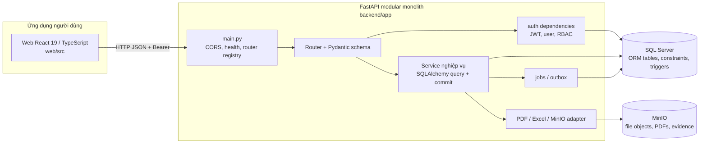
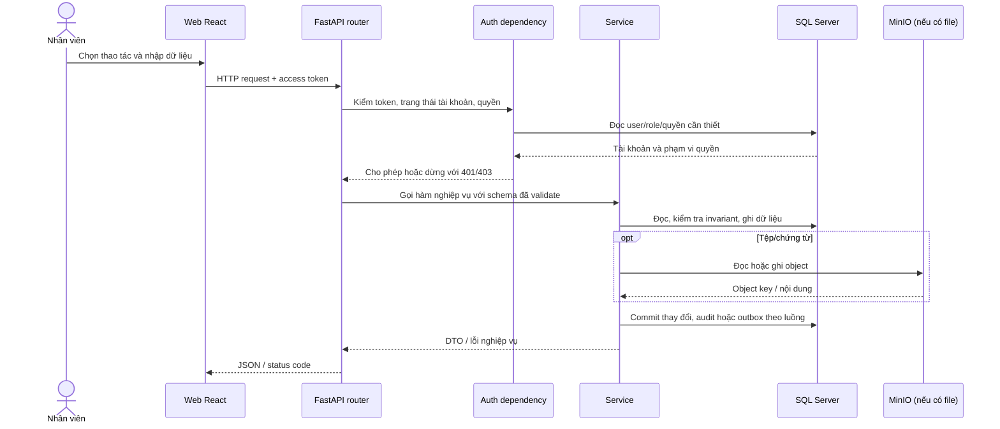
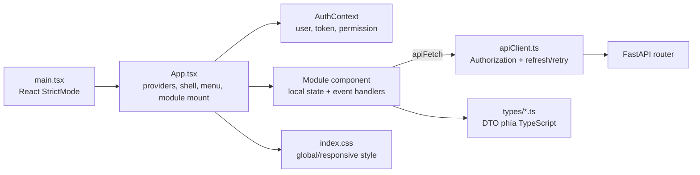

# Cẩm nang đọc code Backend và Web để ôn vấn đáp

**Dự án:** Hệ thống Quản lý Nghĩa trang Tư nhân  
**Ngày khảo sát:** 20/10/2026  
**Phạm vi:** Phân tích code của API backend và web React/TypeScript, cùng migration, scripts, tests, cấu hình và tài liệu giúp lần luồng. **Không phân tích Flutter/mobile** theo yêu cầu. Không tính thư viện cài đặt, file build, cache hoặc dữ liệu runtime.

Tài liệu này ưu tiên code hiện tại trong repo. Tên file và nội dung trong `README`, ADR, kế hoạch, prototype có thể nói về kiến trúc mục tiêu; khi khác source đang chạy, phần **“Đối chiếu thiết kế với hiện trạng”** ở cuối ghi rõ để tránh nhầm trong vấn đáp.

Lượt kiểm kê source/config chính ghi nhận: `backend/app` 57 file, `backend/alembic/versions` 13 migration, `backend/scripts` 14 file, `backend/tests` 19 file và `web/src` 46 file. Các ảnh bằng chứng, file Word/SQL đầu vào và lockfiles được xem như tài liệu/cấu hình, không phải code runtime.

## 1. Cách giới thiệu hệ thống trong 1 phút

Đây là monorepo; trong phạm vi phân tích này có hai phần runtime: API FastAPI và web React/TypeScript. API chia theo phân hệ nghiệp vụ; router nhận HTTP và gắn dependency kiểm quyền, Pydantic schema định hình dữ liệu, service chứa quy tắc nghiệp vụ và truy vấn SQLAlchemy models. SQL Server lưu trạng thái giao dịch, MinIO lưu nội dung file. Web gọi API chung; quyền và điều kiện chuyển trạng thái phải được kiểm tra tại server. Các luồng tiêu biểu là tạo hợp đồng giữ ô, xác minh giấy báo tử rồi xác nhận an táng tại hiện trường, phân công/đóng việc và ghi nhận thanh toán.

## 2. Sơ đồ kiến trúc thực tế



Luồng xử lý một lệnh:



### Mỗi lớp chịu trách nhiệm gì?

| Phần | Nằm ở đâu | Vai trò thực tế |
|---|---|---|
| Điểm khởi động API | `backend/app/main.py` | Tạo FastAPI, CORS, đăng ký router, health/readiness/version. |
| Xác thực và quyền | `backend/app/modules/auth/dependencies.py` | Đọc Bearer JWT, xác minh user còn hoạt động và `auth_version`, tạo dependency kiểm permission/role. |
| HTTP và quyền route | `backend/app/modules/*/router.py` | Định nghĩa URL, method, schema đầu vào/đầu ra, status code và `Depends(...)`. |
| Validate/DTO | `backend/app/modules/*/schemas.py` | Pydantic kiểm kiểu/giá trị request và định dạng response. Một số module khai báo response/schema ngay trong router. |
| Nghiệp vụ và truy vấn | `backend/app/modules/*/service.py` | Kiểm trạng thái, quyền tài nguyên khi cần, tính toán, query ORM, audit/outbox và commit. |
| ORM / bảng SQL | `backend/app/modules/*/models.py` | Ánh xạ SQLAlchemy tới các bảng và quan hệ. |
| Tệp | `backend/app/storage/minio_adapter.py`, `modules/documents` | Adapter S3 và nghiệp vụ upload/download/file ACL. |
| Database session | `backend/app/db/session.py` | Engine SQLAlchemy, `SessionLocal`, dependency `get_db()`. |

**Điểm cấu trúc cần nhớ:** source hiện không có `repository.py` riêng. Service truy vấn `db.query(...)` trực tiếp. Vì vậy khi trình bày, nói rõ “router → service → SQLAlchemy model/session”, không mô tả repository như một lớp đã tồn tại.

## 3. Bản đồ thư mục cấp dự án

```text
QL-NghiaTrang/
├── backend/       API Python, ORM, migrations, scripts và test
├── web/           Web nội bộ + cổng công khai React/TypeScript
├── docs/          Kế hoạch, chính sách, kiểm chứng và hướng dẫn
├── reference/     Đặc tả nghiệp vụ, Lab, prototype và kế hoạch đầu vào
├── scripts/       Lệnh hỗ trợ phát triển / kiểm tra toàn repo
├── .agents/       Quy tắc và skill dành cho coding agent
├── AGENTS.md      Quy ước làm việc, kiến trúc và bất biến nghiệp vụ
├── README.md      Mô tả tổng quan do dự án duy trì
└── CHANGELOG.md   Nhật ký các thay đổi theo phiên bản
```

## 4. Danh mục file theo thành phần

Phần dưới giải thích file source/config quan trọng. Với các module backend tuân theo mẫu, từng file vẫn được ghi riêng để tiện tra cứu khi mở code.

### 4.1 Backend — điểm khởi động và cấu hình chung

| File | Giải thích |
|---|---|
| `backend/app/main.py` | Tạo ứng dụng FastAPI; cấu hình CORS; đăng ký 12 router; health sống (`live`), readiness kiểm SQL Server + MinIO, thông tin version và root endpoint. Đây là nơi lần đầu kiểm tra API được ghép ra sao. |
| `backend/app/core/config.py` | Đọc cấu hình môi trường qua `pydantic-settings`, gồm tên ứng dụng, API prefix, JWT, kết nối database, CORS, MinIO. Không ghi giá trị bí mật thật vào tài liệu; dùng `.env.example` làm mẫu. |
| `backend/app/core/security.py` | Hàm băm/kiểm mật khẩu Argon2, tạo/giải mã JWT, sinh refresh token ngẫu nhiên và băm refresh token trước khi lưu. |
| `backend/app/db/session.py` | Khởi tạo SQLAlchemy engine/session; `get_db()` cấp session cho request rồi đóng; `check_database_readiness()` chạy `SELECT 1`. |
| `backend/app/db/base.py` | Import tất cả ORM model để `Base.metadata` được đăng ký đầy đủ; Alembic dùng metadata này. Không chứa nghiệp vụ. |
| `backend/app/services/pdf_service.py` | Tạo PDF nghiệp vụ như hợp đồng/biên lai bằng ReportLab. |
| `backend/app/services/excel_service.py` | Tạo file Excel báo cáo bằng openpyxl. |
| `backend/app/storage/minio_adapter.py` | Kết nối MinIO theo S3 API, kiểm tra readiness và thao tác object; module documents gọi adapter thay vì giao diện truy cập bucket trực tiếp. |

### 4.2 Backend — các phân hệ nghiệp vụ

| Phân hệ | File | Trách nhiệm |
|---|---|---|
| **audit** | `backend/app/modules/audit/models.py` | ORM nhật ký thay đổi. |
|  | `backend/app/modules/audit/router.py` | Route đọc nhật ký, tổng hợp, lọc entity/action; giới hạn quyền quản trị ở route/dependency. |
|  | `backend/app/modules/audit/schemas.py` | DTO bản ghi và số liệu tổng hợp kiểm toán. |
|  | `backend/app/modules/audit/service.py` | Truy vấn nhật ký, tổng hợp; `redact_sensitive_json()` loại thông tin nhạy cảm khỏi nội dung log trả về. |
| **auth** | `backend/app/modules/auth/models.py` | ORM `User`, `Role`, `Permission`, `AuthSession` và các liên kết. |
|  | `backend/app/modules/auth/router.py` | Login, refresh/logout, `/me`, đổi mật khẩu/thu hồi phiên, quản lý user/role và staff lookup. |
|  | `backend/app/modules/auth/schemas.py` | Request/response đăng nhập, token, user, role, tạo/cập nhật tài khoản, hồ sơ nhân sự rút gọn. |
|  | `backend/app/modules/auth/service.py` | Xác minh mật khẩu, tổng hợp quyền, quản lý vòng đời refresh session và CRUD user. |
|  | `backend/app/modules/auth/dependencies.py` | `get_current_user`, `require_permission`, `require_role`; là cổng bảo vệ route nội bộ. |
| **care** | `backend/app/modules/care/models.py` | ORM gói chăm sóc, lịch/ca, checklist, ảnh minh chứng. |
|  | `backend/app/modules/care/router.py` | API lịch, sinh kỳ, phân công, checklist, evidence, đóng ca và phụ lục chăm sóc. |
|  | `backend/app/modules/care/schemas.py` | DTO lịch, checklist, gán người, minh chứng, yêu cầu đóng ca/generate. |
|  | `backend/app/modules/care/service.py` | Tính lịch neo ngày cuối tháng, tạo lịch idempotent, kiểm xung đột, thao tác checklist/evidence, gate đóng ca. |
| **catalog** | `backend/app/modules/catalog/models.py` | ORM bảng giá, khoản mục giá và quan hệ. |
|  | `backend/app/modules/catalog/router.py` | API xem/lookup và quản trị bảng giá, gói chăm sóc, mẫu hợp đồng. GET dùng quyền đọc; thay đổi cấu hình yêu cầu quyền quản lý. |
|  | `backend/app/modules/catalog/schemas.py` | DTO/request cho giá, hiệu lực, gói chăm sóc, checklist gói và mẫu hợp đồng. |
|  | `backend/app/modules/catalog/service.py` | Kiểm khoảng hiệu lực chồng lấn, tra giá phù hợp, quản lý gói và version mẫu hợp đồng. |
| **construction** | `backend/app/modules/construction/models.py` | ORM lệnh thi công, checklist task, tệp evidence, lịch nghỉ/vắng nhân viên. |
|  | `backend/app/modules/construction/router.py` | API lệnh, task, hoàn tất, evidence, lịch bận và kiểm xung đột. |
|  | `backend/app/modules/construction/schemas.py` | DTO/request cho lệnh, checklist, evidence, phân công, lịch bận và conflict. |
|  | `backend/app/modules/construction/service.py` | Tạo lệnh từ phụ lục đã hiệu lực, chọn checklist, kiểm nhân sự/lịch, cập nhật tiến độ, nghiệm thu. |
| **contracts** | `backend/app/modules/contracts/models.py` | ORM hợp đồng nhiều loại, phụ lục và chi tiết riêng như mua đất/an táng/chăm sóc/thi công/cải táng/chuyển nhượng/hỏa táng. |
|  | `backend/app/modules/contracts/router.py` | API lập/xem/đổi trạng thái hợp đồng, PDF, phụ lục, căn cứ bàn giao và xác nhận an táng. |
|  | `backend/app/modules/contracts/schemas.py` | Request/DTO cho các loại hợp đồng/phụ lục, danh sách/chi tiết, WorkBasis và lệnh xác nhận an táng. |
|  | `backend/app/modules/contracts/service.py` | Quy tắc giữ ô, snapshot giá, trạng thái ký/kích hoạt, kiểm giấy báo tử, phụ lục, command an táng và DTO. |
| **documents** | `backend/app/modules/documents/models.py` | ORM `FileObject` và phiên bản/liên kết tài liệu. |
|  | `backend/app/modules/documents/router.py` | Upload, download, preview, media công khai, liên kết tài liệu và PDF hợp đồng mẫu. |
|  | `backend/app/modules/documents/schemas.py` | DTO file, version và yêu cầu liên kết vào hồ sơ. |
|  | `backend/app/modules/documents/service.py` | Kiểm loại file/magic bytes/dung lượng, SHA-256, MinIO, liên kết và kiểm quyền tải xuống. |
| **finance** | `backend/app/modules/finance/models.py` | ORM khoản phải thu, chiết khấu, thanh toán, biên lai/hóa đơn, khóa idempotency. Tiền dùng kiểu Decimal/NUMERIC thay vì float. |
|  | `backend/app/modules/finance/router.py` | Summary, khoản thu, FinanceBasis, thu tiền, chiết khấu, receipt/download. Permission gắn tại endpoint. |
|  | `backend/app/modules/finance/schemas.py` | Request/DTO khoản thu, chiết khấu, payment, invoice, FinanceBasis; validate nguồn công nợ dạng XOR. |
|  | `backend/app/modules/finance/service.py` | Tạo khoản thu, áp chiết khấu, ghi payment idempotent, tổng hợp công nợ, biên lai và FinanceBasis. |
|  | `backend/app/modules/finance/currency_words.py` | Chuyển số tiền thành chữ tiếng Việt để in trên biên lai. |
| **jobs** | `backend/app/modules/jobs/models.py` | ORM background job và outbox event. |
|  | `backend/app/modules/jobs/router.py` | API enqueue, xem trạng thái và xử lý job; một số request/response đặt ngay trong router thay vì file schema riêng. |
|  | `backend/app/modules/jobs/service.py` | Enqueue, claim, complete/fail tác vụ và ghi/đọc/đánh dấu sự kiện outbox. |
| **plots** | `backend/app/modules/plots/models.py` | ORM khu, hàng, loại mộ, ô, huyệt, giữ chỗ, lịch sử chủ sở hữu và an táng. |
|  | `backend/app/modules/plots/router.py` | API đọc/bảo trì khu/hàng/loại/ô, giữ chỗ, thống kê và timeline công khai. |
|  | `backend/app/modules/plots/schemas.py` | Request/DTO cho quy hoạch, ô/huyệt, reservation, thống kê và timeline. |
|  | `backend/app/modules/plots/service.py` | Tra cứu, lọc/ẩn bớt dữ liệu theo actor, CRUD, invariant Kim Tĩnh, giữ/hủy chỗ và timeline. |
| **profiles** | `backend/app/modules/profiles/models.py` | ORM thân nhân/khách hàng, hồ sơ người mất, giấy báo tử và quan hệ giữa họ. |
|  | `backend/app/modules/profiles/router.py` | API hồ sơ nội bộ, quan hệ, giấy báo tử/verify và tra cứu tưởng niệm công khai. |
|  | `backend/app/modules/profiles/schemas.py` | DTO/request với kiểm tra ngày sinh, ngày cấp giấy, giới tính, độ chính xác năm sinh và bản công khai. |
|  | `backend/app/modules/profiles/service.py` | CRUD hồ sơ, liên kết thân nhân, kiểm giấy báo tử, tìm kiếm công khai theo DTO tối thiểu. |
| **reports** | `backend/app/modules/reports/models.py` | ORM lịch sử export báo cáo. |
|  | `backend/app/modules/reports/router.py` | Route báo cáo doanh thu, lấp đầy, hợp đồng, vận hành và export/download. |
|  | `backend/app/modules/reports/schemas.py` | DTO các báo cáo và yêu cầu/theo dõi file export. |
|  | `backend/app/modules/reports/service.py` | Truy vấn số liệu, kiểm capability, dựng PDF/XLSX/export và quản lý file kết quả. |

### 4.3 Migrations, cấu hình, scripts và test backend

| Nhóm | File | Vai trò |
|---|---|---|
| Alembic | `backend/alembic.ini` | Cấu hình CLI logging và đường dẫn migration. |
|  | `backend/alembic/env.py` | Nạp `Base.metadata`, kết nối settings và chạy migration offline/online. |
|  | `backend/alembic/script.py.mako` | Template sinh migration mới. |
|  | `backend/alembic/README` | Ghi chú Alembic mặc định. |
| Migration | `0001_baseline_37_tables.py` | Đánh dấu baseline DB 37 bảng đã tồn tại; `upgrade()` rỗng, không dựng lại DB. |
|  | `0002_g01_auth_sessions_and_version.py` | Bổ sung phiên đăng nhập và version thu hồi quyền. |
|  | `0003_g02_g17_files_documents_jobs_outbox.py` | Cấu trúc file, phiên bản tài liệu, job và outbox nền. |
|  | `0004_g03_catalog_pricing_templates.py` | Danh mục, bảng giá và mẫu hợp đồng. |
|  | `0005_g04_g05_g06_plots_reservations.py` | Quy hoạch, reservation và lịch sử sở hữu ô mộ. |
|  | `0006_g07_g08_profiles_certificates.py` | Hồ sơ và giấy báo tử. |
|  | `0007_g09_contracts_workflow.py` | Luồng hợp đồng, số hợp đồng và nghiệp vụ kích hoạt. |
|  | `0008_g10_g18_g20_lifecycle_annexes.py` | Phụ lục an táng, cải táng, chuyển nhượng, hỏa táng. |
|  | `0009_g11_g13_construction_evidence_scheduling.py` | Thi công, checklist/evidence và khả dụng nhân viên. |
|  | `0010_g12_care_schedules_period_evidence.py` | Lịch chăm sóc theo kỳ và bằng chứng. |
|  | `0011_g14_g15_g16_finance_receivables.py` | Khoản phải thu, payment/idempotency và chiết khấu. |
|  | `0012_g17_report_exports.py` | Theo dõi xuất báo cáo. |
|  | `0013_fix_kim_tinh_plot_types_and_unoccupied_flags.py` | Migration chỉnh dữ liệu/loại mộ và cờ khóa cho trạng thái chưa an táng. |
| Cấu hình | `backend/.env.example` | Tên các biến cấu hình mẫu; không phải file chứa credentials triển khai. |
|  | `backend/pyproject.toml` | Khai báo Python >=3.12, dependencies, Ruff và pytest. |
|  | `backend/uv.lock` | Khóa phiên bản dependency Python để cài nhất quán. |
|  | `backend/compose.yaml` | Định nghĩa MinIO container, port localhost và bind mount `backend/runtime/minio/data`. |
| Scripts | `backend/scripts/introspect_db.py` | Đọc metadata/schema DB để so sánh hiện trạng. |
|  | `backend/scripts/seed_demo_workspace.py` | Seed nhân sự/ô demo; mặc định dry-run, cần `--apply` để ghi. Kiểm DB và backup theo hướng dẫn trong script. |
|  | `backend/scripts/seed_rbac.py` | Khởi tạo/sửa role và permission demo. |
|  | `backend/scripts/seed_catalog.py` | Dữ liệu danh mục/bảng giá. |
|  | `backend/scripts/seed_plots.py` | Tạo dữ liệu khu/hàng/ô demo. |
|  | `backend/scripts/seed_profiles.py` | Tạo hồ sơ demo. |
|  | `backend/scripts/seed_rich_demo_data.py` | Seed dữ liệu demo liên kết phong phú; cần đọc kỹ trước khi dùng với DB thật. |
|  | `backend/scripts/check_schedule_146.py` | Script kiểm tra lịch/fixture được chọn. |
|  | `backend/scripts/fix_missing_slots.py` | Công cụ sửa slot thiếu; là script có thể ghi DB. |
|  | `backend/scripts/scan_corrupted_unicode.py` | Chẩn đoán chuỗi Unicode lỗi. |
|  | `backend/scripts/repair_unicode.py` | Sửa chuỗi Unicode theo logic trong script; tác động dữ liệu nếu chạy. |
|  | `backend/scripts/repair_corrupted_unicode.py` | Script sửa dữ liệu Unicode lỗi. |
|  | `backend/scripts/repair_all_unicode.py` | Biến thể sửa Unicode trên phạm vi rộng. |
|  | `backend/scripts/deep_clean_unicode.py` | Làm sạch Unicode chuyên sâu; cần hiểu phạm vi trước khi chạy. |
| Tests | `backend/tests/conftest.py` | Cưỡng chế `DB_NAME=QL_NghiaTrang_Test` và xác minh database vật lý trước test. |
|  | `test_auth.py` | Login, refresh, logout, user/permission. |
|  | `test_catalog.py` | Bảng giá, gói và template. |
|  | `test_plots.py` | CRUD/lọc ô, giữ chỗ và bất biến Kim Tĩnh. |
|  | `test_profiles.py` | Khách hàng, người mất, giấy báo tử, quan hệ. |
|  | `test_contracts.py` | Hợp đồng và các nhánh phụ lục. |
|  | `test_lifecycle.py` | Vòng đời mua/an táng/cải táng/chuyển nhượng và bất biến. |
|  | `test_construction.py` | Lệnh thi công, checklist, evidence và nhân sự. |
|  | `test_care.py` | Lịch, checklist, evidence và đóng ca. |
|  | `test_finance.py` | Khoản thu, discount, payment, idempotency và biên lai. |
|  | `test_documents.py` | Upload, link file và kiểm quyền tài liệu. |
|  | `test_storage.py` | Tích hợp adapter/object storage. |
|  | `test_reports_audit.py` | Báo cáo/export và audit. |
|  | `test_jobs.py` | Queue/job/outbox. |
|  | `test_health.py` | Health/readiness API. |
|  | `test_trigger_mapping.py` | Tương thích mapping ORM với trigger SQL Server. |
|  | `test_rbac_strict_matrix.py` | Kiểm ma trận quyền actor. |
|  | `test_workspace_fixes.py` | Regression cho các sửa đổi phân quyền, lookup, seed và nghiệp vụ mới đây. |
|  | `test_business_lifecycle_e2e.py` | Kịch bản xuyên nhiều phân hệ từ hồ sơ đến giao dịch. |

> `backend/` còn `README.md` mô tả cách chạy API, và `alembic/versions/` là source thay đổi schema. Không chạy bootstrap SQL trong docs/source; database đang có cần migration tăng dần.

### 4.4 Web React — điểm vào, auth, giao diện và kiểu dữ liệu

| File | Giải thích |
|---|---|
| `web/src/main.tsx` | Mount React root trong `StrictMode`. |
| `web/src/App.tsx` | App root, gắn ErrorBoundary/AuthProvider/NotificationModalProvider; shell chính, sidebar/mobile drawer, role/capability navigation và mount module theo actor. |
| `web/src/App.css` | CSS còn lại từ scaffold; không thấy được import trong source hiện hành. |
| `web/src/index.css` | Style/toàn cục, layout responsive và các component/module CSS. |
| `web/src/context/authContextDef.ts` | Khai báo kiểu/context xác thực dùng chung. |
| `web/src/context/AuthContext.tsx` | Khôi phục session, login/logout, user/access token và kiểm tra quyền ở client. |
| `web/src/context/useAuth.ts` | Hook consumer để component lấy auth context. |
| `web/src/context/NotificationModalContext.tsx` | Context/modal thông báo và xác nhận dùng xuyên module. |
| `web/src/services/authApi.ts` | Hàm gọi login/me/refresh/logout và endpoint tài khoản. |
| `web/src/services/apiClient.ts` | `apiFetch`: gắn access token, gom refresh đồng thời, retry một lần khi 401; 403 không được thử lại. |
| `web/src/components/common/ErrorBoundary.tsx` | Chặn lỗi render lan ra toàn ứng dụng và hiển thị trạng thái lỗi. |
| `web/src/components/common/Pagination.tsx` | Điều khiển phân trang tái sử dụng. |
| `web/src/components/common/MediaEvidenceGallery.tsx` | Hiển thị ảnh/tệp minh chứng. |
| `web/src/components/auth/LoginModal.tsx` | Biểu mẫu đăng nhập. |
| `web/src/components/admin/UserManagementModule.tsx` | UI quản trị tài khoản/vai trò. |
| `web/src/components/audit/AuditModule.tsx` | UI xem nhật ký hoạt động. |
| `web/src/components/catalog/CatalogModule.tsx` | UI danh mục và cấu hình/tra cứu bảng giá, gói, mẫu theo capability. |
| `web/src/components/plots/PlotMapModule.tsx` | Điều phối dữ liệu, bộ lọc, tab GIS/ma trận, chi tiết và thao tác khu/hàng/ô. |
| `web/src/components/plots/GeographicPlotMap.tsx` | Leaflet hiển thị tọa độ lat/long, trạng thái ô, marker trùng tọa độ và chọn ô. |
| `web/src/components/plots/plotCoordinates.ts` | Chuyển/kiểm tra tọa độ từ DTO plot để dùng ở map. |
| `web/src/components/plots/PlotDirectionsButton.tsx` | Shortcut vị trí từ công việc; nạp plot và mở map tập trung vào ô cần tìm. |
| `web/src/components/plots/SimulatedPlotMap.tsx` | Ma trận SVG minh họa hàng/ô; đây là hình sơ đồ nội bộ, không phải nền bản đồ lat/long. |
| `web/src/components/profiles/ProfileModule.tsx` | UI hồ sơ thân nhân/người mất/quan hệ/giấy tờ. |
| `web/src/components/contracts/ContractModule.tsx` | Wizard và danh sách hợp đồng/phụ lục, ký, upload, activate, PDF. |
| `web/src/components/contracts/WorkBasisView.tsx` | Danh sách căn cứ công việc bàn giao cho Quản trang, xác nhận an táng và file minh chứng. |
| `web/src/components/construction/ConstructionModule.tsx` | Điều phối lệnh thi công, người giám sát, task/evidence và nghiệm thu. |
| `web/src/components/care/CareModule.tsx` | Điều phối lịch chăm sóc, phân công, checklist, ảnh và đóng ca. |
| `web/src/components/finance/FinanceModule.tsx` | Shell công nợ/thu tiền, tab dữ liệu và điều hướng. |
| `web/src/components/finance/FinanceBasisView.tsx` | Căn cứ khoản thu được phép xem cho Kế toán, kết nối sang sổ công nợ. |
| `web/src/components/reports/ReportsModule.tsx` | UI báo cáo theo quyền và yêu cầu tải export. |
| `web/src/components/documents/DocumentManager.tsx` | Upload, danh sách/preview/tải file và gắn file vào hồ sơ. |
| `web/src/components/documents/DocumentAttachmentList.tsx` | Danh sách attachment gọn trong hồ sơ. |
| `web/src/types/auth.ts` | Kiểu User, Role, Permission và token/auth DTO. |
| `web/src/types/audit.ts` | Kiểu audit DTO. |
| `web/src/types/care.ts` | Kiểu lịch/checklist/evidence chăm sóc. |
| `web/src/types/catalog.ts` | Kiểu bảng giá/gói/template. |
| `web/src/types/construction.ts` | Kiểu lệnh/task/evidence thi công. |
| `web/src/types/contracts.ts` | Kiểu hợp đồng/phụ lục/WorkBasis. |
| `web/src/types/document.ts` | Kiểu file và attachment. |
| `web/src/types/finance.ts` | Kiểu khoản thu/payment/invoice/report basis. |
| `web/src/types/plots.ts` | Kiểu khu/hàng/ô/slot/tọa độ/map DTO. |
| `web/src/types/profiles.ts` | Kiểu khách hàng/người mất/giấy báo tử. |
| `web/src/types/reports.ts` | Kiểu payload báo cáo và export. |
| `web/src/assets/hero.png` | Asset trong source; không thấy reference/import hiện hành. |
| `web/src/assets/react.svg`, `web/src/assets/vite.svg` | Asset khởi đầu từ Vite/template; không thấy reference/import hiện hành. |

Các file cấu hình web: `web/package.json` khai báo script và dependencies; `web/pnpm-lock.yaml` khóa phiên bản; `web/index.html` host React root; `web/vite.config.ts` dev server/proxy/allowed host; `web/tsconfig.json`, `web/tsconfig.app.json`, `web/tsconfig.node.json` thiết lập TypeScript; `web/public/favicon.svg`, `web/public/icons.svg` icon tĩnh. `web/README.md` có hướng dẫn chạy web.

### 4.5 Tài liệu và tài nguyên thiết kế trong repo

| Đường dẫn | Nội dung để dùng khi ôn vấn đáp |
|---|---|
| `AGENTS.md` | Nguyên tắc code: DB an toàn/migration, Kim Tĩnh, server-side RBAC, dữ liệu giả, Decimal, MinIO trên D và trạng thái UI. |
| `docs/decisions/0001-system-architecture-and-runtime.md` | Lý do chọn monorepo, SQL Server, MinIO, client và quy tắc vận hành; đọc cùng phần đối chiếu hiện trạng ở cuối tài liệu này. |
| `docs/EXECUTION_PLAN.md`, `docs/execution/STATE.md` | Kế hoạch và trạng thái milestone; STATE là ghi chú tiến độ, không thay code source. |
| `docs/db-baseline.json`, `docs/db-gap-register.md` | Baseline schema DB đã khảo sát và khoảng cách so với thiết kế. |
| `docs/source-inventory.md` | Nguồn Lab1–Lab4/SQL, hash và thứ tự ưu tiên tài liệu khi có xung đột. |
| `docs/BUSINESS_TEST_SCENARIOS.md` | Kịch bản nghiệp vụ xuyên phân hệ. |
| `docs/ui-alignment/actor-policy.md` | Ma trận quyền actor và allowlist dữ liệu giữa phân hệ. |
| `docs/ui-alignment/route-inventory.md`, `api-ui-contracts.md`, `acceptance.md`, `baseline.md`, `decisions.md`, `traceability.csv` | Rà soát route/UI, hợp đồng API, chuẩn chấp nhận, baseline và truy vết actor/UC. |
| `docs/ui-alignment/02_PLAN_ANTIGRAVITY_CAI_THIEN_GIAO_DIEN.md`, `docs/WEB_RESPONSIVE_UX_PLAN.md` | Các kế hoạch UI/responsive; kế hoạch không đồng nghĩa toàn bộ đã triển khai. |
| `docs/actor-business-audit/PLAN.md`, `PLAN-RBAC-MAP-7467905.md`, `REVIEW-3cfc146.md`, `FIXES-20261018.md` | Kế hoạch audit, phát hiện review, sửa đổi phân quyền/bản đồ gần nhất. |
| `docs/actor-business-audit/AUTHORIZATION-MATRIX-7467905.csv` và `docs/actor-business-audit/evidence/` | Bằng chứng kiểm chứng: probe/API/UI/ảnh; dùng để truy nguồn phát hiện, không phải source runtime. |
| `docs/execution/evidence/` | Ảnh và kết quả JSON các lượt kiểm trình duyệt/số liệu. |
| `docs/source/` và `reference/` | Lab1–Lab4, SQL và tài liệu nghiệp vụ đầu vào. Đặc tả `.md` trong `reference/` giúp hiểu yêu cầu; `lab4-sql.sql` là DDL lịch sử nguy hiểm, không chạy. |
| `reference/*prototype*.html`, `reference/Giao_dien_*.html` | Prototype/mockup giao diện, không phải code đang render. |
| `scripts/dev.ps1` | Hướng dẫn khởi động các dịch vụ phát triển liên quan. |
| `scripts/doctor.ps1` | Chẩn đoán công cụ, DB, MinIO và đề xuất quality gate. |
| `scripts/quality-gate.ps1` | Ghép các lệnh kiểm tra backend và web cùng các thành phần khác trong repo; chỉ dùng khi chủ động muốn chạy quality gate. |
| `.agents/rules/project.md`, `.agents/skills/*/SKILL.md` | Quy tắc/skill phục vụ coding agent, không nằm trong runtime ứng dụng. |

Tệp nguồn/đầu vào trong `reference/` được chia như sau: `DAC_TA_NGHIEP_VU_HE_THONG_QUAN_LY_NGHIA_TRANG.md` là đặc tả nghiệp vụ hệ thống; `lab1.docx` bài toán/actor; `Lab2-TruongXuanHuy-2324802010044.docx` use case và quy tắc chi tiết; `Lab3-TruongXuanHuy-2324802010044.docx` sơ đồ tuần tự/lớp; `lab4-TruongXuanHuy-2324802010044.docx` ERD/từ điển dữ liệu; `lab4-sql.sql` DDL SQL Server; `02_PLAN_ANTIGRAVITY_CAI_THIEN_GIAO_DIEN.md`, `EXECUTION_PLAN_QL_NGHIA_TRANG_ANTIGRAVITY.md` và `REMEDIATION_PLAN_CEMETERY_MANAGEMENT_SYSTEM.md` là kế hoạch thực thi; `plan01.docx` là bản kế hoạch Word; `cemetery_ui_prototype.html`, `Giao_dien_Quan_ly_Nghia_trang.html`, `Giao_dien_Quan_ly_Nghia_trang (1).html` là prototype giao diện. Bản Lab được sao lưu trong `docs/source/`; xem `docs/source-inventory.md` khi cần biết độ ưu tiên và hash của nguồn.

## 5. Ba luồng backend nên trình bày được

### 5.1 Đăng nhập và kiểm quyền

Ví dụ đăng nhập qua `POST /api/v1/auth/login`:

1. `auth/router.py::login` nhận `LoginRequest` đã được Pydantic validate, gọi `AuthService.authenticate_user()` rồi `create_session()`.
2. `authenticate_user()` tìm username trong SQL Server, kiểm mật khẩu Argon2 và chặn user inactive.
3. `create_session()` sinh refresh token ngẫu nhiên, lưu **hash** trong `auth_sessions`, gom role/permission, tạo access JWT ngắn hạn.
4. Client nhận access + refresh token. Web gọi qua `apiFetch`; khi có 401 thì chỉ gom một refresh request đồng thời và retry request một lần. 403 không được refresh.
5. Ở mọi route được bảo vệ, `get_current_user()` decode JWT, đọc lại User từ DB, kiểm active và so sánh `auth_version`. Đổi quyền/mật khẩu có thể làm token cũ mất hiệu lực.
6. `require_permission("finance", "write")` tạo dependency yêu cầu `finance:write`. ADMIN được bypass; các role còn lại phải có permission tương ứng.

| Đoạn code | File/vị trí | Ý nghĩa khi giải thích |
|---|---|---|
| Route login | `backend/app/modules/auth/router.py:57` | Router mỏng: nhận request, cấp DB session, gọi service. |
| Authenticate / tạo session / rotate | `backend/app/modules/auth/service.py:40`, `:60`, `:99` | Nghiệp vụ xác thực và vòng đời refresh token. |
| Verify JWT/password | `backend/app/core/security.py:17`, `:49` | Hash mật khẩu tách khỏi HTTP layer; token ký bằng secret. |
| User và permission check | `backend/app/modules/auth/dependencies.py:16`, `:94` | Mọi module dùng chung dependency, không tự đọc header rải rác. |
| Session client | `web/src/context/AuthContext.tsx`, `web/src/services/apiClient.ts` | UI giữ trạng thái đăng nhập và tự khôi phục access token khi 401. |

Đoạn cốt lõi ở `backend/app/modules/auth/dependencies.py:16-36,69-89`:

```python
user = db.get(User, user_id)
if not user:
    raise HTTPException(
        status_code=status.HTTP_401_UNAUTHORIZED,
        detail="Người dùng không tồn tại",
        headers={"WWW-Authenticate": "Bearer"},
    )
if not user.is_active:
    raise HTTPException(
        status_code=status.HTTP_403_FORBIDDEN,
        detail="Tài khoản đã bị vô hiệu hóa",
    )
if token_auth_version != user.auth_version:
    raise HTTPException(
        status_code=status.HTTP_401_UNAUTHORIZED,
        detail="Token đã bị thu hồi do đổi quyền, đổi mật khẩu hoặc đăng xuất.",
        headers={"WWW-Authenticate": "Bearer"},
    )
```

Điểm đáng giải thích: JWT được giải mã và kiểm hạn/chữ ký trước; sau đó API đọc lại tài khoản hiện tại từ DB, nên tài khoản bị vô hiệu hóa hoặc token mang `auth_version` cũ sẽ bị chặn. Bản code thực có thông báo lỗi riêng cho từng trường hợp; đoạn trên đã rút gọn để tập trung vào luồng.

**Câu trả lời ngắn:** “Frontend có thể ẩn menu theo permission để actor không thấy chức năng không liên quan, nhưng server vẫn kiểm JWT và permission trong từng API. Vì vậy gọi API trực tiếp không vượt qua được RBAC.”

### 5.2 Hợp đồng mua đất → giữ ô → kích hoạt phụ lục → xác nhận an táng

```mermaid
sequenceDiagram
    actor M as Marketing
    actor Q as Quản trang
    participant UI as Web
    participant API as contracts router/service
    participant DB as SQL Server
    M->>UI: Chọn khách, ô, giá và lập hợp đồng
    UI->>API: POST /contracts/land-purchase
    API->>DB: Tìm khách; nạp ô; kiểm trạng thái/giữ chỗ; tìm giá hiệu lực
    API->>DB: Tạo Contract DRAFT + LandPurchaseContract + Reservation
    API->>DB: Ghi AuditLog; commit
    M->>UI: Nộp scan đã ký và kích hoạt
    UI->>API: POST /contracts/{id}/activate
    API->>DB: Kiểm file READY, trạng thái, kiểm tra điều kiện domain
    API->>DB: ACTIVE + khoản phải thu/outbox/audit theo luồng
    Q->>UI: Xác nhận an táng tại hiện trường
    UI->>API: POST /contracts/annexes/{id}/confirm-burial
    API->>DB: Kiểm annex ACTIVE, giấy báo tử VERIFIED, plot/slot hợp lệ
    API->>DB: OCCUPIED + burial history; khóa vĩnh viễn nếu Kim Tĩnh
    API->>DB: Outbox + audit; commit
```

**Tạo hợp đồng mua đất (`ContractService.create_land_purchase_contract`)** — `backend/app/modules/contracts/service.py:104`:

- Kiểm khách hàng tồn tại, nạp plot với `.with_for_update()`, chỉ nhận plot `EMPTY_UNSOLD` hoặc `RESERVED`.
- Nếu đã có giữ chỗ, đối chiếu người giữ với nhân viên/khách; giữ chỗ do hợp đồng khác chiếm hoặc khách khác đặt thì trả `409 Conflict`.
- `LandPurchaseContractCreate.land_unit_price` cho phép bỏ trống; khi bỏ trống hoặc gửi giá `<= 0`, service tra khoản giá hiệu lực trong `PriceList` theo loại ô/số slot. Nếu request gửi giá dương thì code hiện dùng trực tiếp giá đó làm snapshot. Vì vậy không nên nói API luôn bắt buộc giá niêm yết; đây là điểm cần đối chiếu thêm với policy giá và quyền nghiệp vụ.
- Tạo `Contract` trạng thái `DRAFT`, `LandPurchaseContract`, và reservation 7 ngày; đổi plot sang `RESERVED`; ghi audit rồi commit.
- `db.flush()` ở giữa để lấy `contract_id` trước khi tạo bản ghi phụ thuộc; `db.commit()` chốt thay đổi.

Ví dụ phần đồng bộ/khóa ô và chọn giá trong `backend/app/modules/contracts/service.py:117-127,164-212`:

```python
plot = db.query(Plot).filter(Plot.plot_id == data.plot_id).with_for_update().first()
if plot.status not in ("EMPTY_UNSOLD", "RESERVED"):
    raise HTTPException(
        status_code=status.HTTP_409_CONFLICT,
        detail=f"Ô mộ {plot.plot_code} hiện ở trạng thái '{plot.status}', không khả dụng để mở bán.",
    )

unit_price = data.land_unit_price
if unit_price is None or unit_price <= 0:
    today = date.today()
    # 1. Look up specific plot_type_id or LAND_{type_id}
    active_price_item = (
        db.query(PriceItem)
        .join(PriceList, PriceList.price_list_id == PriceItem.price_list_id)
        .filter(
            PriceList.is_active == True,  # noqa: E712
            PriceList.effective_from_date <= today,
            or_(PriceList.effective_to_date.is_(None), PriceList.effective_to_date >= today),
            or_(
                PriceItem.plot_type_id == plot.type_id,
                PriceItem.item_code == f"LAND_{plot.type_id}",
            ),
        )
        .first()
    )
    # Nếu chưa có giá riêng, code tiếp tục tra mã chuẩn theo số huyệt.
    if not active_price_item:
        ...
    if not active_price_item:
        raise HTTPException(
            status_code=status.HTTP_400_BAD_REQUEST,
            detail=f"Chưa có đơn giá niêm yết hiệu lực cho loại đất mộ '{plot.type_id}'. Vui lòng liên hệ ban quản trị để cấu hình bảng giá.",
        )
    unit_price = active_price_item.unit_price
```

`with_for_update()` yêu cầu DB khóa bản ghi ô trong thao tác tạo hợp đồng để giảm nguy cơ hai nhân viên cùng chốt một ô. Cơ chế khóa và semantics cụ thể phụ thuộc dialect/isolation SQL Server được cấu hình. Phần giá thể hiện snapshot: hợp đồng lưu giá đã chọn ở thời điểm lập; code hiện vẫn chấp nhận giá dương gửi từ request, đây là điểm cần nói đúng thay vì khẳng định luôn tra bảng giá.

**Kích hoạt pháp lý khác với thao tác hiện trường.** `activate_burial_annex()` ở `contracts/service.py:958` kiểm điều kiện pháp lý và file scan, ghi trạng thái phụ lục/thu phải thu. Code có comment nói việc đổi slot/plot sang `OCCUPIED` và khóa Kim Tĩnh phải đợi command hiện trường. Quản trang gọi `confirm_burial()` ở `:1234`: kiểm annex ACTIVE, giấy báo tử VERIFIED, plot chưa khóa, slot thuộc plot; sau đó cập nhật slot/plot, thêm `BurialHistory`, `OutboxEvent`, `AuditLog`, rồi commit. Khi hình thức là Kim Tĩnh, set `is_kim_tinh=True` và `is_locked=True`.

Đoạn chuyển trạng thái ở `backend/app/modules/contracts/service.py:1299-1307`:

```python
slot.status = "OCCUPIED"
slot.current_deceased_id = burial.deceased_id
plot.status = "OCCUPIED"
if burial.is_kim_tinh:
    plot.is_kim_tinh = True
    plot.is_locked = True
```

Ba dòng đầu ghi nhận vị trí huyệt và người đã an táng. Hai cờ cuối đánh dấu loại kết cấu và khóa ô sau an táng Kim Tĩnh. Đây là một command hiện trường riêng; không đồng nhất với bước ký/kích hoạt giấy tờ.

**Vì sao cần nhiều lớp bảo vệ Kim Tĩnh?** `plots/service.py::update_plot` từ chối gỡ cờ/chỉnh sửa khi locked; hợp đồng chặn cải táng/chuyển nhượng; ORM tắt `implicit_returning` ở bảng có trigger; SQL Server trigger là lớp cuối ngăn request/script ngoài service sửa trái luật. Bất biến nghiệp vụ không nên chỉ nằm ở nút frontend.

`backend/app/modules/plots/service.py:493-524` minh họa lớp service:

```python
if plot.is_kim_tinh:
    if data.is_kim_tinh is False:
        raise HTTPException(
            status_code=status.HTTP_400_BAD_REQUEST,
            detail="QUY TẮC BẤT BIẾN KIM TĨNH: Ô mộ đã thiết lập kết cấu Kim Tĩnh, nghiêm cấm gỡ bỏ cờ Kim Tĩnh!",
        )
    if plot.is_locked:
        raise HTTPException(
            status_code=status.HTTP_400_BAD_REQUEST,
            detail="QUY TẮC BẤT BIẾN KIM TĨNH: Ô mộ Kim Tĩnh đã an táng và khóa vĩnh viễn, nghiêm cấm chỉnh sửa thông số!",
        )
```

Sau guard, service chỉ cập nhật các trường được phép và commit. Mô hình `Plot` tắt `implicit_returning` (`plots/models.py:56-62`) để tương thích trigger SQL Server; migration/trigger và service cùng bảo vệ invariant ở các tầng khác nhau.

### 5.3 Kế toán ghi nhận khoản thanh toán

Endpoint `POST /api/v1/finance/receivables/{id}/payments` ở `finance/router.py:125` yêu cầu `finance:write`, validate `PaymentRecordRequest` rồi gọi `FinanceService.record_payment()` (`finance/service.py:446`).

1. Chuẩn hóa số tiền bằng `Decimal`, chuẩn hóa phương thức/mã giao dịch, tạo hash đại diện request.
2. Nạp khoản phải thu và gọi `.with_for_update()`; từ chối khoản không còn nợ hoặc đã hủy, và từ chối số tiền vượt số dư.
3. Khi request có khóa idempotency, tìm theo nhân viên + operation + key. Cùng key nhưng nội dung khác trả 409; request đã hoàn tất thì trả lại response đã lưu; request đang chạy thì báo xung đột. Service nhận key là optional, nên cần xác minh client/route luôn gửi key nếu muốn bảo đảm retry chống ghi trùng.
4. Thêm `Payment` kiểu append-only. Commit để SQL Server trigger `trg_payments_sync_receivable_balance` cập nhật tổng đã thu/số dư; sau đó đọc lại receivable.
5. Tạo số biên lai, đổi tiền ra chữ, sinh PDF, upload vào MinIO, tạo `Invoice` nếu khâu tệp thành công. Nếu tạo file lỗi, payment vẫn đã commit và response có thể không có invoice; có endpoint `regenerate-invoice` để phục hồi.
6. Đánh dấu request idempotency hoàn tất và lưu response, ghi audit và phát outbox event.

**Điểm phân tích sâu:** SQL và MinIO không cùng một transaction phân tán. Mã ghi payment trước, sau đó thử sinh biên lai trong `try/except`; do vậy không nên khẳng định “payment + PDF luôn atomic”. Thiết kế dùng khả năng phục hồi biên lai để xử lý trường hợp payment thành công nhưng storage tạm lỗi.

Mã cần nhớ:

```python
norm_amount = Decimal(str(payload.paid_amount)).quantize(Decimal("0.01"))
receivable = (
    db.query(Receivable)
    .filter(Receivable.receivable_id == receivable_id)
    .with_for_update()
    .first()
)
remaining_debt = receivable.final_payable_amount - receivable.total_paid_amount
if payload.paid_amount > remaining_debt:
    raise HTTPException(
        status_code=status.HTTP_400_BAD_REQUEST,
        detail=(
            f"Số tiền thanh toán ({payload.paid_amount:,.0f} đ) vượt quá "
            f"dư nợ hiện tại ({remaining_debt:,.0f} đ)."
        ),
    )
```

Đây là phần rút gọn từ `backend/app/modules/finance/service.py:456-496`; kiểm tra khóa trùng tiếp theo nằm ở `:498-537`.

Request vào service đã qua Pydantic `PaymentRecordRequest` (`finance/schemas.py:52-61`): tiền là `Decimal`, lớn hơn 0, phương thức thanh toán thuộc danh sách cố định và khóa chống trùng có giới hạn độ dài. ORM lưu các số tiền bằng `Numeric(15,2)` (`finance/models.py:19-35,65-82`); kiểu số này tránh sai số nhị phân của `float`.

### 5.4 Phân công thi công và nghiệm thu

- `ConstructionService.create_order()` (`construction/service.py:291`) nhận phụ lục đang `ACTIVE` loại `CONSTRUCTION` hoặc `BURIAL`, kiểm `plot_id` trùng với plot trong annex.
- Người giám sát và người nhận việc phải là nhân sự thực địa hợp lệ; kiểm lịch bận trong khoảng ngày. Nếu conflict thì trả 409 trước khi tạo order.
- Tạo order `PENDING`, đổi plot `OWNED_EMPTY` thành `UNDER_CONSTRUCTION`, rồi sinh task từ checklist của phụ lục hoặc checklist mặc định. Ghi audit và commit.
- `complete_task()` kiểm evidence READY trước khi chốt task. `complete_order()` (`:488`) kiểm task bắt buộc DONE và evidence READY; nếu thiếu thì không nghiệm thu.
- Khi hoàn thành, plot chỉ đổi từ `UNDER_CONSTRUCTION` về `OWNED_EMPTY` nếu chưa có slot occupied, hoặc `OCCUPIED` nếu đã có người an táng. Hoàn tất xây dựng không tự tạo sự kiện an táng.

Gate nghiệm thu ở `backend/app/modules/construction/service.py:503-533` kiểm hai mức: không còn task bắt buộc chưa `DONE`, và mỗi task bắt buộc có ít nhất một tệp `READY`. Ngoài ra order phải có ít nhất một evidence sẵn sàng ở cấp toàn lệnh. Những kiểm tra này nằm trong service nên API không thể bị vượt qua chỉ bằng cách bỏ validation ở web.

### 5.5 Chăm sóc định kỳ và đóng ca

- `CareService.calculate_anchored_date()`/`generate_schedules_for_period()` tính ca theo chu kỳ gói và giữ neo ngày cuối tháng; khóa unique/idempotency tránh sinh trùng cùng kỳ.
- Quản trang cập nhật checklist và gắn ảnh qua `documents/upload` rồi attach vào schedule.
- `close_schedule()` (`care/service.py:339`) không cho đóng nếu còn checklist bắt buộc chưa xong hoặc không có ít nhất một file `READY` có MIME ảnh.
- Khi đạt gate, set `CLOSED`, thời gian/người hoàn thành, commit. Sau đó code phát outbox và audit. Lưu ý đọc thứ tự commit thực tế khi giải thích: ở flow này các bước event/audit được gọi sau commit trạng thái.

Đoạn kiểm checklist ở `backend/app/modules/care/service.py:352-380`:

```python
incomplete_required = [
    item.task_description for item in schedule.checklist_items
    if item.is_required and not item.is_completed
]
if incomplete_required:
    raise HTTPException(
        status_code=status.HTTP_400_BAD_REQUEST,
        detail=f"Không thể đóng ca: Còn {len(incomplete_required)} hạng mục bắt buộc chưa hoàn tất ({', '.join(incomplete_required)})",
    )
```

Sau đó service duyệt evidence, nạp metadata `FileObject` và chỉ đếm tệp có trạng thái `READY` cùng MIME bắt đầu bằng `image/`. Vì thế checklist xong nhưng không có ảnh hiện trường vẫn chưa thể đóng ca.

### 5.6 Upload file và kiểm quyền

`DocumentService.upload_file()` (`documents/service.py:52`) kiểm giới hạn dung lượng, nhận diện MIME từ nội dung/đuôi file, SHA-256, tạo key không trùng, upload object vào MinIO và tạo `FileObject` trạng thái `READY` trong SQL Server. File database lưu metadata; binary lưu object storage.

Trình tự hiện thực ở `backend/app/modules/documents/service.py:60-99`:

```python
mime_type = cls.detect_mime_type(content, file_name)
sha256 = hashlib.sha256(content).hexdigest()
object_key = f"documents/{now.year}/{now.month:02d}/{file_id}_{clean_name}"
upload_meta = storage_adapter.put_object(
    object_key=object_key,
    data=content,
    content_type=mime_type,
)
...
db.add(file_obj)
db.commit()
db.refresh(file_obj)
```

Đây là hai hệ lưu trữ riêng: MinIO nhận nội dung trước, SQL Server lưu metadata sau. Nếu SQL commit lỗi sau khi upload thành công có thể còn object chưa được DB tham chiếu; source không tạo transaction phân tán để tự rollback MinIO.

Khi download, service kiểm tra file còn tồn tại và liên kết của nó. Biên lai/export nhạy cảm yêu cầu actor có quyền tương ứng. Cổng công khai dùng endpoint/DTO riêng; không nên lấy file private rồi chỉ ẩn link ở client.

## 6. Đọc frontend web từ điểm vào đến từng phân hệ

Frontend hiện là React 19 + TypeScript + Vite. `web/src/main.tsx` chỉ mount root trong `StrictMode`; `App.tsx` tạo app shell, context và điều hướng; từng module JSX quản lý state/form và gọi API trực tiếp bằng `apiFetch`. Không có lớp API/repository riêng cho từng domain. DTO TypeScript được định nghĩa thủ công trong `web/src/types/*`, vì vậy khi backend schema đổi, frontend type và cách đọc JSON cần được cập nhật đồng bộ.



### 6.1 Điểm vào và app shell

`web/src/main.tsx:6-10` gọi `createRoot(...).render(<StrictMode><App /></StrictMode>)`. StrictMode hỗ trợ React phát hiện một số side effect không an toàn trong lúc phát triển; nó không phải router hay state manager.

`web/src/App.tsx:1074-1082` bọc `MainApp` theo thứ tự `ErrorBoundary → AuthProvider → NotificationModalProvider`. `ErrorBoundary` bắt lỗi render/lifecycle để trang không trắng hoàn toàn; lỗi HTTP trong `fetch` vẫn phải được component xử lý riêng bằng trạng thái loading/error.

`MainApp` giữ `activeTab`, modal đăng nhập và trạng thái mobile drawer tại `App.tsx:108-112`. CSS responsive nằm chủ yếu ở `web/src/index.css`: breakpoint 480/640/768/1024px; sidebar desktop đổi thành drawer/backdrop dưới 1024px (`:138-210`), còn các grid/form/map có quy tắc riêng. `web/src/App.css` không được import trong entry hiện tại. Layout/tab chuyển bằng state chứ không dùng URL router nên tab chưa được deep-link/bookmark độc lập.

### 6.2 Đăng nhập, quyền hiển thị và mount module

`web/src/context/AuthContext.tsx:24-39` gửi login, lưu access/refresh token, rồi gọi `/auth/me` để nhận user/roles/permissions. Khi mở trang, `:41-80` thử refresh token đã lưu để khôi phục session. `hasPermission()` tại `:82-86` cho ADMIN bypass ở giao diện; các actor khác phải có code quyền đúng trong mảng `user.permissions`.

Menu và module được bảo vệ riêng tại `App.tsx:340-490,1020-1063`: menu chỉ hiện khi có permission, còn phần render module kiểm tra lại trước khi mount. Đây là kiểm soát trải nghiệm ở client; quyền thật vẫn phải được kiểm tra tại router backend. Một module có thể được nhìn thấy vì quyền đọc trong khi một số nút ghi bị ẩn theo quyền ghi (ví dụ finance), nhưng nếu component không kiểm tra permission chi tiết thì API sẽ trả 403.

### 6.3 API client và refresh session

Đoạn thực tế ở `web/src/services/apiClient.ts:35-53`:

```typescript
const generation = sessionGeneration
const headers = new Headers(init?.headers)
const authenticated = headers.has('Authorization')
const current = localStorage.getItem('access_token')
if (authenticated && current) headers.set('Authorization', `Bearer ${current}`)
const response = await fetch(input, { ...init, headers })
if (response.status !== 401 || !authenticated || generation !== sessionGeneration) return response
const latest = localStorage.getItem('access_token')
const token = latest && latest !== current ? latest : await refreshSession()
if (generation !== sessionGeneration) return response
headers.set('Authorization', `Bearer ${token}`)
return await fetch(input, { ...init, headers })
```

`apiFetch()` chỉ refresh khi request có Authorization và server trả 401. `refreshSession()` dùng một Promise chung (`:16-33`), nên nhiều request cùng lúc không xoay refresh token đồng thời. Mỗi request được retry tối đa một lần; 403 không refresh vì đó là trường hợp thiếu quyền, không phải token hết hạn. `sessionGeneration` ngăn response thuộc tài khoản cũ ghi đè session sau khi logout hoặc đăng nhập tài khoản khác. Hàm `responseError()` chuyển 401/403 thành thông báo tiếng Việt, các component vẫn tự quyết định cách hiển thị lỗi.

### 6.4 Bản đồ component web và API

| Component / file | Vai trò trên giao diện | API hoặc phần backend liên quan |
|---|---|---|
| `components/auth/LoginModal.tsx` | Form đăng nhập; gọi auth context. | `auth/router.py` login/refresh/logout. |
| `components/admin/UserManagementModule.tsx` | Danh sách tài khoản/vai trò, tạo/sửa/khóa/reset. | `/auth/users`, `/auth/roles`; `auth` router/service. |
| `components/audit/AuditModule.tsx` | Bộ lọc nhật ký, entities/actions và bản ghi. | `/audit/summary`, `/audit/entities`, `/audit/actions`, `/audit/logs`; `audit` module. |
| `components/catalog/CatalogModule.tsx` | Bảng giá, mặt hàng, gói chăm sóc, mẫu hợp đồng và tra giá. | `/catalog/*`; `catalog` module. |
| `components/plots/PlotMapModule.tsx` | Nạp dữ liệu, lọc, xem GIS/ma trận, xem chi tiết, giữ chỗ và quản trị quy hoạch. | `/plots`, `/plots/zones`, `/plots/rows`, `/plots/types`, reserve; `plots` module. |
| `components/plots/GeographicPlotMap.tsx` | Leaflet vẽ các điểm/ô theo lat-long và cho chọn marker. | Nhận `Plot[]` đã tải từ `PlotMapModule`; không gọi API riêng. |
| `components/plots/SimulatedPlotMap.tsx` | Sơ đồ ma trận SVG để nhìn bố cục hàng/ô; pan/zoom/select bằng pointer events. | Dữ liệu mô phỏng phía web; khác với layer GIS địa lý. |
| `components/plots/PlotDirectionsButton.tsx` | Shortcut từ bản ghi công việc đến vị trí ô trên tab sơ đồ. | `/plots/{id}` và trang danh sách ô theo khu. |
| `components/profiles/ProfileModule.tsx` | Tab khách hàng, người mất, quan hệ, giấy báo tử và cổng tưởng niệm. | `/profiles/customers`, `/profiles/deceased`, `/profiles/relations`, upload documents. |
| `components/contracts/ContractModule.tsx` | Danh sách/wizard hợp đồng; tạo loại hợp đồng, phụ lục, ký/kích hoạt/PDF. | `/contracts/*`, `/plots`, `/profiles`, `/catalog`, `/documents`. |
| `components/contracts/WorkBasisView.tsx` | Danh sách căn cứ bàn giao và xác nhận an táng ở hiện trường. | `/contracts/work-bases`, `/contracts/annexes/{id}/confirm-burial`. |
| `components/construction/ConstructionModule.tsx` | Tạo lệnh, kiểm xung đột nhân sự, checklist, ảnh và nghiệm thu. | `/construction/*`, `/contracts/work-bases`, `/auth/staff`, `/documents`. |
| `components/care/CareModule.tsx` | Sinh kỳ, phân công, cập nhật checklist, đính ảnh, đóng ca. | `/care/*`, `/auth/staff`, `/documents`. |
| `components/finance/FinanceModule.tsx` | Summary/sổ khoản phải thu, nhận thanh toán, chiết khấu, tải/tạo lại biên lai. | `/finance/*`; `finance` module. |
| `components/finance/FinanceBasisView.tsx` | Căn cứ tài chính, chọn khoản làm việc với sổ công nợ. | `/finance/bases`; `finance` module. |
| `components/reports/ReportsModule.tsx` | Chọn loại báo cáo, lọc kỳ và xuất/tải file. | `/reports/*`; quyền `reports:read` hoặc `reports:revenue`. |
| `components/documents/DocumentManager.tsx` | Quản lý file, xem trước, tải, gắn phiên bản. | `/documents/upload`, `versions`, `preview`, `download`. |
| `components/documents/DocumentAttachmentList.tsx` | Attachment gắn trong một hồ sơ/hợp đồng. | Cùng API documents, nhận khóa liên kết từ component cha. |
| `components/common/MediaEvidenceGallery.tsx` | Gallery ảnh/PDF, lightbox, zoom, thao tác cảm ứng và upload tùy props. | Được construction/care/profile dùng lại; component cha truyền `canUpload/canDelete`. |
| `components/common/Pagination.tsx` | Hook trạng thái phân trang và component nút trang. | Không gọi API; module cha quyết định nạp trang. |
| `components/common/ErrorBoundary.tsx` | Fallback khi cây React phát sinh lỗi render. | Không thay thế xử lý HTTP/error trong module. |

Các file `web/src/types/*.ts` là hợp đồng dữ liệu phía TypeScript: `auth` (User/Role/token), `plots` (khu/hàng/ô/slot/tọa độ), `profiles` (khách/người mất/giấy), `contracts` (hợp đồng/phụ lục/WorkBasis), `care` và `construction` (lịch/ca/task/evidence), `finance` (receivable/payment/invoice), `catalog`, `documents`, `reports`, `audit`. Đây là các interface compile-time; chúng không tự validate JSON lúc chạy như Pydantic phía server.

### 6.5 Lần một số tương tác quan trọng từ UI xuống API

**Sơ đồ ô mộ.** `PlotMapModule.tsx:150-195` nạp danh sách theo lô 500 bản ghi (tăng `skip` đến hết), đồng thời gọi zones/rows/types/stats; chọn ô gọi `/plots/{id}` ở `:199-212`. Thao tác giữ chỗ và cập nhật quy hoạch nằm ở các handler `:239-299`, `:442-616`, tạo hàng/ô theo lô ở `:680-756`. Component hiển thị `GeographicPlotMap` với DTO đã lọc; helper `plotCoordinates.ts:3-6` loại null/toạ độ sai miền trước khi Leaflet dùng.

`GeographicPlotMap.tsx:21-26,38-47,58-90` tạo nền Leaflet/OSM, theo dõi kích thước container, nhóm các plot trùng tọa độ, đổi marker thành footprint rectangle ở zoom lớn, mở popup chọn từng ô bị chồng tọa độ và fit map theo dữ liệu. Nền đường phố là tile bên ngoài; mã/trạng thái/vị trí các plot là dữ liệu API. `SimulatedPlotMap` là SVG độc lập để trình bày bố cục nội khu, không phải nguồn tọa độ GIS. Đây là điểm dễ bị hỏi khi hai màn hình cùng được gọi là “bản đồ”.

**Hồ sơ và tài liệu.** `ProfileModule.tsx:180-240` nạp khách hàng/người mất/quan hệ theo tab và filter; handler tạo hồ sơ gọi API profiles (`:353-436`). Đính giấy báo tử thực hiện theo hai bước: upload binary qua documents, sau đó gắn `file_id` vào hồ sơ chứng nhận (`:438-486`). Vì upload và attach là hai HTTP request, nếu request thứ hai hỏng thì file có thể đã ở kho nhưng chưa liên kết với hồ sơ.

**Hợp đồng.** `ContractModule.tsx:363-495` nạp list/lookup và tạo draft hợp đồng mua đất; các handler tiếp theo làm submit signing, tải PDF, activate, tạo phụ lục chăm sóc/thi công/an táng, cải táng/chuyển nhượng/hỏa táng. Với ký/kích hoạt, UI upload file trước rồi mới gọi endpoint đổi trạng thái (`:570-613`, `:967-1016`). `WorkBasisView.tsx:64-100` là luồng riêng dành cho danh sách căn cứ và command xác nhận an táng, không phải nút “activate” hợp đồng.

**Thi công và chăm sóc.** `ConstructionModule.tsx:198-278` lấy căn cứ đang active, kiểm conflict nhân sự rồi tạo lệnh; hoàn tất task/order qua các handler `:281-318`, `:452-482`. Upload ảnh cũng tách thành upload rồi attach vào task (`:357-410`). `CareModule.tsx:90-140` nạp ca và nhân sự; `:153-220` sinh kỳ/phân công; `:253-326` đính ảnh và đóng ca. Component hiển thị action theo permission chi tiết ở một số điểm; server vẫn kiểm lại các command.

**Thu tiền.** `FinanceModule.tsx:150-207` kiểm số tiền/loại giao dịch ở UX, tạo payload có `idempotency_key`, gọi `/finance/receivables/{id}/payments`, rồi tải lại dữ liệu. Validation phía web giúp người dùng phát hiện lỗi nhanh; service là nơi khóa khoản phải thu và chốt số dư thực.

### 6.6 Phân quyền giao diện: điều nên phân biệt khi trình bày

Phân quyền hiện có ba vị trí: (1) `App.tsx` ẩn/hiện menu và ngăn mount module; (2) component kiểm tra permission/role để ẩn nút ghi cụ thể; (3) router backend là chốt quyền bắt buộc. Nếu chỉ thấy menu ẩn thì chưa đủ chứng minh API an toàn; nếu nút hiện nhưng backend trả 403 thì server vẫn chặn được nhưng UX chưa hoàn thiện.

Quét source hiện tại thấy hai chỗ lệch cụ thể cần biết:

| Vị trí | Bằng chứng source | Tác động |
|---|---|---|
| Nhật ký audit | `App.tsx:482,1062` chỉ hiện và mount `AuditModule` khi có `users:read`; trong khi `backend/app/modules/audit/router.py:29,55,66,77` yêu cầu `audit:read`. | Người có `audit:read` riêng có thể không thấy menu; người chỉ có `users:read` thấy menu nhưng API audit có thể trả 403. Đây là lệch code UI/backend, không phải ý nghĩa của hai quyền tương đương. |
| Hồ sơ khách/người mất | `App.tsx:1024-1029` chỉ kiểm `customers:read`; `ProfileModule.tsx:43` nhận role vào `_currentUserRoles` nhưng không dùng permission, trong khi form tạo khách/người mất hiển thị trong module (`:1018-1032,3466,3625`). API tạo/sửa yêu cầu `customers:write` hoặc `deceased:write` (`profiles/router.py:51-55,96-102,135-140`). | Actor chỉ đọc có thể vào màn hình và thấy form ghi; nếu gửi sẽ bị backend từ chối. Backend vẫn bảo vệ dữ liệu, nhưng UI chưa phản ánh đúng quyền thao tác. |
| Hợp đồng | `ContractModule.tsx:341` tính `canManage` từ role `ADMIN`/`MARKETING`; App chỉ cần `contracts:read` để mount (`App.tsx:1031`), API mỗi thao tác lại có permission cụ thể. | UI dựa vào role name cho một số action thay vì permission chính xác; cần đối chiếu từng endpoint khi diễn giải thao tác. |
| Quản trị tài khoản | `App.tsx:1054` mount `UserManagementModule` theo `users:read`; component có form tạo/sửa/khóa/reset (`UserManagementModule.tsx:128,177,210,250`), còn các route ghi yêu cầu `users:write` (`auth/router.py:187,214`). | Nếu có role chỉ đọc user, component chưa có kiểm tra `users:write` riêng cho các nút ghi; API vẫn chặn nhưng UI có thể mời bấm thao tác không được phép. |

Ngoài ra `web/vite.config.ts` hiện đặt `server.allowedHosts: true` và proxy `/api` sang `127.0.0.1:8000`. Vì vậy source hiện đã cho phép hostname ngrok ở **development Vite server**; đây không phải cấu hình host của FastAPI và không nên nhầm với whitelist production.

## 7. Bảng tra cứu nhanh 8 phân hệ backend

| Module | Nghiệp vụ chính | Entity/khái niệm nên nhắc | Điểm bảo vệ |
|---|---|---|---|
| `auth` | Tài khoản, session, vai trò | User, Role, Permission, AuthSession | JWT, `auth_version`, password hash, permission dependency. |
| `catalog` | Giá và gói | PriceList, PriceItem, CarePackage, ContractTemplate | Hiệu lực ngày, tránh khoảng giá chồng. |
| `plots` | Không gian và ô mộ | Zone, Row, Plot, PlotSlot, Reservation, Ownership | Trạng thái, giữ chỗ, Kim Tĩnh, dữ liệu theo actor. |
| `profiles` | Thân nhân/người mất | Customer, DeceasedProfile, DeathCertificate, Relation | PII, xác minh chứng từ, public DTO tối thiểu. |
| `contracts` | Giao dịch pháp lý | Contract, Annex, các bảng detail theo loại | Giữ ô, ký/activate, death-certificate gate, command hiện trường. |
| `construction` | Thi công | Order, Task, Evidence, StaffUnavailability | Nhân sự phù hợp, lịch, evidence và nghiệm thu. |
| `care` | Dịch vụ định kỳ | CarePackage, Schedule, Checklist, Evidence | Sinh ca theo kỳ, phân công, ảnh, gate đóng ca. |
| `finance` | Công nợ và thanh toán | Receivable, Payment, Discount, Invoice, IdempotencyRequest | Decimal, nguồn XOR, thu không quá nợ, chống ghi trùng. |

`documents`, `reports`, `audit`, `jobs` là các phân hệ nền liên kết nhiều domain: lưu tệp; đọc/xuất tổng hợp; truy vết; xử lý job/event.

## 8. Những khác biệt giữa mô tả thiết kế và source cần trả lời trung thực

| Mô tả thường gặp | Hiện trạng thấy trong repo | Cách trả lời an toàn |
|---|---|---|
| Có đủ `router → service → repository` | Các module hiện query ORM trực tiếp trong `service.py`; chưa có lớp `repository.py`. | “Phân tầng router/service/model có, repository chưa được tách; đây là điểm có thể refactor nếu cần test/query reuse tốt hơn.” |
| Web dùng Tailwind, shadcn, React Query, React Hook Form/Zod | `web/package.json` hiện khai báo React, Vite, TypeScript, Leaflet, Lucide và lint/type tooling; không thấy các thư viện kể trên. UI hiện dùng component/CSS trong source. | Nêu công nghệ có trong package hiện tại; không đọc danh sách trong ADR như dependency đã cài. |

| Mọi thay đổi nghiệp vụ và outbox luôn một transaction | Tùy service: một số code tạo outbox trước commit, nhưng care/payment có các bước commit riêng rồi mới publish event/audit. MinIO cũng nằm ngoài SQL transaction. | Nêu thứ tự cụ thể ở luồng đang nói; không khẳng định tất cả đều atomic. |
| `0001_baseline` tạo 37 bảng | File migration baseline chỉ `pass`; comment nói DB đã tồn tại. | Đây là stamp/baseline phản ánh schema hiện hữu; các thay đổi sau đi qua migration tăng dần. |
| README là bằng chứng triển khai hoàn chỉnh | README/ADR mô tả mục tiêu và tổng quan; chi tiết phải xác nhận trong `backend/app`, `web/src`, migration và tests. | Phân biệt “thiết kế nói” và “source hiện làm”. |

Các quy tắc an toàn khi trình bày:

- Không nói đã có repository layer, queue offline, hoặc transaction xuyên SQL–MinIO nếu không chỉ được file thực thi.
- Nói frontend ẩn control theo quyền là UX; security enforcement thực nằm ở backend router/service.
- Mô tả dữ liệu demo là synthetic; không gọi tọa độ giả là GPS khảo sát thật.
- Không nói chạy bootstrap DB; `docs/source/lab4-sql.sql` chứa thao tác phá hủy DB. Dùng Alembic migration tăng dần.
- Nếu hỏi test, dẫn `backend/tests/conftest.py`: test buộc vào `QL_NghiaTrang_Test` và kiểm database vật lý trước khi chạy.

## 9. Câu hỏi vấn đáp có thể gặp

**Vì sao có cả access token lẫn refresh token?** Access token ngắn hạn dùng cho API; refresh token sống lâu hơn để đổi cặp token. Server lưu hash của refresh token, xoay token khi refresh và có thể thu hồi session.

**401 và 403 khác nhau thế nào?** 401 là token thiếu/sai/hết hạn/đã thu hồi; 403 là đã xác thực nhưng không đủ quyền hoặc tài khoản bị cấm truy cập.

**Tại sao xác nhận an táng tách khỏi kích hoạt phụ lục?** Ký/kích hoạt là hoàn thành bước pháp lý. Chỉ sau thao tác thực địa, Quản trang mới xác nhận người và huyệt đã được an táng; lúc đó hệ thống cập nhật occupancy và nếu là Kim Tĩnh thì khóa ô.

**Vì sao không dùng float cho tiền?** Float nhị phân có thể biểu diễn gần đúng; Decimal/NUMERIC giữ độ chính xác để đối chiếu khoản nợ, thanh toán và chiết khấu.

**File ở đâu, dữ liệu gì nằm ở SQL?** Binary đi MinIO; SQL lưu `FileObject` metadata, object key, hash, loại, kích thước và các quan hệ đến hồ sơ.

**Làm sao tránh thu tiền hai lần khi client retry?** Gửi idempotency key; service nhận diện cùng actor/operation/key, kiểm hash request, trả response cũ nếu đã hoàn thành và 409 nếu payload mâu thuẫn/đang xử lý. SQL trigger đồng bộ số dư từ payment đã lưu.

**Tại sao vẫn cần kiểm quyền ở API khi menu đã ẩn?** Client có thể bị chỉnh sửa hoặc gọi thẳng API. Quyền hiển thị chỉ giúp UX; API phải từ chối request không có permission.

**Phân biệt sơ đồ SVG và bản đồ GIS?** SVG là ma trận minh họa hàng/cột, phù hợp xem bố cục nội khu. Leaflet dùng lat/long để đặt marker/rectangle địa lý; nền OSM chỉ là tile hiển thị, còn trạng thái/mã ô đến từ API.

## 10. Cách mở code và lần tiếp khi ôn

1. Bắt đầu ở `backend/app/main.py`, lần từ `include_router` tới route cụ thể.
2. Đọc `router.py` để thấy HTTP contract và permission dependency.
3. Mở schema để hiểu dữ liệu vào/ra; sau đó mở service để đọc các nhánh lỗi, truy vấn, trạng thái và commit.
4. Mở `models.py` để nối field/relationship với bảng; nếu có invariant DB thì tra migration/schema baseline/trigger mapping.
5. Tìm client tương ứng trong `web/src/components`, lần từ event handler qua `apiFetch` để thấy request đi lên API.
6. Đọc test phân hệ tương ứng để xem tình huống hợp lệ, bị từ chối và trạng thái lỗi mong đợi.

Các con số file được khảo sát theo source hiện có, không bao gồm dependencies/build/runtime. Test/lint/build không được chạy thêm trong lượt lập cẩm nang này; khi cần nghiệm thu kỹ thuật, chạy quality gate theo đúng hướng dẫn và đảm bảo DB test/MinIO đã sẵn sàng.
