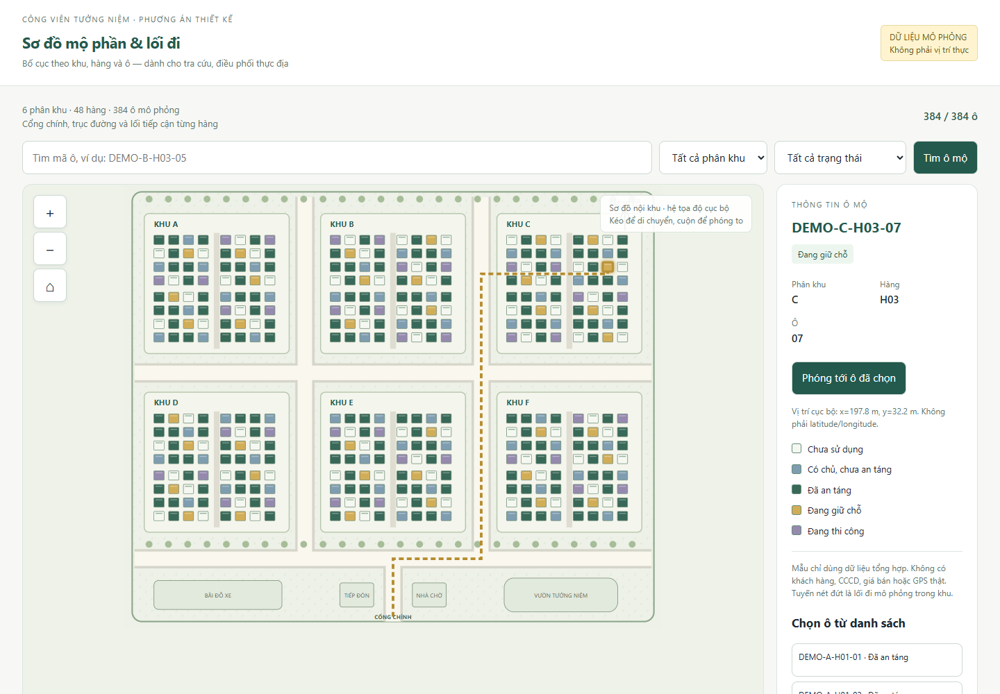

# Rà soát phân quyền actor và kế hoạch bản đồ mô phỏng

Ngày kiểm chứng: **16/10/2026**. Baseline: **`7467905`** (`fix(business): resolve review audit findings R01-R14 and transfer contract annexes`). Phạm vi: backend và **web trong folder `web`**, gồm web trên điện thoại; không thiết kế lại ứng dụng Flutter. Admin ngoài phạm vi thay đổi chính sách quyền của lần này.

**Kết luận: chưa thể nghiệm thu phân quyền.** Có cả lỗi UI mở nhầm màn hình/nút và lỗi server thật sự cho phép đọc hoặc ghi trái nghiệp vụ. Việc ẩn CCCD ở một DTO hoặc chặn một nút chưa đóng được vấn đề. Báo cáo “hoàn tất R01–R14” của agent không phải kết quả nghiệm thu độc lập.

Lần rà soát này tạo tài liệu, bằng chứng và mẫu bản đồ độc lập; **chưa sửa mã nguồn ứng dụng, chưa thay quyền đang vận hành, chưa sửa tọa độ trong DB**. Các đầu việc dưới đây dành cho agent thực thi tiếp.

## 1. Nguồn và phạm vi xác nhận

- Đọc đặc tả [nghiệp vụ hiện tại](../../reference/DAC_TA_NGHIEP_VU_HE_THONG_QUAN_LY_NGHIA_TRANG.md), đặc biệt mục 3, 4, 8, 9; đối chiếu nội dung Lab1–Lab4 và SQL trong `reference`. SQL chỉ đọc, không chạy bootstrap.
- Trích lại **39 bảng UC con từ Lab2 DOCX**; bản trích actor nằm tại [lab2-actors.json](evidence/rbac-7467905/lab2-actors.json). Lab3 phần text chủ yếu là nhãn sơ đồ; nội dung sơ đồ được đối chiếu qua đặc tả tổng hợp đã cung cấp, không coi trích text là đọc đầy đủ hình.
- Ưu tiên làm rõ trực tiếp của chủ dự án: actor chỉ dùng chức năng được giao, mặc định từ chối; ngoại lệ phối hợp phải có mục đích và dữ liệu tối thiểu. Quản trang không đọc hợp đồng pháp lý đầy đủ, danh bạ khách hàng hoặc báo cáo doanh nghiệp.
- Rà soát mã tại HEAD, chạy backend mới từ HEAD, đăng nhập UI với **Marketing, Kế toán, Quản trang**. Thử API bằng JWT thật và kiểm tra role rỗng/không đăng nhập.
- [observed-http.csv](evidence/rbac-7467905/observed-http.csv): **122 lượt HTTP** gồm 48 lượt đọc qua backend dùng DB chính và 74 bước probe trên DB Test. [no-role.json](evidence/rbac-7467905/no-role.json): thêm 13 lượt kiểm tra role rỗng và audit. Đây là số lượt, không phải số endpoint duy nhất.
- [routes.csv](evidence/rbac-7467905/routes.csv) kiểm kê **130 khai báo route bằng phân tích mã**, không khẳng định đã thực thi đủ 130 route. [browser.json](evidence/rbac-7467905/browser.json) ghi menu/nút/UI và kết quả đọc; [probes.json](evidence/rbac-7467905/probes.json) ghi thao tác thật trên fixture synthetic.
- Không chạy lại toàn bộ bộ 91 tests hay quality gate trong lần rà soát này. Con số đó trong báo cáo agent là bằng chứng do agent cung cấp, không chứng minh đủ ma trận quyền hoặc 39 UC.

### Sai lệch cần sửa ngay trong tài liệu traceability

`docs/ui-alignment/traceability.csv` đang gán sai một số mã UC so với Lab2: UC-1.1 bị gán sang public thay vì quản lý khu/hàng/ô của Sếp; UC-2.3 lệch sang giấy báo tử thay vì liên kết khách–người mất–mộ; UC-6.3/6.4 lệch nghĩa; UC-8.1 lệch sang quản trị tài khoản thay vì đăng nhập. Không dùng bảng cũ làm oracle kiểm thử.

Sử dụng [AUTHORIZATION-MATRIX-7467905.csv](AUTHORIZATION-MATRIX-7467905.csv) làm đầu vào đối chiếu 39 UC. Các giá trị như `READ_FIELD_MAP`, `DENY_MODULE`, `CONFIRM_FIELD` diễn đạt **chính sách đích**, không phải tên permission đã có trong code. `DENY_MODULE` vẫn cho phép một projection liên quan được định nghĩa riêng bên dưới; không được biến ngoại lệ đó thành quyền vào cả phân hệ.

## 2. Quyền đích của các actor

### 2.1. Màn hình, dữ liệu và thao tác

| Chức năng | Marketing | Kế toán | Quản trang | Public / thân nhân |
|---|---|---|---|---|
| Khu/hàng/ô, loại mộ, slot | Đọc lựa chọn/bản đồ phục vụ giao dịch; không cấu hình C/U/D | Chỉ mã ô liên quan nghĩa vụ thu | Đọc sơ đồ hiện trường; không cấu hình C/U/D | Bản công bố tối thiểu |
| Khách hàng/thân nhân, người mất, quan hệ, giấy báo tử | C/R/U và liên kết theo UC; xác minh đúng luồng | Không vào danh bạ; chỉ người trả/liên hệ cần thu trong FinanceBasis | Không vào danh bạ; chỉ thông tin cần nhận diện phần mộ/công việc trong WorkBasis | Tra cứu thông tin tưởng niệm được công bố |
| Hợp đồng/phụ lục | Tạo/sửa bản nháp, in, gắn bản ký, xác nhận/kích hoạt theo điều kiện; hủy/gia hạn bằng command | Không vào module pháp lý; đọc căn cứ khoản phải thu | Không vào module pháp lý; đọc căn cứ công việc | Không truy cập nội bộ |
| Đăng ký chăm sóc | Đăng ký/gia hạn qua phụ lục; chọn gói có hiệu lực | Nhận nghĩa vụ tài chính | Nhận phạm vi, chu kỳ, thời hạn đã bàn giao | Xem kết quả được công bố |
| Thi công, ca chăm sóc | Chỉ tiến độ/kết quả của hồ sơ dịch vụ liên quan | Không điều phối | Lập checklist/lịch, phân công, cập nhật, ảnh minh chứng, xác nhận/đóng theo trạng thái | Không điều phối |
| Trạng thái an táng thực địa | Không xác nhận thay Quản trang | Không thao tác | Xác nhận bằng command có căn cứ hợp lệ; không sửa status tùy ý | Không thao tác |
| Thu tiền, chiết khấu, biên lai | Không vào sổ tài chính; trạng thái thanh toán liên quan nếu luồng cần | Tạo khoản thu hợp lệ, ghi nhận thanh toán, chiết khấu theo policy, xuất/tạo lại biên lai | Không truy cập | Thanh toán/ký ngoài hệ thống theo đặc tả |
| Báo cáo | Không báo cáo doanh nghiệp | Xem/xuất/tải doanh thu | Không báo cáo doanh nghiệp; số việc trong workspace riêng | Không truy cập |
| Gói mẫu, mẫu hợp đồng, bảng giá | Chọn dữ liệu có hiệu lực; không C/U/D cấu hình | Đọc snapshot giá của nghĩa vụ; không C/U/D cấu hình | Nhận yêu cầu kỹ thuật snapshot; không C/U/D cấu hình | Chỉ nội dung công bố riêng nếu có |
| Tài khoản, phân quyền, audit | Không truy cập | Không truy cập | Không truy cập; danh sách người thực hiện là lookup riêng | Không truy cập |

**C/R/U/D không phải một quyền gộp.** UC quản lý hồ sơ không tự cho hard-delete. Payment, chứng từ pháp lý, audit và lịch sử không được sửa/xóa bằng CRUD thông thường. Hủy, điều chỉnh, hoàn tiền, gia hạn chỉ được thêm khi có quy tắc nghiệp vụ cụ thể; không tự bịa hạn mức chiết khấu hoặc chính sách pháp lý.

Menu đích:

- **Marketing:** Hồ sơ; Hợp đồng & dịch vụ; Tra cứu ô mộ. Theo dõi thi công/chăm sóc nằm trong hồ sơ liên quan, không mở toàn bộ bộ điều phối. Không menu Tài chính, Báo cáo, Cấu hình.
- **Kế toán:** Công nợ & thu tiền; Biên lai; Báo cáo doanh thu. Tra cứu nguồn thu/người trả từ màn hình tài chính bằng FinanceBasis, không dùng module Hồ sơ/Hợp đồng.
- **Quản trang:** Sơ đồ & phần mộ; Công việc thi công; Lịch chăm sóc; xác nhận hiện trường trong công việc/phần mộ. Không Hồ sơ, Hợp đồng, Bảng giá/Gói mẫu, Báo cáo doanh nghiệp.
- **Public:** Giới thiệu, tra cứu tưởng niệm, phần mộ/kết quả đã công bố và dẫn đường khi đủ điều kiện. Không có account nội bộ mặc định.
- **Đã đăng nhập nhưng role rỗng:** thông báo chưa được cấp quyền và thao tác đăng xuất; không fallback vào Hồ sơ, không gọi API module. Tự xem thông tin phiên và đăng xuất vẫn được phép.

### 2.2. Ngoại lệ phối hợp phải là projection riêng

| Mã | Dữ liệu được phép | Dữ liệu không được kéo theo |
|---|---|---|
| EX-01 WorkBasis cho Quản trang | Mã căn cứ/phụ lục, hiệu lực, loại việc, ô/huyệt, nhận diện người mất tối thiểu khi cần, thời hạn, checklist/yêu cầu, trạng thái bàn giao | Toàn bộ hồ sơ khách, CCCD, địa chỉ nhà, số tiền/công nợ, scan/PDF hợp đồng, giấy báo tử. Liên hệ hiện trường chỉ thêm nếu có mục đích và policy cụ thể |
| EX-02 FinanceBasis cho Kế toán | Nguồn khoản phải thu, mã/loại căn cứ, hiệu lực, người trả, thông tin xuất chứng từ/liên hệ thu cần thiết, mã ô, khoản tiền/hạn/snapshot dịch vụ | Danh bạ khách toàn hệ thống, hồ sơ người mất/giấy báo tử, toàn văn và scan/PDF hợp đồng. Không lấy toàn DTO rồi ẩn ở React |
| EX-03 Tiến độ cho Marketing | Mốc bàn giao, tiến độ, kết quả/ảnh đủ điều kiện liên quan hồ sơ dịch vụ đang xử lý | Toàn bộ danh sách công việc, nhân sự/lịch nghỉ, chức năng phân công/đóng ca, evidence của công việc không liên quan |
| EX-04 Lookup bán hàng | Loại/mẫu đang hiệu lực, gói/snapshot/bảng giá niêm yết cần tư vấn và lập hợp đồng | Màn hình cấu hình, bản nháp hoặc lịch sử quản trị không cần thiết, quyền sửa giá/template |
| EX-05 Người thực hiện | Danh sách người/tổ đủ điều kiện, lịch khả dụng tối thiểu cho điều phối; hỗ trợ người ngoài theo đặc tả | User directory quản trị, permissions, tài khoản/mật khẩu hoặc toàn bộ hồ sơ nhân sự |
| EX-06 Public | DTO công bố cho tưởng niệm, phần mộ và kết quả chăm sóc đã được phép công bố | Owner/contact, CCCD, hợp đồng, giá/nợ, bản gốc chứng từ, ảnh chưa được duyệt công bố |

Tên route đề xuất như `/field/work-bases`, `/finance/bases`, `/catalog/options` chỉ minh họa, **chưa tồn tại và không bắt buộc đặt tên như vậy**. Có thể dùng endpoint hiện có nếu tách rõ policy, query và schema allowlist theo mục đích. Không dùng `total_amount=0` hoặc `citizen_id='******'` để giả làm WorkBasis: trường không được phép phải vắng mặt, không mang giá trị giả.

Phạm vi dữ liệu theo trách nhiệm nghĩa trang/khu/công việc và quan hệ bàn giao đã có căn cứ. Không tự áp “chỉ do chính mình tạo” vì sẽ làm mất khả năng bàn giao giữa nhân viên. Với tài khoản nhiều role được cấp hợp lệ, kiểm tra capability hợp thành, nhưng DTO của endpoint hiện trường vẫn là WorkBasis. Một nhánh `if CARETAKER` không được vô tình chặn chức năng Marketing được cấp cho cùng tài khoản; ngược lại có một role bất kỳ không mở toàn bộ hệ thống.

## 3. Phát hiện hiện tại và chỉ dẫn sửa

P1: cấp quyền/dữ liệu sai hoặc chặn luồng hợp lệ; P2: lỗi UI/chất lượng và bố trí. Nhãn **LIVE** là đã tái hiện HTTP/UI; **CODE** là bằng chứng từ mã chưa thực thi lại nhánh đó trong đợt này. Số dòng dưới đây theo baseline 7467905.

### RBAC-01 — P1 — Policy quá rộng và không mặc định từ chối [LIVE + CODE]

- `backend/scripts/seed_rbac.py`: Marketing có `plots:write`, `care:write`, `finance:read`, `reports:read`; Kế toán có `finance:write`, `contracts:read`, `customers:read`; Quản trang có `care:write`, `contracts:read`, `customers:read`. Các quyền nghiệp vụ bị tái sử dụng cho cấu hình không thuộc actor.
- Các GET plots/zones/stats, catalog và `/auth/staff` chỉ yêu cầu đăng nhập. User synthetic **roles=[]** vẫn nhận 200 ở bảy route đã thử; profiles/audit trả 403. Không có JWT thì các route nội bộ đã thử trả 401.
- **Sửa:** tách read theo mục đích, cấu hình không gian, cấu hình dịch vụ, cấu hình giá, pháp lý, hiện trường, thu tiền, chiết khấu, báo cáo từng loại. Kiểm tra permission trước query/serialize và kiểm tra object scope tại service. Không dùng `get_current_user` làm quyền đọc chung.
- Sửa cả policy seed và **quyền đã lưu trong DB hiện hữu** bằng cập nhật tăng dần, có dry-run diff, backup, transaction và chạy lặp an toàn. Chỉ sửa file seed không đổi account hiện có; không chạy seed tùy tiện lên DB chính. Không sửa vai trò Admin hoặc reset account/password. Thu hồi cache/session quyền cũ bằng cơ chế `auth_version` sẵn có và thử token cũ sau thay đổi.

### RBAC-02 — P1 — Marketing thật sự CRUD quy hoạch; actor nghiệp vụ sửa được cấu hình giá [LIVE]

| Actor | Thao tác thực tế trên dữ liệu Test | Kết quả | Kết quả đích |
|---|---|---|---|
| Marketing | POST/PUT/DELETE khu và ô mộ | 201/200/200 | 403; tư vấn ô khả dụng vẫn hoạt động |
| Marketing | Tạo/sửa template hợp đồng | 201/200 | 403; chọn mẫu hợp lệ vẫn hoạt động |
| Marketing, Quản trang | Tạo gói chăm sóc, sửa giá gói | 201/200 | 403; đăng ký hoặc thi hành gói vẫn hoạt động |
| Kế toán | Tạo/sửa bảng giá; tạo/sửa/xóa price item | 201/200/204 tương ứng | 403; thu tiền/chiết khấu hợp lệ vẫn hoạt động |

Nguyên nhân: `plots/router.py` dùng `plots:write`; `catalog/router.py` dùng `care:write`, `contracts:write`, `finance:write` cho cấu hình. Tách capability cấu hình khỏi nghiệp vụ; không chỉ thêm một role check trên nút. Phủ toàn bộ các verb, lookup, list/detail và endpoint liên quan theo [routes.csv](evidence/rbac-7467905/routes.csv).

### RBAC-03 — P1 — Quản trang/Kế toán truy cập hồ sơ và pháp lý quá mức [LIVE]

- Cả hai nhận danh sách/chi tiết khách và người mất. Fixture xác nhận CCCD, phone, address trả nguyên ở customer detail; không chỉ là vấn đề giao diện.
- Quản trang list contracts trả **giá trị thật**; detail che CCCD và đổi tổng tiền thành 0 nhưng vẫn có phone và cấu trúc hợp đồng đầy đủ. `contracts/service.py` list khoảng 1120/1175 không nhận actor; nhánh che detail khoảng 1775 không áp cho list.
- Kế toán tải PDF hợp đồng và scan đã ký được **200**. Chặn Quản trang ở hai đường này đã có hiệu lực **403**, nhưng không đồng nghĩa Kế toán có quyền pháp lý.
- **Sửa:** bỏ quyền truy cập directory/profile/full legal của hai actor; thay bằng EX-01/EX-02. Kiểm tra list, search, detail, nested payload, file, export và endpoint trực tiếp. File ACL phải theo quyền resource và purpose, không theo ai biết `file_id`.
- **Không làm đứt luồng:** nút xác nhận an táng mới đang nằm trong ContractModule và route dùng `contracts:read` trước role check (`contracts/router.py`, khoảng 321). Chuyển sang màn hình hiện trường/WorkBasis và capability xác nhận trước khi rút quyền hợp đồng. Kế toán phải chọn được căn cứ hợp lệ để tạo/tra khoản phải thu mà không mở pháp lý.

### RBAC-04 — P1 — Marketing đọc sổ tài chính; Kế toán thiếu capability chiết khấu [LIVE / CODE]

- Marketing đọc finance summary và receivables được 200 qua quyền `finance:read`. Nghiệp vụ chỉ cần thông tin liên quan hồ sơ khi có căn cứ, không toàn sổ.
- `documents/service.py` khoảng 122 vẫn kiểm invoice bằng quyền finance:read; vì Marketing có quyền này, đường generic download còn nguy cơ cấp nhầm. Đây là **CODE**, chưa thử receipt Marketing trong đợt này.
- `FinanceModule.tsx` khoảng 856 đòi `finance:discount`, nhưng seed không khai báo/cấp permission này. Kế toán được sửa bảng giá nhưng thiếu nút nghiệp vụ chiết khấu đúng vai trò (**CODE**).
- **Sửa:** rút quyền sổ tài chính Marketing; thêm projection trạng thái liên quan nếu cần. Định nghĩa discount capability thống nhất router/service/UI/seed, giữ Decimal và policy phê duyệt, không tự đặt mức giảm. Thử receipt download/preview/regenerate theo cùng resource scope.

### RBAC-05 — P1 — Báo cáo sai actor, GET và export không nhất quán [LIVE]

- Quản trang `GET reports/operations` trả **403** nhưng export OPERATIONS trả **201**. `reports/service.py` khoảng 533 cho CARETAKER theo role, trong khi GET thêm dependency `reports:read`. Quan trọng hơn, **UC-7.4 thuộc Sếp**, không phải quyền báo cáo doanh nghiệp của Quản trang.
- Marketing/Kế toán GET báo cáo contracts trả **500**, do tham số `status` che module `fastapi.status` tại `reports/router.py:86–99`.
- Những nhánh đã chặn đúng: Marketing xem/xuất REVENUE 403; Kế toán xem/xuất OCCUPANCY 403; Quản trang xuất CONTRACTS 403.
- **Sửa:** policy duy nhất cho xem, tạo export, poll job, download và generic file; Kế toán chỉ doanh thu, các non-admin khác từ chối báo cáo doanh nghiệp. Đổi tên tham số nội bộ hoặc alias module status, vẫn giữ query contract nếu cần. Bộ đếm việc hiện trường dùng endpoint và scope công việc, không mở lại reports/operations.

### RBAC-06 — P1 — Tải file nháp của chính người upload bị 500 [LIVE]

- Marketing upload PDF synthetic thành công 201 trên MinIO thật, download file còn chưa liên kết trả 500.
- `documents/service.py:218` import `CareScheduleEvidence` không tồn tại; model thực là `CareMediaEvidence` trong `care/models.py`. Lỗi xảy ra trước khi quy tắc uploader được áp dụng.
- **Sửa:** sửa model/query và kiểm tra mọi quan hệ binding hợp lệ. Tệp chưa liên kết: uploader trong scope hợp lệ được tải; người khác bị từ chối. Tệp đã liên kết: quyền tài nguyên/mục đích quyết định, không cấp quyền vĩnh viễn chỉ vì là uploader. Tệp nhiều liên kết xử lý theo chính sách rõ ràng, không bỏ qua binding nhạy cảm.
- Thử thêm upload chưa READY, file của người khác, evidence đúng/sai việc, giấy báo tử, scan hợp đồng, invoice, export; cả download, preview và link version. Không coi sửa import là đóng toàn bộ ACL.

### RBAC-07 — P2 — UI chỉ kiểm đăng nhập, mở module và nút ngoài quyền [LIVE]

- `web/src/App.tsx`: menu Hồ sơ (~338), Catalog (~397), Reports (~431) mở với mọi user; render module (~929–961) chủ yếu kiểm `user + activeTab`; fallback (~164) có thể vào Profiles.
- `PlotMapModule.tsx`: thêm ô (~1070), cấu hình khu/hàng/loại (~1630), xóa (~1447) không có capability gate tương ứng. `ProfileModule.tsx`: thêm khách (~843/882), thêm người mất (~1289) tương tự. Catalog hiển thị các nút cấu hình cho cả ba actor.
- UI Quản trang/Kế toán mở được modal thêm khách, nhưng API create/update đã **403**. Quản trang CRUD quy hoạch đã **403** ở server. Không mô tả các trường hợp này là “full CRUD thành công”.
- **Sửa:** dùng cùng capability registry cho menu, route/tab guard, action, empty-state CTA, phím tắt và deep link. User không có quyền phải không mount module/fetch dữ liệu. Không chỉ ẩn nav rồi giữ đường vào bằng state/URL. Làm mới quyền khi đổi user; xóa dữ liệu/cache của actor trước.
- Không thay nút sai quyền bằng lời giải thích dài gây chen chúc. Các màn hình cho actor chỉ hiển thị hành động có ích. Trường hợp không còn module được cấp: màn hình trạng thái gọn, không menu rỗng hoặc fallback sang module trái quyền.

### FLOW-01 — P1 — Xác nhận an táng vẫn chưa tách hoàn toàn khỏi ký pháp lý [CODE]

`contracts/service.py:865` chỉ trì hoãn occupancy khi `burial_date > today`. Ngày hôm nay/quá khứ vẫn có nhánh kích hoạt làm OCCUPIED/BURIAL_COMPLETED dù chưa có command xác nhận hiện trường. Đây là rủi ro còn lại của R05 từ review trước, chưa tái hiện động lại lần này.

**Sửa và xác nhận:** tách hiệu lực pháp lý/giữ chỗ khỏi xác nhận an táng cho mọi ngày; command hiện trường mới chiếm slot và khóa Kim Tĩnh theo invariant. Tạo đủ ca hôm qua/hôm nay/tương lai, chống double booking và lặp command. Không giữ `contracts:read` cho Quản trang để chữa tạm luồng UI. Không gỡ khóa Kim Tĩnh để phục vụ demo bản đồ.

## 4. Đánh giá kết quả agent vừa bàn giao

| Nhóm | Kết luận ở baseline mới |
|---|---|
| R01 | Chặn PDF/scan Quản trang có tác dụng; full directory, list contract và DTO vẫn sai; chưa đạt WorkBasis |
| R02 | Link version Quản trang/Kế toán bị chặn đúng trong probe; download file nháp phát sinh 500; cần kiểm ACL toàn bộ theo mục đích |
| R03 | Một số loại báo cáo đã chặn đúng; Quản trang vẫn export OPERATIONS; GET contracts có 500; chưa đạt |
| R05 | Có command xác nhận và xử lý ngày tương lai; còn nhánh ngày hôm nay/quá khứ từ đọc mã; chưa đủ đóng |
| R09 | Có guard điều phối và UI Marketing ẩn thao tác sinh lịch; nhưng Marketing vẫn vào cả module, Quản trang/Marketing vẫn sửa gói mẫu; phải tách policy |
| R04/R06/R07/R08/R10/R11/R12/R13/R14 và phụ lục của TRANSFER | Có thay đổi mã trong commit, không chạy lại toàn bộ E2E trong lần rà soát tập trung này; không coi là nghiệm thu hoặc tự động mở lại tất cả. Giữ kiểm thử theo review cũ và gate cuối |

Không lập lại phát hiện hash payment cũ như thể chưa sửa: commit mới đã đưa reference chuẩn hóa vào hash. Những điểm chưa kiểm chứng cần có test đích trước khi kết luận. Backlog trong [PLAN.md](PLAN.md) và [REVIEW-3cfc146.md](REVIEW-3cfc146.md) vẫn phải được đối chiếu; plan này không thay toàn bộ 37 BA và các luồng nghiệp vụ cũ.

## 5. Vì sao bản đồ hiện chỉ thấy bốn ô

Theo truy vấn đọc DB chính và API hiện tại, xem [map-data.json](evidence/rbac-7467905/map-data.json):

| Chỉ số | Kết quả |
|---|---:|
| Tổng ô mộ | 1.027 |
| Có đủ latitude + longitude | 78 |
| Thiếu tọa độ | 949 |
| Cặp tọa độ khác nhau trong 78 ô | 13 |
| Số ô trùng tại một cặp | 46 |
| Số ô trùng tại một cặp khác | 21 |
| API được UI gọi: `/plots?limit=500` | 500 bản ghi, chỉ 4 có tọa độ |

`PlotMapModule.tsx` đang tải tối đa 500 (~118), lọc phía client, marker cố định 32 px (~230), mặc định zoom 18 và fitBounds tối đa 18. Bốn tọa độ đầu cùng vĩ độ, cách kinh độ 0,00005° (xấp xỉ 5,5 m tại đây): ở zoom 18 tâm cách nhau khoảng 9 px, nhỏ hơn marker 32 px. Đó là lý do các số đè lên nhau. Screenshot người dùng cho thấy vị trí nằm trên sông; dữ liệu seed không phải tọa độ nghĩa trang đã khảo sát.

Không chỉ tăng limit hoặc giãn ngẫu nhiên lat/long. Tải cả 78 vẫn còn trùng tọa độ và các cụm cách xa nhau; 949 bản ghi chưa có vị trí. Chưa có cột nguồn tọa độ/`is_demo`/`gps_verified` trên bảng plots để phân biệt đáng tin cậy. Một số bản ghi mang dấu test; không được tự suy tên lạ là có quyền xóa hoặc ghi đè.

## 6. Hướng bản đồ đề xuất và mẫu xem trước

### 6.1. Chọn sơ đồ cục bộ làm nền demo

**Khuyến nghị:** sơ đồ nghĩa trang theo mét, có polygon ô mộ, khu/hàng, đường chính, lối đi từng hàng, cây xanh/cổng; dữ liệu synthetic tách khỏi vị trí GPS thật. Khi có mốc/boundary được chủ dự án cung cấp hoặc tọa độ khảo sát mới neo sơ đồ ra địa lý.

| Cách làm | Ưu điểm | Giới hạn / sử dụng |
|---|---|---|
| Sơ đồ cục bộ deterministic | Vuông vức, bố trí kiểm soát được, chạy offline, không đặt mộ lên sông | Dùng cho demo và đường đi nội bộ; không phải vị trí thật trên Google Maps |
| Sơ đồ local được neo bằng mốc WGS84 + góc xoay | Giữ bố cục, tận dụng lat/long/GeoJSON và nền địa lý | Cần mốc/boundary phù hợp; dữ liệu sinh vẫn phải ghi rõ synthetic, không gắn “GPS đã xác minh” |
| Tọa độ/boundary khảo sát từng phần mộ | Phù hợp triển khai thực tế | Cần thu thập dữ liệu, không thể suy ra từ bốn marker seed |

Tận dụng Leaflet 1.9.4 đang có; chế độ local dùng `CRS.Simple`, polygon hoặc SVG overlay, thay vì cài thêm stack bản đồ. Leaflet phân biệt đơn vị sơ đồ với pixel ảnh và dùng thứ tự `[y, x]` cho CRS.Simple ([tài liệu chính thức](https://leafletjs.com/examples/crs-simple/crs-simple.html)). Prototype đi kèm dùng SVG thuần để mở offline độc lập; đó là mẫu bố trí, không yêu cầu viết lại map engine của app.

**Mẫu tương tác:** [map-demo-7467905.html](map-demo-7467905.html) — 384 ô, 6 khu, 48 hàng; tìm mã, lọc khu/trạng thái, chọn ô, phóng/thu và lộ trình dọc lối đi. Tất cả tên/mã/trạng thái là DEMO, không đọc/ghi DB và không tạo khách hàng/giá giả. Kiểm tra tại 1440, 768, 390 px; tìm `DEMO-B-H03-05` được 1/384; từ khóa không khớp ra 0; không lỗi JS trong ca thử. Đây không phải chứng nhận responsive cho toàn app.

### 6.2. Thiết kế dữ liệu và bộ sinh

1. Tạo một `layout_version` và manifest riêng: `dataset_id`, `is_synthetic`, đơn vị mét, origin, rotation, nguồn/tình trạng xác minh, danh sách plot ID/code được phép gắn. Không ghi đè ngầm lat/long của 1.027 bản ghi. Ưu tiên fixture demo riêng; chỉ nối bản ghi hiện hữu đã xác định rõ là synthetic bằng manifest minh bạch.
2. Geometry ô gồm rectangle/polygon và centroid; liên kết bằng `plot_id`, không dùng vị trí trong mảng hoặc tên người mất làm khóa. Khu/hàng có geometry/nhãn riêng. Tách slot bên trong ô: một ô nhiều slot không biến thành nhiều marker chồng tọa độ.
3. Bộ sinh deterministic theo seed và thứ tự khu/hàng/ô. Tham số demo ví dụ ô 2,4 × 4,2 m, lối hàng 1,6 m, đường chính 6 m, khoảng khu 4 m; **chỉ là kích thước minh họa**, không quy chuẩn nghĩa trang. Mộ đôi/gia tộc dùng footprint khác, không ép mọi loại vào ô cùng kích thước.
4. Tính layout theo dải hàng, dành lối đi rõ ràng và kiểm polygon không giao nhau, không lấn đường/biên. Chừa vùng cổng, cây xanh, bãi xe. Sinh tọa độ trước, lấy trạng thái nghiệp vụ từ API sau; không random tình trạng kinh doanh của bản ghi thật để làm bản đồ đẹp.
5. Nếu cần WGS84: nhận mốc `(lat0, lng0)` và góc xoay rõ ràng. Với x hướng Đông, y hướng Bắc, quay: `E=x*cosθ−y*sinθ`, `N=x*sinθ+y*cosθ`; demo diện tích nhỏ có thể xấp xỉ `lat=lat0+(N/R)*180/pi`, `lng=lng0+(E/(R*cos(lat0)))*180/pi`, `R=6378137`, lat0 đưa vào cos bằng radian. SVG có y hướng xuống phải đổi dấu; triển khai dữ liệu khảo sát dùng hệ quy chiếu phù hợp, không coi phép xấp xỉ là độ chính xác khảo sát.
6. Khi đổi GeoJSON, tọa độ là **[longitude, latitude]**, khác đối số lat/lng thường dùng của Leaflet ([GeoJSON Leaflet](https://leafletjs.com/examples/geojson/)). Round-trip test và kiểm bounds tránh đảo trục/đơn vị.
7. Lat/long sinh chỉ là centroid cho tương thích; polygon quyết định hình dạng/định hướng. Lưu nguồn `SYNTHETIC_LAYOUT` khác `SURVEYED`, `gps_verified=false`. Nếu schema cần thêm bảng/cột: Alembic tăng dần, dữ liệu cũ mặc định UNKNOWN, không tự đánh dấu đã xác minh.
8. Hiển thị nhãn “Dữ liệu mô phỏng” ở map demo. Không bật nút dẫn đường Google Maps cho tọa độ synthetic/unknown. Hướng dẫn trong sơ đồ đi qua graph lối đi; không nối một đường thẳng xuyên các ô. Dẫn đường ngoài chỉ mở cho GPS được xác minh.

### 6.3. API và UI bản đồ thực thi

- Đổi fetch 500 sang map endpoint hoặc pagination/bbox có tổng số thực; search/filter phải áp toàn dataset. Trả geometry tối thiểu theo actor, không nhúng profile/contract vào GeoJSON. Có số ô chưa định vị và CTA phù hợp **chỉ cho actor được cấu hình**.
- Khi zoom xa: tên khu + thống kê phù hợp actor; mức giữa: hàng/footprint; gần: mã ô/slot. Tránh marker 32 px cho mọi mức zoom. Nếu giữ bản đồ GPS, có thể cluster điểm khi xa và hiện polygon khi gần. Leaflet hỗ trợ vector layer và renderer Canvas; đánh giá thực tế trên tập mục tiêu trước khi chọn renderer ([Leaflet reference](https://leafletjs.com/reference.html)).
- Không recreate map/reset pan/zoom mỗi lần đổi bộ lọc hoặc mở drawer; cập nhật layer và chỉ fitBounds khi đổi dataset hoặc người dùng bấm “Toàn khu”. Không fit nhiều cụm seed cách xa nhau như một nghĩa trang.
- Desktop: bản đồ chính, danh sách/chi tiết gọn; mobile: thanh tìm kiếm, nút bộ lọc, bản đồ cao đủ dùng, chi tiết dạng bottom sheet hoặc trang riêng; safe-area và nút điều khiển không đè nhau. Không sidebar cố định chiếm gần hết chiều rộng như ảnh lỗi cũ.
- Target chạm 44–48 px cho control; đối tượng mộ nhỏ cần zoom hoặc chọn từ danh sách thay vì làm mọi marker to lên. Có legend vừa màu vừa nhãn/icon, focus bàn phím, selected state rõ, tương phản phù hợp ngoài trời.
- Bốn trạng thái: loading skeleton ổn định; normal; empty theo bộ lọc với xóa lọc; error với thử lại. Tách “không khớp” khỏi “chưa định vị”. Lỗi tile không làm mất danh sách và dữ liệu công việc.
- Khi dùng nền OpenStreetMap, giữ attribution và tuân thủ tile policy; không bulk-download tile để làm demo offline. Sơ đồ SVG nội bộ không phụ thuộc tile ([OSM tile policy](https://operations.osmfoundation.org/policies/tiles/)).

## 7. Gói công việc theo thứ tự thực thi

| Gói | Công việc / file chính | Điều kiện hoàn tất |
|---|---|---|
| P01 — Chốt policy có căn cứ | Đồng bộ 39 UC, `docs/ui-alignment/{traceability.csv,actor-policy.md,api-ui-contracts.md}`; định nghĩa capability và EX-01…06; chỉ rõ C/R/U/D, command, data/file scope | Mỗi quyền có UC hoặc ngoại lệ được giải thích; không mặc định read toàn module; không thay quyền Admin |
| P02 — Backend + DB permission | `auth`, seed, `plots/catalog/profiles/contracts/finance/reports/documents`; DTO/query projection; migration/update quyền hiện hữu; sửa hai lỗi 500 | JWT actor thật chạy allow/deny, list/detail/file cùng policy; token cũ mất quyền sau cập nhật; DB Test có backup |
| P03 — Web theo actor | `App.tsx`, auth/capability helper và các Module; WorkBasis/FinanceBasis; chuyển command xác nhận sang hiện trường; gỡ cấu hình sai vai trò | Tất cả menu/route/button/CTA/deep-link đúng quyền; actor vẫn đi hết luồng hợp lệ; 4 trạng thái, responsive và keyboard |
| P04 — Map/dataset | Generator/manifest synthetic, geometry/API/bbox/search, Leaflet layers, DEMO mode và dẫn đường có điều kiện | Đủ dataset, không chồng footprint/lối đi; không mất ô do limit; không ghi đè GPS thật; UI desktop/mobile rõ |
| P05 — Nghiệm thu và bàn giao | Tests mới cho các lỗ hổng, E2E đúng actor, kiểm lại backlog review cũ, gate và tài liệu | Có kết quả thực thi, ảnh và payload redacted; STATE không tuyên bố hoàn tất khi còn lỗi hoặc ca chưa chạy |

P02/P03 có thể chia increment nhỏ nhưng phải bàn giao projection trước khi loại bỏ màn hình mà actor đang phụ thuộc. Không phát hành thay đổi chỉ ẩn nút, hoặc chỉ sửa API khiến các luồng hợp lệ thành trang 403.

### Tiêu chí kiểm thử bắt buộc

1. **Policy/API:** mỗi capability mới có actor được phép và ba loại từ chối: role sai, role rỗng, scope/object sai. Thử URL trực tiếp, ID/file của resource khác, list/search/detail/nested DTO, export/download/preview, retry/duplicate. Trạng thái 401/403 hoặc 404 không tiết lộ tài nguyên phải nhất quán; không 500 ở nhánh deny.
2. **Marketing:** CRU hồ sơ → chọn ô/gói/giá hiệu lực → lập/in/scan/kích hoạt căn cứ → bàn giao → đọc tiến độ liên quan. CRUD quy hoạch, cấu hình giá/template, thu tiền, điều phối ca và báo cáo doanh nghiệp bị chặn. Không được mất lookup hợp lệ sau khi rút quyền cấu hình.
3. **Kế toán:** từ FinanceBasis tạo/đọc nghĩa vụ → chiết khấu theo policy → ghi nhận thanh toán → xem/tạo lại biên lai → doanh thu/export. Không mở profile/full contract/legal file/configuration; khoản tiền cần thu không bị che vì tái sử dụng WorkBasis.
4. **Quản trang:** từ WorkBasis → checklist/lịch/phân công → minh chứng → hoàn tất và xác nhận an táng theo quyền. Không profile/legal PDF/price/config/reports. Test ngày an táng quá khứ/hôm nay/tương lai và Kim Tĩnh; rút `contracts:read` không làm hỏng field command.
5. **Public:** không đăng nhập vẫn tra cứu bản công bố; DTO/file không có PII nội bộ; evidence chưa công bố không thể tải bằng đổi ID. Demo GPS không mở external route. Những ca public này là **yêu cầu kiểm thử tiếp**, không ghi là đã chạy lại toàn bộ trong đợt hiện tại.
6. **Đổi actor/nhiều role:** logout/login, refresh session, token trước thay đổi quyền, cache dữ liệu, fallback/deep link và actor được cấp nhiều role có chủ đích. Admin chạy smoke tương thích, không sửa ma trận quyền Admin.
7. **UI:** 1440×900, 768×1024, 390×844 và màn hình ngang/thấp; menu đóng bằng Escape, focus quay đúng nút, body scroll không kẹt; dialog/drawer/bottom sheet không chồng; text dài, bảng công nợ, footer/pagination không tràn ngang. Nút trái quyền vắng mặt cả trong empty-state lẫn row action. Kiểm desktop và **web mobile**, không lấy screenshot Flutter thay thế.
8. **Map:** trên 500 ô, ô không tọa độ, trùng tọa độ, khác khu, nhiều slot, loại mộ khác footprint, tìm mã nằm ngoài trang đầu, không có kết quả, lỗi mạng/tile, lọc giữ viewport. Verify geometry vào đúng hành lang và liên kết đúng plot ID; đo render/pan trên tập mục tiêu, không hứa hiệu năng bằng số lượng marker đơn thuần.
9. **Gates:** chạy tests đúng thay đổi bằng `uv run pytest`, `uv run ruff check .`, `pnpm lint`, `pnpm build`; mở rộng theo backend/web bị tác động. Negative regression phải thất bại trên baseline cũ và thành công sau sửa. Không sửa expected để hợp thức hóa quyền sai. Với claim cạnh tranh/ACID cần transaction commit qua connection độc lập trên Test, probe rollback lần này không thay được phép thử đó.

## 8. Bảo toàn dữ liệu và bằng chứng đợt review

- Backup Test trước probe: `backend/runtime/backups/QL_NghiaTrang_Test_before_actor_rbac_7467905.bak`, COPY_ONLY/CHECKSUM và RESTORE VERIFYONLY. Không restore/overwrite DB chính.
- Probe tạo dữ liệu nhãn `RBAC-`/`SYNTHETIC` trên `QL_NghiaTrang_Test`, outer transaction + savepoints, rollback cuối. Không coi rollback là chứng minh durability/concurrency; SQL identity/sequence có thể tăng dù rollback.
- MinIO thật: tổng 4 object phát sinh/4 đã dọn. Lần đầu helper cleanup gọi nhầm API SDK; sau đó kiểm file binding ở cả hai DB và dọn đúng hai key, rồi sửa helper và chạy lại. Dấu vết tại [cleanup-recovery.json](evidence/rbac-7467905/cleanup-recovery.json), không che sự cố helper thành lỗi ứng dụng.
- [cleanup.json](evidence/rbac-7467905/cleanup.json): không còn các hàng synthetic probe ở các bảng kiểm tra; số hàng nghiệp vụ chính, role-permission và revision trước/sau không đổi. Đây không phải so sánh từng byte; đăng nhập bình thường có thể tạo auth session/audit.
- [screens](evidence/rbac-7467905/screens): ảnh UI ba actor và mẫu bản đồ. Evidence JSON không lưu token/password hoặc giá trị CCCD/địa chỉ thật; chỉ lưu cờ/field keys và số tiền fixture synthetic.
- Hạ tầng MinIO trên D đã hoạt động; không cần chạy lại bootstrap hoặc reset dữ liệu để thực thi plan.

## 9. Prompt giao cho agent thực thi

> Thực thi `docs/actor-business-audit/PLAN-RBAC-MAP-7467905.md`, đọc ma trận 39 UC đi kèm và đặc tả nghiệp vụ trong `reference` trước. Baseline review là 7467905; kiểm tra diff nếu HEAD đã thay đổi. Ưu tiên RBAC-01…07 và FLOW-01, sau đó P04 bản đồ. Actor non-admin mặc định bị từ chối ngoài UC hoặc ngoại lệ projection có mục đích. Sửa backend permission/query/DTO/file ACL và quyền DB hiện hữu cùng frontend menu/route/action; không chỉ che nút. Tạo WorkBasis/FinanceBasis để Quản trang/Kế toán hoàn thành công việc mà không mở pháp lý/hồ sơ đầy đủ. Không đổi quyền Admin, không bootstrap/drop DB, không sửa dữ liệu thật để làm demo. Mọi test ghi dùng DB Test đã xác nhận DB_NAME và backup; MinIO/logs/backups ở D. Dùng mẫu HTML làm tham khảo bố trí; triển khai trong Leaflet hiện có, synthetic layout tách biệt GPS thật, không ngoại suy vị trí thực. Kiểm UI desktop và web mobile, đủ loading/normal/empty/error. Bàn giao ma trận allow/deny đã chạy, bằng chứng actor, ảnh responsive, manifest/dry-run demo, kết quả test thật và phần chưa đạt. Cập nhật STATE trung thực; không tuyên bố đóng toàn bộ R01–R14 hoặc 39 UC chỉ vì bộ test cũ xanh.
